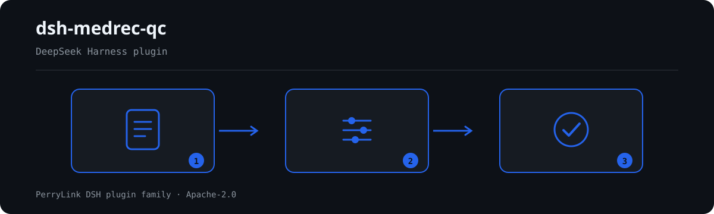

# dsh-medrec-qc — भर्ती रोगी के मेडिकल रिकॉर्ड की फ्रंट शीट की रूप-जाँच और तार्किक विरोधाभास की चेतावनी

[English](README.md) · [简体中文](README-zh.md) · [Español](README-es.md) · [Português](README-pt.md) · [हिन्दी](README-hi.md)

```sh
dsh plugin --profile <name> add dsh-medrec-qc
```


[](https://dsh.market/)
[](https://dshfind.com/en/plugins/PerryLink/dsh-medrec-qc?ref=badge)

`dsh-medrec-qc` भर्ती रोगी के मेडिकल रिकॉर्ड की फ्रंट शीट (病案首页) के एक्सपोर्ट को पढ़ता है, जिसमें प्रत्येक डिस्चार्ज की एक पंक्ति होती है और कॉलम-सेट राष्ट्रीय मूल्यांकन एक्सपोर्ट, स्वास्थ्य सांख्यिकी एक्सपोर्ट या अस्पताल के स्थानीय एक्सपोर्ट का हो सकता है, और उसी एक्सपोर्ट की रूप-पूर्णता, आंतरिक अंकगणित तथा कोडन-रूप की जाँच करता है: हर अनिवार्य कॉलम में सामग्री या `-` चिह्न हो, भर्ती और डिस्चार्ज का समय दर्ज हो, मिनट तक सटीक हो और उलटा न हो, दर्ज ठहराव-अवधि दोनों तारीख़ों से मेल खाए, मुख्य निदान का नाम और कोड तथा मुख्य ऑपरेशन का नाम और कोड साथ-साथ भरे गए हों, कोड उस लिखित रूप में हों जो नियम-पैक कॉन्फ़िगर करता है, तीन हस्ताक्षर कॉलम त्रि-स्तरीय चिकित्सक उत्तरदायित्व दर्शाते हों, डिस्चार्ज मोड निर्धारित कोड में से हो, आयु और नवजात का वज़न निर्धारित रूपों में हों, अन्य निदानों की संख्या कॉन्फ़िगर की गई सीमा के भीतर हो, और दर्ज लिंग से असंगत निदान अथवा मृत्यु-डिस्चार्ज में परस्पर भिन्न दो समय मानवीय समीक्षा के लिए सामने लाए जाएँ।

## Install

```sh
dsh plugin --profile <name> add dsh-medrec-qc
dsh --profile <name> --dump-config | grep 'dsh-medrec-qc'
```

## आउटपुट कैसा दिखता है



*कार्यप्रवाह: कॉल → प्लगइन → परिणाम। नीचे के उदाहरण वास्तविक कमांड सतह का उपयोग करते हैं।*


इस प्लगइन का अपने ही `MR-009` टेस्ट फ़िक्स्चर पर वास्तविक आउटपुट — कोई नकली चित्र नहीं। नियम-पैक उद्धरण नहीं गढ़ता, इसलिए हर निष्कर्ष लागू किए गए खंड का नाम और यह भी बताता है कि उसका मूल पाठ इस बार प्राप्त नहीं हुआ।

## यह किन सवालों का जवाब देता है

### उदाहरण

नीचे दी गई तालिका उदाहरण-समुच्चय है: पहली पंक्ति विस्तृत केस है, बाकी संक्षिप्त केस हैं।

| आपका सवाल | इसका जवाब |
|---|---|
| कोई अनिवार्य कॉलम खाली छूटा है, पर मैंने उसमें `-` लिखा है। क्या यह दर्ज होगा? | नहीं। `MR-001` अकेले `-` को «यहाँ दर्ज करने योग्य कुछ नहीं» का चिह्न मानता है और केवल सचमुच खाली छूटे कॉलम दर्ज करता है। यह देखता है कि अनिवार्य कॉलम में सामग्री है, यह नहीं कि सामग्री सही है। यह `error` है: 24号文 के अनुलग्नक 1 की अंतिम टिप्पणी **2026-10-13** को शब्दशः प्राप्त हुई (अनुलग्नक में **पाठ-परत है**: 328 पृष्ठ, 205,847 वर्ण निकाले जा सकते हैं, **OCR का प्रयोग नहीं**), और वह है 「注：必填栏不能为空项，没有可填写内容时填写“-”」。⚠️ `www.nhc.gov.cn` स्वचालित अनुरोधों पर **HTTP 412** लौटाता है, इसलिए पाठ **हेनान प्रांतीय मेडिकल रिकॉर्ड गुणवत्ता नियंत्रण केंद्र** के संकलन से पढ़ा गया — वही URL जो इस नियम के `source` में पहले से है; देखें `rules/evidence/clause-verification-homepage-attachment1.md`। वही `-` `MR-009` में हस्ताक्षर अनुपस्थित ही गिना जाता है। |
| भर्ती का समय केवल तारीख़ के रूप में लिखा है, घंटा-मिनट नहीं, और एक पंक्ति में डिस्चार्ज का समय भर्ती से पहले है। | `MR-002` ऐसे `入院时间` या `出院时间` को दर्ज करता है जो केवल दिन तक पढ़ा जा सके, क्योंकि दर्ज समय मिनट तक सटीक होना चाहिए, और ऐसा मान भी दर्ज करता है जिसे तारीख़ और समय के रूप में पढ़ा ही न जा सके। `MR-003` दोनों फ़ील्ड के शाब्दिक क्रम की तुलना करके उस पंक्ति को दर्ज करता है जिसमें डिस्चार्ज का समय पहले आता है। दोनों केवल शाब्दिक मानों पर काम करते हैं और कोई यह नहीं तय करता कि सच्चा समय कौन-सा है। |
| फ्रंट शीट में `5` दिन लिखा है, पर तारीख़ें 12 जून को भर्ती और 15 जून को डिस्चार्ज हैं। | `MR-004` दिनों को «डिस्चार्ज की तारीख़ घटा भर्ती की तारीख़» से दोबारा जोड़ता है और जिस पंक्ति में दर्ज `实际住院天数` मेल न खाए उसे दर्ज करता है; उसी दिन भर्ती और डिस्चार्ज `0` दिन गिना जाता है, और पूर्णांक दिन न होने वाला मान भी दर्ज होता है। यह केवल उन तीन दर्ज मानों की तुलना करता है और यह नहीं तय करता कि उनमें कौन ग़लत है। |
| `主要诊断名称` भरा है पर `主要诊断编码` खाली है, और किसी अन्य पंक्ति में कोड का रूप विचित्र है। | `MR-005` दोनों को साथ भरे जाने की अपेक्षा करता है और बताता है कि कौन-सा छूटा है; यह केवल यह देखता है कि दोनों मौजूद हैं, यह नहीं कि कोड निदान से मेल खाता है। इसके बाद `MR-006` कोड को नियम-पैक में कॉन्फ़िगर किए गए लिखित रूप से मिलाता है और यह नहीं जाँचता कि वह कोड वर्गीकरण निर्देशिका के किसी संस्करण में मौजूद है या नहीं। |
| किसी बैच में ऑपरेशन का कोई रिकॉर्ड ही नहीं है। क्या ऑपरेशन के नियम चुपचाप पास हो जाते हैं? | नहीं। `MR-007` चुपचाप पास होने के बजाय `skipped` में यह कारण दर्ज करता है कि सामग्री में ऑपरेशन का कोई रिकॉर्ड नहीं है और जोड़ी-जाँच लागू नहीं होती। जब किसी पंक्ति में ऑपरेशन दर्ज हो, तो नियम `主要手术名称` और `主要手术编码` दोनों को साथ भरे जाने की अपेक्षा करता है, और `MR-008` केवल ऑपरेशन कोड का लिखित रूप देखता है। |
| एक पुरुष रोगी का मुख्य निदान गर्भावस्था से जुड़ी स्थिति है। क्या इससे एक्सपोर्ट रुक जाएगा? | `MR-014` इसे मानवीय पुष्टि के लिए `warn` स्तर के अंतर के रूप में दर्ज करता है, कभी अवरोध के रूप में नहीं: स्वास्थ्य-पक्ष के दस्तावेज़ों में ऐसा कोई खंड नहीं है जो किसी निदान को दर्ज लिंग से असंगत ठहराए, और चिकित्सा-बीमा के उस नियम-प्रकार का प्रकाशित विवरण गर्भावस्था, प्रसव और प्रसवोत्तर अध्याय को समाहित नहीं करता तथा नैदानिक औचित्य के अपवाद की अनुमति देता है। चिकित्सक से पुष्टि करें कि ग़लती लिंग में है या निदान में। |

## यह किन मानकों पर आधारित है

| दस्तावेज़ | संख्यांक | इन्हें उद्धृत करने वाले नियम |
|---|---|---|
| 《住院病案首页数据质量管理与控制指标（2016版）》 | 国卫办医发〔2016〕24号 | MR-001 |
| 《住院病案首页数据填写质量规范（暂行）》 | 国卫办医发〔2016〕24号 | MR-002, MR-003, MR-005, MR-006, MR-007, MR-008, MR-013, MR-015 |
| 《卫生部关于修订住院病案首页的通知》 | 卫医政发〔2011〕84号 | MR-004, MR-009, MR-010, MR-011, MR-012 |
| 国家医疗保障局"两库"知识点（诊断与患者性别不符） | 国家医疗保障局公告（第二十一批） | MR-014 |

**Boundary:** this plugin checks the **front sheet of the inpatient medical record (病案首页)** — the
one-page discharge summary coders and the national assessment system read — for form completeness,
internal contradictions and coding form. It is not `dsh-nurse-record-check` (which checks nursing
documentation timeliness), not `dsh-icd-rule-check` (which checks ICD coding rules and dagger/asterisk
pairing), and it does not judge whether a diagnosis was clinically correct. It reads an export of the
front sheet and reports literal mismatches against cited clauses.

## Compatibility

| सतह | स्थिति |
|---|---|
| Harness | peer रेंज `>=0.1.2-rc.1 <0.2.0 \|\| >=0.2.0-0 <0.3.0` — `0.2.0-rc.2` और `0.2.1-rc.2` दोनों को स्वीकार करने के लिए सत्यापित। **`engines.dsh` `>=0.2.1-0 <0.3.0` के रूप में घोषित है** और 0.2.1 से होस्ट इसे लागू करता है |
| Node | `^22.19.0 || >=24.0.0` |
| प्लेटफ़ॉर्म | सभी (शुद्ध ESM; कोई नेटिव कोड नहीं, कोई नेटवर्क नहीं, कोई मॉडल कॉल नहीं) |
| टूल मोड | `native` और `ptc` में काम करता है; पूरे फ़ोल्डर के लिए `ptc` चुनें |

## What it does

नियम-सूची, फ़ील्ड और विस्तृत व्यवहार [README.md](README.md#what-it-does) (अंग्रेज़ी मुख्य संस्करण) में हैं। यह प्लगइन केवल उद्धृत धाराओं के सामने शाब्दिक अंतर सूचीबद्ध करता है और हर न चल पाई जाँच को `skipped` में बताता है।

## Configuration

सभी समायोज्य पैरामीटर `src/config.ts` की Schemastery स्कीमा में हैं, इसलिए कोड बदले बिना `cordis.yml` से बदले जा सकते हैं; प्रति-नियम सीमाएँ `rules/` के नियम-पैक में हैं।

| कुंजी | प्रकार | डिफ़ॉल्ट | विवरण |
|---|---|---|---|
| `rulesFile` | string | `rules/medrec-qc.yaml` | नियम-पैक का पथ, पैकेज रूट के सापेक्ष |
| `disabledRules` | string[] | `[]` | बंद करने वाले नियम id; प्रत्येक `skipped` में दिखता है |
| `onlyRules` | string[] | `[]` | केवल ये नियम चलाएँ; खाली होने पर सभी नियम चलते हैं |
| `skipNotes` | string | `""` | हर `skipped` कारण के आगे जोड़ी जाने वाली टिप्पणी |
| `timeoutMs` | number | `120000` | उपकरण का सहकारी समय-सीमा बजट |

## Material format

JSON या YAML स्वीकार्य है। पूरा फ़ील्ड उदाहरण [README.md](README.md#material-format) (अंग्रेज़ी मुख्य संस्करण) में है। पढ़ने की परत में फ़ील्ड वैकल्पिक हैं और जाँच इंजन उन्हें सत्यापित करता है, इसलिए आंशिक निर्यात पर क्रैश के बजाय "अनुपस्थित" श्रेणी के निष्कर्ष मिलते हैं।

## Rule sources

नियम-डेटा कोड से अलग है: प्रत्येक नियम में दस्तावेज़, संख्या, स्रोत की अपनी क्रमांकन-प्रणाली के अनुसार धारा, शब्दशः उद्धरण और स्रोत URL होता है। लोडर लागू करता है कि उद्धरण कम से कम आठ अक्षरों का वास्तविक उद्धरण हो, और जिस जाँच का आधार केवल सामान्य सिद्धांत (`kind: derived-from-principle`, अधिकतम `warn`) या स्थानीय नीति (`kind: institutional-configuration`, अधिकतम `info`) हो, उसे कभी `error` घोषित न किया जाए।

सत्यापित सीमाएँ और जान-बूझकर **न** कहे गए निष्कर्ष [README.md](README.md#rule-sources) (अंग्रेज़ी मुख्य संस्करण) और `rules/evidence/` में हैं।

## Troubleshooting

- **प्लगइन इंस्टॉल हो गया पर टूल दिखता नहीं**: जाँचें कि `main` `lib/index.mjs` पर जाता है और `pnpm run build` ने उसे बनाया है।
- **`dsh plugin add` असंगत बताकर मना करता है**: peer range `0.1.x` और `0.2.x` दोनों को कवर करती है; बाहर होने पर स्पष्ट छूट दें: `dsh plugin --profile <name> allow-version <pkg@ver> --dsh-version <runtime> --accept-risk`।
- **कोई नियम नहीं चला**: `skipped` सरणी देखें।
- **`check` में `manifest-peers` विफल दिखता है**: यह `dsh-plugin-dev` की ज्ञात अपस्ट्रीम समस्या है; रनटाइम इंस्टॉल के समय अनुकूलता लागू करता है।
- **समय खिसका हुआ लगता है**: सारी गणना दिए गए स्ट्रिंग पर वॉल-क्लॉक है।

## Development

```sh
pnpm install
pnpm run typecheck
pnpm test
pnpm run build
node ../scripts/sync-shared.mjs dsh-medrec-qc
```

अंतिम कमांड `../_shared` का साझा किट `src/shared/` में कॉपी करता है; हर साझा बदलाव के बाद इसे दोबारा चलाएँ।

## PerryLink DSH Plugin Family

यह प्रोजेक्ट [PerryLink](https://github.com/PerryLink) के DeepSeek Harness प्लगइन परिवार का हिस्सा है। पूरी सूची नीचे संक्षिप्त रखी गई है ताकि हर README की पहली स्क्रीन छोटी रहे; हर पंक्ति और उसकी स्थिति देखने के लिए इसे खोलें।

<details>
<summary>सभी प्लगइन खोलें</summary>

| प्लगइन | स्थिति |
|---|---|
| **[dsh-aqua-input-check](https://github.com/PerryLink/dsh-aqua-input-check)** |  |
| **[dsh-archive-check](https://github.com/PerryLink/dsh-archive-check)** |  |
| **[dsh-auto-review](https://github.com/PerryLink/dsh-auto-review)** |  |
| **[dsh-autotier](https://github.com/PerryLink/dsh-autotier)** |  |
| **[dsh-bid-ca-precheck](https://github.com/PerryLink/dsh-bid-ca-precheck)** |  |
| **[dsh-bid-qual-check](https://github.com/PerryLink/dsh-bid-qual-check)** |  |
| **[dsh-cert-mcp](https://github.com/PerryLink/dsh-cert-mcp)** |  |
| **[dsh-checkpoint-rewind](https://github.com/PerryLink/dsh-checkpoint-rewind)** |  |
| **[dsh-click](https://github.com/PerryLink/dsh-click)** |  |
| **[dsh-composer-history](https://github.com/PerryLink/dsh-composer-history)** |  |
| **[dsh-contract-stance](https://github.com/PerryLink/dsh-contract-stance)** |  |
| **[dsh-customs-doc-check](https://github.com/PerryLink/dsh-customs-doc-check)** |  |
| **[dsh-data-quality](https://github.com/PerryLink/dsh-data-quality)** |  |
| **[dsh-demurrage-ledger](https://github.com/PerryLink/dsh-demurrage-ledger)** |  |
| **[dsh-doublecheck](https://github.com/PerryLink/dsh-doublecheck)** |  |
| **[dsh-drill-script-check](https://github.com/PerryLink/dsh-drill-script-check)** |  |
| **[dsh-eia-guide-check](https://github.com/PerryLink/dsh-eia-guide-check)** |  |
| **[dsh-emergency-plan](https://github.com/PerryLink/dsh-emergency-plan)** |  |
| **[dsh-essay-rubric-check](https://github.com/PerryLink/dsh-essay-rubric-check)** |  |
| **[dsh-evidence-check](https://github.com/PerryLink/dsh-evidence-check)** |  |
| **[dsh-export-ctl-check](https://github.com/PerryLink/dsh-export-ctl-check)** |  |
| **[dsh-fast](https://github.com/PerryLink/dsh-fast)** |  |
| **[dsh-fmea-table-check](https://github.com/PerryLink/dsh-fmea-table-check)** |  |
| **[dsh-forecast-penalty](https://github.com/PerryLink/dsh-forecast-penalty)** |  |
| **[dsh-fund-research](https://github.com/PerryLink/dsh-fund-research)** |  |
| **[dsh-github](https://github.com/PerryLink/dsh-github)** |  |
| **[dsh-gongwen-flow-check](https://github.com/PerryLink/dsh-gongwen-flow-check)** |  |
| **[dsh-gongwen-word-check](https://github.com/PerryLink/dsh-gongwen-word-check)** |  |
| **[dsh-guard-plan-qc](https://github.com/PerryLink/dsh-guard-plan-qc)** |  |
| **[dsh-hazchem-check](https://github.com/PerryLink/dsh-hazchem-check)** |  |
| **[dsh-hazplan-check](https://github.com/PerryLink/dsh-hazplan-check)** |  |
| **[dsh-hidden-risk-map](https://github.com/PerryLink/dsh-hidden-risk-map)** |  |
| **[dsh-hs-classify](https://github.com/PerryLink/dsh-hs-classify)** |  |
| **[dsh-icd-rule-check](https://github.com/PerryLink/dsh-icd-rule-check)** |  |
| **[dsh-industry-research](https://github.com/PerryLink/dsh-industry-research)** |  |
| **[dsh-lawcite-adapter](https://github.com/PerryLink/dsh-lawcite-adapter)** |  |
| **[dsh-laya](https://github.com/PerryLink/dsh-laya)** |  |
| **[dsh-lc-doc-check](https://github.com/PerryLink/dsh-lc-doc-check)** |  |
| **[dsh-learning-gap-check](https://github.com/PerryLink/dsh-learning-gap-check)** |  |
| **[dsh-library](https://github.com/PerryLink/dsh-library)** |  |
| **[dsh-local-ai](https://github.com/PerryLink/dsh-local-ai)** |  |
| **[dsh-lsp-actions](https://github.com/PerryLink/dsh-lsp-actions)** |  |
| **[dsh-mask](https://github.com/PerryLink/dsh-mask)** |  |
| **[dsh-mcp-panel](https://github.com/PerryLink/dsh-mcp-panel)** |  |
| **[dsh-medrec-qc](https://github.com/PerryLink/dsh-medrec-qc)** |  |
| **[dsh-memento](https://github.com/PerryLink/dsh-memento)** |  |
| **[dsh-nsfc-form-check](https://github.com/PerryLink/dsh-nsfc-form-check)** |  |
| **[dsh-nurse-record-check](https://github.com/PerryLink/dsh-nurse-record-check)** |  |
| **[dsh-observe](https://github.com/PerryLink/dsh-observe)** |  |
| **[dsh-origin-rvc-check](https://github.com/PerryLink/dsh-origin-rvc-check)** |  |
| **[dsh-ota-review-check](https://github.com/PerryLink/dsh-ota-review-check)** |  |
| **[dsh-output-styles](https://github.com/PerryLink/dsh-output-styles)** |  |
| **[dsh-paper-doc-adapter](https://github.com/PerryLink/dsh-paper-doc-adapter)** |  |
| **[dsh-permission-rules](https://github.com/PerryLink/dsh-permission-rules)** |  |
| **[dsh-permit-report-check](https://github.com/PerryLink/dsh-permit-report-check)** |  |
| **[dsh-pipeline-check](https://github.com/PerryLink/dsh-pipeline-check)** |  |
| **[dsh-pleading-draft](https://github.com/PerryLink/dsh-pleading-draft)** |  |
| **[dsh-plugin-doctor](https://github.com/PerryLink/dsh-plugin-doctor)** |  |
| **[dsh-plugin-guide](https://github.com/PerryLink/dsh-plugin-guide)** |  |
| **[dsh-plugin-kit](https://github.com/PerryLink/dsh-plugin-kit)** |  |
| **[dsh-plugin-upgrade](https://github.com/PerryLink/dsh-plugin-upgrade)** |  |
| **[dsh-policy-brief-draft](https://github.com/PerryLink/dsh-policy-brief-draft)** |  |
| **[dsh-power-loss-split](https://github.com/PerryLink/dsh-power-loss-split)** |  |
| **[dsh-power-ticket-check](https://github.com/PerryLink/dsh-power-ticket-check)** |  |
| **[dsh-ppap-check](https://github.com/PerryLink/dsh-ppap-check)** |  |
| **[dsh-protest-deadline](https://github.com/PerryLink/dsh-protest-deadline)** |  |
| **[dsh-railway-window](https://github.com/PerryLink/dsh-railway-window)** |  |
| **[dsh-repair-order-qc](https://github.com/PerryLink/dsh-repair-order-qc)** |  |
| **[dsh-research-report](https://github.com/PerryLink/dsh-research-report)** |  |
| **[dsh-review-reply-check](https://github.com/PerryLink/dsh-review-reply-check)** |  |
| **[dsh-rulefile-check](https://github.com/PerryLink/dsh-rulefile-check)** |  |
| **[dsh-safety-brief-check](https://github.com/PerryLink/dsh-safety-brief-check)** |  |
| **[dsh-score](https://github.com/PerryLink/dsh-score)** |  |
| **[dsh-session-sync](https://github.com/PerryLink/dsh-session-sync)** |  |
| **[dsh-site-log-check](https://github.com/PerryLink/dsh-site-log-check)** |  |
| **[dsh-skill-pack-security](https://github.com/PerryLink/dsh-skill-pack-security)** |  |
| **[dsh-soe-decision-check](https://github.com/PerryLink/dsh-soe-decision-check)** |  |
| **[dsh-soilwater-check](https://github.com/PerryLink/dsh-soilwater-check)** |  |
| **[dsh-sop-sync-check](https://github.com/PerryLink/dsh-sop-sync-check)** |  |
| **[dsh-spc-gbt-adapter](https://github.com/PerryLink/dsh-spc-gbt-adapter)** |  |
| **[dsh-talk](https://github.com/PerryLink/dsh-talk)** |  |
| **[dsh-tender-extract](https://github.com/PerryLink/dsh-tender-extract)** |  |
| **[dsh-tender-matrix](https://github.com/PerryLink/dsh-tender-matrix)** |  |
| **[dsh-test-drive](https://github.com/PerryLink/dsh-test-drive)** |  |
| **[dsh-ticktick](https://github.com/PerryLink/dsh-ticktick)** |  |
| **[dsh-translate](https://github.com/PerryLink/dsh-translate)** |  |
| **[dsh-warranty-calc](https://github.com/PerryLink/dsh-warranty-calc)** |  |
| **[dsh-budget](https://github.com/PerryLink/dsh-budget)** | 🧊 फ़्रोज़न — रिपॉज़िटरी README देखें |
| **[dsh-claude-move](https://github.com/PerryLink/dsh-claude-move)** | 🧊 फ़्रोज़न — रिपॉज़िटरी README देखें |
| **[dsh-defend](https://github.com/PerryLink/dsh-defend)** | 🧊 फ़्रोज़न — रिपॉज़िटरी README देखें |
| **[dsh-draw](https://github.com/PerryLink/dsh-draw)** | 🧊 फ़्रोज़न — रिपॉज़िटरी README देखें |
| **[dsh-reach](https://github.com/PerryLink/dsh-reach)** | 🧊 फ़्रोज़न — रिपॉज़िटरी README देखें |
| **[dsh-background-agents](https://github.com/PerryLink/dsh-background-agents)** | 🚫 सेवानिवृत्त — रिपॉज़िटरी README देखें |
| **[dsh-session-pin](https://github.com/PerryLink/dsh-session-pin)** | 🚫 सेवानिवृत्त — रिपॉज़िटरी README देखें |
| **[dsh-team-rooms](https://github.com/PerryLink/dsh-team-rooms)** | 🚫 सेवानिवृत्त — रिपॉज़िटरी README देखें |

</details>

## License

[Apache License 2.0](LICENSE) © 2026 dsh-medrec-qc contributors.
