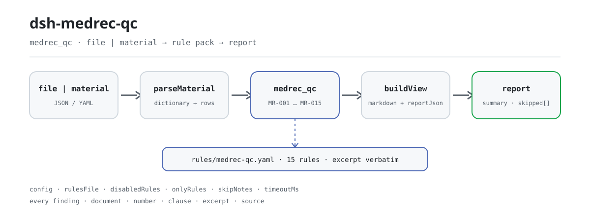

<div align="center">

<picture>
  <source media="(prefers-color-scheme: dark)" srcset="docs/assets/dsh-medrec-qc-flow-dark.svg">
  
</picture>

# dsh-medrec-qc

**Check one inpatient front-sheet export and get back a line-by-line list of which row, which column, what differs, and which clause says so.**

A DeepSeek Harness checker for medical-record rooms and quality-control teams: the rule pack is data, every finding carries its citation, and it lists differences only — it never rules.

[Install](#three-step-setup) · [Configuration](#configuration) · [FAQ](#faq) · [简体中文](README.md) · [English](README.en.md) · [Español](README.es.md) · [Português](README.pt.md) · [हिन्दी](README.hi.md)

[](LICENSE)
[](#compatibility)
[](https://www.npmjs.com/package/dsh-medrec-qc)
[](https://github.com/PerryLink/dsh-medrec-qc/actions/workflows/ci.yml)
[](#compatibility)

[](https://github.com/PerryLink/dsh-medrec-qc/stargazers)
[](https://www.npmjs.com/package/dsh-medrec-qc)
[](https://dshfind.com/plugins/PerryLink/dsh-medrec-qc?ref=badge)
[](https://securityscorecards.dev/viewer/?uri=github.com/PerryLink/dsh-medrec-qc)
[](https://dsh.market/)
[](https://gitee.com/perrylink/dsh-medrec-qc)

```sh
dsh plugin --profile <name> add dsh-medrec-qc
```

</div>

<sub>Community plugin, not affiliated with DeepSeek. Canonical repository: <https://github.com/PerryLink/dsh-medrec-qc> (Gitee is a mirror).</sub>

## What it is

`dsh-medrec-qc` reads an export of the inpatient medical record front sheet — one row per discharge, with column names from the national assessment export, the health statistics export, or a hospital-local spelling. It checks that export against itself: is the form complete, is the internal arithmetic consistent, are the codes written the way the rule pack says — does every required column carry content or the approved `-` marker, are the admission and discharge times present, precise to the minute and not in the wrong order, does the declared length of stay agree with the two dates, are the primary diagnosis name and code and the primary operation name and code filled together, is the three-level physician signature block complete, is the discharge mode one of the defined codes, do the age and the neonatal weights use the prescribed forms, does the count of other diagnoses stay within the configured ceiling.

Cases that need human judgement — a diagnosis incompatible with the recorded sex, two disagreeing times in a death discharge — are surfaced for review, never decided.

It reads a file and returns a list: no network, no model call, no writes, so the same material can be checked as often as you like; swap the rule pack and you swap the whole rule set.

## Three-step setup

1. **Install** (published to npm):

   ```sh
   # npm channel (published releases)
   dsh plugin --profile web add dsh-medrec-qc
   # tarball channel: after pnpm pack in this repo
   dsh plugin --profile web add ./dsh-medrec-qc-<version>.tgz
   ```

   Running from a source checkout needs `pnpm install && pnpm run build` first: the `main` entry points at the build output `lib/index.mjs`, not at the sources.

2. **Minimal config** (defaults are enough; the bundle patch only inserts one row):

   ```yaml
   - insert:
       - id: dsh-medrec-qc
         name: dsh-medrec-qc
   ```

3. **Verify it mounts**:

   ```sh
   dsh --profile web --dump-config | grep -A2 'id: dsh-medrec-qc'
   ```

   Then run the bundled sample; this is its real output (recorded in `docs/assets/quickstart.log`):

   ```sh
   pnpm run build && node samples/quickstart/run.mjs
   ```

   ```
   $ node samples/quickstart/run.mjs
   medrec_qc: 1 issue(s) — error 1, warn 0, info 0
   skipped: 14
   ```

   The material is `samples/quickstart/input/MR-001-unsafe.yaml`, the expected summary is `samples/quickstart/expected/result.json`, and the capture is at [docs/assets/quickstart.png](docs/assets/quickstart.png).

**Uninstall**: `dsh plugin --profile web remove dsh-medrec-qc` (or remove the row from the profile patch).

<details>
<summary>Install from the DSH Desktop market</summary>

Every PerryLink plugin is listed in the built-in DSH Desktop market: **Market → Sources → Add source → paste** `https://perrylink-dsh-catalog.perrylink.workers.dev/catalog-source.json` **→ select**. Installation still requires the market's npm identity check and your confirmation.

</details>

## Core capabilities

- **One command, a whole batch** — registers the `medrec_qc` tool, which takes `file` or `material` (JSON / YAML) and checks every discharged case in the export at once.
- **The rule pack is data, not code** — 15 rules live in `rules/medrec-qc.yaml` (pack version `2026.1`); replacing that file switches the rule set without touching TypeScript.
- **Every difference is traceable** — each finding carries `document` / `number` / `clause` / `excerpt` / `source`: which document, which clause, what the text says, and where it was read.
- **Severity follows the evidence** — only a check whose clause was read verbatim may be `error`; a check derived from a principle is capped at `warn`, an institutional threshold at `info`. The rule-pack loader enforces this instead of trusting authors.
- **An empty result is not a clean bill** — a check that could not run lands in `skipped` with its reason (missing column, no operation records in the batch, disabled by config), never a silent pass.
- **Differences, never verdicts** — no compliance finding, no liability finding, no replacement for the reviewer; every report carries the disclaimer and a wording guard blocks adjudicating language.
- **Local only** — no network, no model call, no writes; material and report stay on your machine and in the host's own session record.

### What the output looks like

| Field | Meaning |
|---|---|
| `summary` | `error` / `warn` / `info` counts |
| `issueCount` / `skippedCount` | findings / checks that could not run |
| `markdown` | the human-readable list (what the tool renders) |
| `reportJson` | the same report as a JSON string, for downstream processing |
| `rulesetVersion` | rule-pack version, the premise of a reproducible report |

### Examples

**Detailed walkthrough** — tool `medrec_qc`.

**Input**

~~~yaml
target: 2026 年 3 月出院病案首页导出
cases:
  - row: 1
    病案号: ""
    入院时间: "2026-03-01 08:30"
    出院时间: "2026-03-06 10:00"
~~~

**Output**

~~~json
{
  "id": "dsh-medrec-qc.MR-001.a58905f0",
  "ruleId": "MR-001",
  "severity": "error",
  "locator": {
    "row": 1,
    "column": "病案号"
  },
  "found": "「病案号」为空",
  "expected": "附件1 必填栏不能为空项，没有可填写内容时填写\"-\""
}
~~~

*Observed from `tests/fixtures/MR-001/MR-001-unsafe.yaml`*

The rule pack never fabricates a citation, so every finding also states the clause it comes from and whether the clause text was obtained this time.

| You ask | What it answers |
|---|---|
| A required column is left empty, but I typed `-` in it. Is that reported? | No. `MR-001` treats a lone `-` as the marker for "nothing to record here" and reports only the columns that are truly blank. It checks that a required column carries content, not that the content is correct. It is an `error` because the note at the end of Appendix 1 of Doc. 24/2016 was read **verbatim on 2026-10-13**. The same `-` still counts as a missing signature under `MR-009`. |
| The admission time is written as a bare date with no hour or minute, and on one row the discharge time is earlier than the admission time. | `MR-002` reports an admission or discharge value that can be read only to the day (the recorded time must be precise to the minute) and any value it cannot parse as a date and time at all. `MR-003` compares the literal order of the two fields and reports the row where the discharge time comes first. Both work on the literal values and neither decides which time is the true one. |
| The front sheet says `5` days, but the dates are 12 June in and 15 June out. | `MR-004` recounts the days as discharge date minus admission date and reports the row when the declared length of stay disagrees; admission and discharge on the same day count as `0` days, and a value that is not a whole number of days is reported too. It compares the three stored values only and does not decide which of them is wrong. |
| The primary diagnosis name is filled in but the primary diagnosis code is blank, and another row carries a code in a strange shape. | `MR-005` requires the two to be filled together and names the one that is missing; it checks only that both exist, not that the code matches the diagnosis. `MR-006` then tests the code against the written form configured in the pack, and it does not verify that the code exists in any version of the classification directory. |
| A batch contains no operation records at all. Do the operation rules pass in silence? | No. `MR-007` reports itself in `skipped` with the reason that the material holds no operation record, so the pairing check does not apply, instead of passing in silence. When a row does record an operation, the rule requires the primary operation name and code to be filled together, and `MR-008` checks the written form of the operation code only. |
| A male patient's primary diagnosis is a pregnancy-related condition. Does that block the export? | `MR-014` reports it as a `warn`-level difference for a human to confirm, never as a block: the health-side documents contain no clause making a diagnosis incompatible with the recorded sex, and the published detail of that medical-insurance rule type does not cover the pregnancy, childbirth and puerperium chapter and allows clinical exceptions. Confirm with the clinician whether the sex or the diagnosis is wrong. |

### Material format

A `cases` list (a bare list is also accepted). Field names are resolved through a shared dictionary, so national-assessment, health-statistics and hospital-local spellings land on the canonical keys the rules read.

~~~yaml
cases:
  - row: 1
    病案号: "A2026030001"
    入院时间: "2026-03-01 08:30"
    出院时间: "2026-03-06 10:00"
    实际住院天数: "5"
    性别: "1"
    出生日期: "1972-05-04"
    年龄: "53"
    离院方式: "1"
    科主任: "赵主任"
    主任医师: "钱主任医师"
    主治医师: "孙主治"
    住院医师: "李医师"
    责任护士: "周护士"
    编码员: "吴编码"
    主要诊断名称: "2型糖尿病"
    主要诊断编码: "E11.900"
    其他诊断: "高血压;慢性肾功能不全"
    主要手术名称: "腹腔镜胆囊切除术"
    主要手术编码: "51.2300"
    有手术操作: "1"
~~~

English headers such as `MEDICAL_RECORD_NO`, `ADMISSION_TIME`, `DISCHARGE_TIME` and `MAIN_DIAGNOSIS_CODE` are accepted too, so a hospital that already exports ASCII headers needs no conversion step. A column the dictionary cannot map is never guessed: it is reported in `warnings` and `unknownColumns`, because an unmapped column is exactly how a check goes missing without anyone noticing.

## Rules and sources

### The 15 rules

| Rule | Check | Severity |
|---|---|---|
| `MR-001` | no required column is blank (a lone `-` is the approved marker) | error |
| `MR-002` | admission and discharge times are present and precise to the minute | error |
| `MR-003` | the discharge time is not before the admission time | error |
| `MR-004` | the recorded length of stay matches the two dates | error |
| `MR-005` | the primary diagnosis name and code are filled together | error |
| `MR-006` | the primary diagnosis code has ICD-10 form | error |
| `MR-007` | when there is an operation, its name and code are filled together | error |
| `MR-008` | the primary operation code has ICD-9-CM-3 form | error |
| `MR-009` | the signature block reflects three-level physician responsibility | error |
| `MR-010` | the discharge mode is one of the defined codes | error |
| `MR-011` | the age uses integer years or the `N M/30` month fraction | warn |
| `MR-012` | neonatal weights are recorded to the nearest 10 grams | warn |
| `MR-013` | the count of other diagnoses stays within the configured ceiling | warn |
| `MR-014` | a diagnosis that does not match the recorded sex needs human review | warn |
| `MR-015` | a death discharge records the death time as the discharge time | info |

### The standards behind them

| Document | Number | Cited by rules |
|---|---|---|
| Quality control indicators for inpatient front-sheet data (2016 edition) | NHC Doc. 24/2016 | MR-001 |
| Interim rules for the quality of inpatient front-sheet data entry | NHC Doc. 24/2016 | MR-002, MR-003, MR-005, MR-006, MR-007, MR-008, MR-013, MR-015 |
| Notice on revising the inpatient medical record front sheet | MOH Doc. 84/2011 | MR-004, MR-009, MR-010, MR-011, MR-012 |
| NHSA two-database knowledge point (diagnosis not matching patient sex) | NHSA announcement (21st batch) | MR-014 |

**Boundary:** this plugin checks the **front sheet of the inpatient medical record** — the one-page discharge summary coders and the national assessment system read — for form completeness, internal contradictions and coding form. It is not `dsh-nurse-record-check` (nursing documentation timeliness), not `dsh-icd-rule-check` (ICD coding rules and dagger/asterisk pairing), and it does not judge whether a diagnosis was clinically correct. It reads an export of the front sheet and reports literal mismatches against cited clauses.

### Why `MR-001` is an `error` again (2026-10-13)

<details>
<summary>Expand: the downgrade, the evidence, and the correction</summary>

**Every `error` rule here rests on two things: a document that imposes the requirement, and the verbatim text of the clause having been read.** Doc. 24/2016 (obtained in full) and Doc. 84/2011 (obtained in full, all three appendices) satisfy the second. `MR-001` was the long-standing exception: its only basis is **the note at the end of Appendix 1**, and that appendix was once recorded as a PDF this environment could not decode, so the rule was **downgraded to `warn` on 2026-10-07** under the same discipline — a clause that cannot be read cannot support a block.

**The appendix does have a text layer.** It was read verbatim on 2026-10-13: 328 pages, 205,847 extractable characters, **no OCR used**. The note reads:

```text
注：必填栏不能为空项，没有可填写内容时填写“-”
```

This matches the rule's `excerpt` exactly, except that the PDF prints curly quotes where the rule uses straight ones — a typographic difference recorded rather than papered over (the citation gate strips both quote forms, which is why the segment matches). **So the rule is back to `error`, corrected on evidence.**

⚠️ **Source tier, stated plainly**: `www.nhc.gov.cn` returns **HTTP 412** to automated requests (measured 2026-10-13; the site root is 412 too). The text was read from a **Henan provincial medical-record quality-control centre** compilation — the very URL this rule's `source` has always carried. That is the same tier as the provincial or university reprints the other fourteen rules use, so it is **not a reason to treat this rule differently**. See `rules/evidence/clause-verification-homepage-attachment1.md` for the full attempt log and `rules/evidence/authority-class-audit.md` for the classification.

</details>

### Rule sources and verification

Rule data lives in `rules/medrec-qc.yaml`. Every rule carries a document, a document number, a clause in the source's own numbering, a verbatim excerpt and the URL the excerpt was read from. The loader enforces that an excerpt is a real quotation of at least eight characters, and that a check whose basis is only a general principle (`kind: derived-from-principle`, capped at `warn`) or a local policy (`kind: institutional-configuration`, capped at `info`) may never be declared `error`. A pack that overstates its basis fails at load time instead of producing a confidently worded report.

The clause numbers were checked against the full texts of the interim data-entry quality rules, the 2016 quality-control indicators (NHC Doc. 24/2016), the appendices to the notice on revising the front sheet (MOH Doc. 84/2011), the 2013 medical-record management provisions (NHC Doc. 31/2013) and the medical-insurance settlement-list entry rules (NHSA Doc. 20/2020). Four findings shaped the pack, and are recorded here so a reviewer can see what was deliberately **not** claimed:

1. **The required-field list is Appendix 1, and it has no column called "physician signature".** Appendix 1's list of 76 mandatory items splits the signature block into department head / chief (deputy chief) physician / attending physician / resident physician. `MR-009` therefore binds to those specific columns and cites Appendix 2 (28) 1 of Doc. 84/2011 for the three-level responsibility requirement, instead of writing "Doc. 24/2016 requires a physician signature".
2. **The age format is in Doc. 84/2011, not in the 2010 record-writing standard.** The rule for ages under one year (`N M/30`, in months) is Appendix 2 (6) of MOH Doc. 84/2011; Doc. 11/2010 mentions age only as a field of the admission note. `MR-011` cites Doc. 84/2011 and does **not** check a "write day-age under one month" rule, because no national document states one — and NHSA Doc. 20/2020 states a different rule (integer day-age) for the insurance channel, so the two are not made mutually exclusive.
3. **"A male patient cannot have a pregnancy diagnosis" is not a national clause.** The National Healthcare Security Administration publishes a "diagnosis does not match patient sex" rule type, but the released detail covers eleven ICD-10 chapters (A/B/C/D/E/F/I/J/K/L/M) and contains **no O-chapter entry at all**; the accompanying press briefing explicitly allows clinical exceptions. `MR-014` is therefore a `warn`-level lead for human review, never a block.
4. **A death discharge has no independent clause tying it to a death time.** Article 8 of Doc. 24/2016 only defines the discharge time as the death time for deceased patients. `MR-015` rests on that definition, is capped at `info`, and says so in its own note.

## Configuration

Every tunable lives in the Schemastery schema in `src/config.ts`, so it can be changed from `cordis.yml` without editing code. The per-rule field lists and thresholds live in `rules/medrec-qc.yaml`.

| Key | Type | Default | Description |
|---|---|---|---|
| `rulesFile` | string | `rules/medrec-qc.yaml` | Rule-pack path relative to the package root; replace that file to switch rule-set versions |
| `disabledRules` | string[] | `[]` | Rule ids to stop running; each appears in `skipped` |
| `onlyRules` | string[] | `[]` | Run only these rule ids; empty runs every rule |
| `skipNotes` | string | `""` | Note appended to every `skipped` reason, e.g. your institutional rules |
| `timeoutMs` | number | `120000` | Cooperative tool timeout budget in milliseconds |

Rule-level parameters worth knowing:

- `MR-001` `fields` — the required-column list, taken from Appendix 1 of Doc. 24/2016. Add your own mandatory columns in the pack, without touching the code.
- `MR-011` `underOnePattern` / `adultPattern` — the accepted age spellings.
- `MR-013` `maxChecked` — the other-diagnosis count above which ordering is flagged for review.
- `MR-014` `rules` — the sex-versus-diagnosis term lists, expressed as `{ sex, label, pattern }`.

Profile patch override example:

~~~yaml
- insert:
    - id: dsh-medrec-qc
      name: dsh-medrec-qc
      config:
        disabledRules: [MR-012]
        onlyRules: []
        skipNotes: 本机构实施细则 2026 版
        timeoutMs: 120000
~~~

## FAQ

<details>
<summary>Is the material uploaded or sent anywhere? Where does the data live?</summary>

No. It reads the document content you pass to the tool: no network, no telemetry, no writes, no upload. Apart from the tool result and the DSH host's own session/log storage, this package stores nothing; that storage is controlled by the host, which decides its retention, and this package never adds a second copy. See [PRIVACY.md](PRIVACY.md).

</details>

<details>
<summary>Is "0 differences" the same as "nothing is wrong"? What if a rule did not run?</summary>

"0 differences" only means **the checks that ran found no literal difference**; it is not a clean bill. Every check that could not run lands in `skipped` with its reason (missing column, no operation records in the batch, disabled via `disabledRules`), so an empty result must not be read as "nothing is wrong". If the tool never appears at all, confirm that `main` resolves to `lib/index.mjs`: a source checkout needs `pnpm run build` first, while the published tarball ships the build output.

</details>

<details>
<summary>Will it rule on compliance, or block a submission?</summary>

No. It does not adjudicate compliance, liability, or clinical correctness, and it never blocks any workflow; every report carries the disclaimer and a wording guard blocks adjudicating language. What you get is a difference list for human review: which row, which column, what differs, and which clause it rests on.

</details>

<details>
<summary>What if install refuses the package as incompatible? What about a failing `manifest-peers` in `check`?</summary>

The peer range covers the `0.1.x` and `0.2.x` lines. If your runtime sits outside it, grant an explicit exemption: `dsh plugin --profile <name> allow-version dsh-medrec-qc@0.2.13 --dsh-version <runtime> --accept-risk`. A failing `manifest-peers` in `check` is a known upstream issue in `dsh-plugin-dev`: the static checker compares against a hard-coded range that predates the 0.2 line, while the install-time check uses the runtime. More in [TROUBLESHOOTING.md](TROUBLESHOOTING.md).

</details>

<details>
<summary>Does it conflict with `dsh-nurse-record-check` or `dsh-icd-rule-check`?</summary>

No, and the division of labour differs. This plugin checks the **front-sheet export** for form completeness, internal arithmetic and coding form; `dsh-nurse-record-check` checks nursing documentation timeliness, and `dsh-icd-rule-check` checks ICD coding rules and dagger/asterisk pairing. They can live in the same profile: this plugin registers one tool, provides no service key, registers no client slot or HTTP route, and reads only the material you pass to it without modifying the original.

</details>

## Security boundaries

- **Local only, no outbound surface.** No network requests, no model calls, no telemetry; `package.json#dsh.demo` states `network: false`, `writes: []` and `external: []` for exactly that reason.
- **A rule with insufficient evidence can never be `error`.** The pack loader requires an `excerpt` to be a verbatim quotation of at least eight characters and caps severity by `kind`: `derived-from-principle` at `warn`, `institutional-configuration` at `info`. A separate citation gate re-checks that every excerpt is traceable in the `rules/evidence/` record.
- **Differences, not verdicts.** Reports contain no compliance, violation, liability or correctness assertions; a wording guard enforces that at render time.
- **An empty result is not innocence.** A check that could not run must appear in `skipped` with a reason; when a rule's required list is unset it reports itself as not run rather than defaulting to pass.
- **Registrations are effects.** The tool is registered through `ctx.tools.register` and its disposer is returned, so stopping or hot-reloading the plugin removes it without leaving a dangling registration.
- **No writes.** Apart from the tool result and the host's own session storage, this package creates and modifies no files.

## Permissions and data

- **Permissions**: it only reads the material the caller passes (a `file` path or inline `material`); it provides no service key and registers no client slot or HTTP route. `package.json#dsh.capabilities` declares `tools:register` only.
- **Data**: material content participates in the comparison inside this process; the plugin keeps no copy, no cache and no file. How the host records a tool result is the host's business, and this package does not append a second copy.
- **Dependencies**: zero runtime dependencies (`dependencies` is empty); the peers are Cordis, `dsh-tools` and Schemastery, all already present in the host.

## Known limitations

- **Literal differences only.** It does not decide which of two conflicting values is true, does not judge clinical correctness, and does not decide for the reviewer; when two fields disagree it reports the disagreement itself.
- **Codes are checked for form only.** `MR-006` / `MR-008` test ICD-10 and ICD-9-CM-3 written form against the pack, and **do not verify** that a code exists in any version of the classification directory, nor that the directory version matches.
- **The field dictionary is deliberately conservative.** An unmapped column is reported in `warnings` and `unknownColumns`; the reader refuses to guess. To support a local column name, extend `CASE_FIELDS` in `src/parse.ts` or the field list in the rule pack.
- **15 rules are not a complete front-sheet compliance check.** They cover the form and arithmetic problems that can be tied to a clause; checks with weaker evidence are deliberately capped at `warn` / `info`, and everything else is out of scope.
- **Source tier is bounded.** `www.nhc.gov.cn` returns HTTP 412 to automated requests (measured 2026-10-13), so some provisions were read from provincial or university reprints; the evidence record is in `rules/evidence/`. That is a stated tier, not a licence to treat a reprint as the original.
- **The dev form needs a build.** In a source checkout `main` points at `lib/index.mjs`, so `pnpm run build` must run first; the published npm tarball ships `lib/` and works on install.
- **Time is wall-clock.** All date and time arithmetic runs on the input strings as wall-clock values with no timezone conversion; an offset in the input never participates in a comparison.
- **A known upstream static-checker false alarm.** `check`'s `manifest-peers` compares against a hard-coded peer range from before the 0.2 line, which disagrees with the install-time runtime check.

## Interoperability with other DSH plugins

This plugin **does not interfere** with other plugins in the same profile:

- **It adds exactly one tool.** Only `medrec_qc`, registered through `ctx.tools.register` with its disposer returned; no bare name owned by a built-in tool or another plugin is taken, and unload removes it.
- **It provides no service key.** `inject` is `['tools']` only, and no Cordis service key is registered, so there is no service-key collision to have.
- **No slot, no route.** The package has no browser half (no `client/`), registers no client slot key, and registers no `webServer` prefix.
- **The patch layer only inserts its own row.** `cordis.patch.yml` appends one `id: dsh-medrec-qc` row and never overrides a built-in or another plugin's `config`.
- **No global mutation.** It patches no prototypes, writes no `process.env`, and replaces no global fetch.
- **Sibling checkers divide the work instead of competing.** The same material can go to `dsh-medrec-qc` (front-sheet form and logic contradictions), `dsh-nurse-record-check` (nursing documentation timeliness) and `dsh-icd-rule-check` (ICD coding rules and dagger/asterisk pairing); each reads the file, writes its own report, leaves the original untouched, and shares no state.

## Compatibility

| Surface | Status |
|---|---|
| Harness | Peer range `>=0.1.2-rc.1 <0.2.0 \|\| >=0.2.0-0 <0.3.0`, measured to accept both `0.2.0-rc.2` and `0.2.1-rc.2`; `engines.dsh` declares `>=0.2.1-0 <0.3.0` and is enforced by the host since 0.2.1 |
| Node | `^22.19.0 \|\| >=24.0.0` |
| Platforms | All (plain ESM; no native code, no network, no model call) |
| Tool mode | Works in `native` and `ptc`; use `ptc` for a whole month of discharges, the schema cost is paid once |
| Material | JSON / YAML; a `cases` list or a bare list |

## Ecosystem and quality

- [Gitee mirror](https://gitee.com/perrylink/dsh-medrec-qc) (sync mirror; GitHub is canonical)
- [dshfind plugin page](https://dshfind.com/plugins/PerryLink/dsh-medrec-qc) (installs and ranking)
- [OpenSSF Scorecard report](https://securityscorecards.dev/viewer/?uri=github.com/PerryLink/dsh-medrec-qc) (driven by [.github/workflows/scorecard.yml](.github/workflows/scorecard.yml))
- [DSH Market](https://dsh.market/) (listed)
- **1024 store channel**: `npm i -g dsh1024` once, then `dsh1024 plugin --profile web add dsh-medrec-qc` (counts toward the [deepseek1024.com](https://deepseek1024.com) install ranking)
- [Ecosystem knowledge base](https://perrylink.github.io/dsh-plugin-guide/) — measured data, not marketing: plugin development guide · plugin-selection data · maintenance criteria

## Development

```sh
pnpm install
pnpm run typecheck          # tsc --noEmit
pnpm test                   # vitest, a compliant/violating fixture pair per rule
pnpm run build              # tsdown -> lib/index.mjs + lib/index.d.mts
pnpm run check:readmes      # five-language README consistency
pnpm run check:citations    # every excerpt is traceable in rules/evidence/
pnpm run verify:self-contained
pnpm run check:lockfile
pnpm pack                   # the published tarball
node samples/quickstart/run.mjs   # after a build
```

Layout:

| Path | Role |
|---|---|
| `src/index.ts` | function-plugin entry: `name` / `inject` / `Config` / `apply`, registers `medrec_qc` and resolves the rule pack |
| `src/config.ts` | the Schemastery schema; every tunable lives here |
| `src/check.ts` | the pure check core, `(input, ruleset, options) => Report`; no plugin context, no I/O, no clock, no model |
| `src/parse.ts` | material reader (JSON / YAML) and the column dictionary |
| `src/view.ts` | the model-facing projection of a report; `output.schema` mirrors it |
| `src/shared/` | shared kit (ruleset loader, report shape, YAML subset, calendar arithmetic, wording guard, table helpers), copied in rather than imported |
| `rules/medrec-qc.yaml` | the rule pack, 15 rules; `rules/evidence/` records how every citation was obtained |
| `tests/` | vitest; a compliant/violating fixture pair per rule |

Topics: `dsh`, `dsh-plugin`, `deepseek-harness`, `deepseek`, `cordis`, `medrec`

The README pictures are generated programmatically by [`scripts/gen-readme-assets.py`](scripts/gen-readme-assets.py) (Python + Pillow, light/dark SVG flow diagram) and are safe to re-run; the older single-version `dsh-medrec-qc-flow.svg` and the terminal captures are kept as-is so external links do not break.

## Family and thanks

This project is part of the DeepSeek Harness plugin family from [PerryLink](https://github.com/PerryLink) (all Apache-2.0). If it is useful, **a star helps the next person find it** — nothing is gated behind it.

- [@PerryLink](https://github.com/PerryLink) — creator and maintainer: the rule pack and check core, the citation gate and evidence record, the `medrec_qc` tool, and the five-language docs.

Pick a checker by material (the family's full index): <https://perrylink.github.io/zh/checkers/choose/>

<details>
<summary>Expand all plugins</summary>

| Plugin | Status |
|---|---|
| **[dsh-aqua-input-check](https://github.com/PerryLink/dsh-aqua-input-check)** |  |
| **[dsh-archive-check](https://github.com/PerryLink/dsh-archive-check)** |  |
| **[dsh-auto-review](https://github.com/PerryLink/dsh-auto-review)** |  |
| **[dsh-autotier](https://github.com/PerryLink/dsh-autotier)** | 🧊 FROZEN — see the repo README |
| **[dsh-bid-ca-precheck](https://github.com/PerryLink/dsh-bid-ca-precheck)** |  |
| **[dsh-bid-qual-check](https://github.com/PerryLink/dsh-bid-qual-check)** |  |
| **[dsh-cert-mcp](https://github.com/PerryLink/dsh-cert-mcp)** | 🧊 FROZEN — see the repo README |
| **[dsh-checkpoint-rewind](https://github.com/PerryLink/dsh-checkpoint-rewind)** |  |
| **[dsh-click](https://github.com/PerryLink/dsh-click)** |  |
| **[dsh-composer-history](https://github.com/PerryLink/dsh-composer-history)** |  |
| **[dsh-contract-stance](https://github.com/PerryLink/dsh-contract-stance)** |  |
| **[dsh-customs-doc-check](https://github.com/PerryLink/dsh-customs-doc-check)** |  |
| **[dsh-data-quality](https://github.com/PerryLink/dsh-data-quality)** | 🧊 FROZEN — see the repo README |
| **[dsh-demurrage-ledger](https://github.com/PerryLink/dsh-demurrage-ledger)** |  |
| **[dsh-doublecheck](https://github.com/PerryLink/dsh-doublecheck)** |  |
| **[dsh-drill-script-check](https://github.com/PerryLink/dsh-drill-script-check)** |  |
| **[dsh-eia-guide-check](https://github.com/PerryLink/dsh-eia-guide-check)** |  |
| **[dsh-emergency-plan](https://github.com/PerryLink/dsh-emergency-plan)** |  |
| **[dsh-essay-rubric-check](https://github.com/PerryLink/dsh-essay-rubric-check)** |  |
| **[dsh-evidence-check](https://github.com/PerryLink/dsh-evidence-check)** |  |
| **[dsh-export-ctl-check](https://github.com/PerryLink/dsh-export-ctl-check)** |  |
| **[dsh-fast](https://github.com/PerryLink/dsh-fast)** |  |
| **[dsh-fmea-table-check](https://github.com/PerryLink/dsh-fmea-table-check)** |  |
| **[dsh-forecast-penalty](https://github.com/PerryLink/dsh-forecast-penalty)** |  |
| **[dsh-fund-research](https://github.com/PerryLink/dsh-fund-research)** |  |
| **[dsh-github](https://github.com/PerryLink/dsh-github)** |  |
| **[dsh-gongwen-flow-check](https://github.com/PerryLink/dsh-gongwen-flow-check)** |  |
| **[dsh-gongwen-word-check](https://github.com/PerryLink/dsh-gongwen-word-check)** |  |
| **[dsh-guard-plan-qc](https://github.com/PerryLink/dsh-guard-plan-qc)** |  |
| **[dsh-hazchem-check](https://github.com/PerryLink/dsh-hazchem-check)** |  |
| **[dsh-hazplan-check](https://github.com/PerryLink/dsh-hazplan-check)** |  |
| **[dsh-hidden-risk-map](https://github.com/PerryLink/dsh-hidden-risk-map)** |  |
| **[dsh-hs-classify](https://github.com/PerryLink/dsh-hs-classify)** |  |
| **[dsh-icd-rule-check](https://github.com/PerryLink/dsh-icd-rule-check)** |  |
| **[dsh-industry-research](https://github.com/PerryLink/dsh-industry-research)** |  |
| **[dsh-lawcite-adapter](https://github.com/PerryLink/dsh-lawcite-adapter)** |  |
| **[dsh-laya](https://github.com/PerryLink/dsh-laya)** |  |
| **[dsh-lc-doc-check](https://github.com/PerryLink/dsh-lc-doc-check)** |  |
| **[dsh-learning-gap-check](https://github.com/PerryLink/dsh-learning-gap-check)** |  |
| **[dsh-library](https://github.com/PerryLink/dsh-library)** |  |
| **[dsh-local-ai](https://github.com/PerryLink/dsh-local-ai)** |  |
| **[dsh-lsp-actions](https://github.com/PerryLink/dsh-lsp-actions)** |  |
| **[dsh-mask](https://github.com/PerryLink/dsh-mask)** |  |
| **[dsh-mcp-panel](https://github.com/PerryLink/dsh-mcp-panel)** |  |
| **[dsh-medrec-qc](https://github.com/PerryLink/dsh-medrec-qc)** |  |
| **[dsh-memento](https://github.com/PerryLink/dsh-memento)** | 🧊 FROZEN — see the repo README |
| **[dsh-nsfc-form-check](https://github.com/PerryLink/dsh-nsfc-form-check)** |  |
| **[dsh-nurse-record-check](https://github.com/PerryLink/dsh-nurse-record-check)** |  |
| **[dsh-observe](https://github.com/PerryLink/dsh-observe)** |  |
| **[dsh-origin-rvc-check](https://github.com/PerryLink/dsh-origin-rvc-check)** |  |
| **[dsh-ota-review-check](https://github.com/PerryLink/dsh-ota-review-check)** |  |
| **[dsh-output-styles](https://github.com/PerryLink/dsh-output-styles)** |  |
| **[dsh-paper-doc-adapter](https://github.com/PerryLink/dsh-paper-doc-adapter)** |  |
| **[dsh-permission-rules](https://github.com/PerryLink/dsh-permission-rules)** |  |
| **[dsh-permit-report-check](https://github.com/PerryLink/dsh-permit-report-check)** |  |
| **[dsh-pipeline-check](https://github.com/PerryLink/dsh-pipeline-check)** |  |
| **[dsh-pleading-draft](https://github.com/PerryLink/dsh-pleading-draft)** |  |
| **[dsh-plugin-doctor](https://github.com/PerryLink/dsh-plugin-doctor)** | 🚫 RETIRED (repo archived) |
| **[dsh-plugin-guide](https://github.com/PerryLink/dsh-plugin-guide)** |  |
| **[dsh-plugin-kit](https://github.com/PerryLink/dsh-plugin-kit)** | 🚫 RETIRED (repo archived) |
| **[dsh-plugin-upgrade](https://github.com/PerryLink/dsh-plugin-upgrade)** | 🚫 RETIRED (repo archived) |
| **[dsh-policy-brief-draft](https://github.com/PerryLink/dsh-policy-brief-draft)** |  |
| **[dsh-power-loss-split](https://github.com/PerryLink/dsh-power-loss-split)** |  |
| **[dsh-power-ticket-check](https://github.com/PerryLink/dsh-power-ticket-check)** |  |
| **[dsh-ppap-check](https://github.com/PerryLink/dsh-ppap-check)** |  |
| **[dsh-protest-deadline](https://github.com/PerryLink/dsh-protest-deadline)** |  |
| **[dsh-railway-window](https://github.com/PerryLink/dsh-railway-window)** |  |
| **[dsh-repair-order-qc](https://github.com/PerryLink/dsh-repair-order-qc)** |  |
| **[dsh-research-report](https://github.com/PerryLink/dsh-research-report)** |  |
| **[dsh-review-reply-check](https://github.com/PerryLink/dsh-review-reply-check)** |  |
| **[dsh-rulefile-check](https://github.com/PerryLink/dsh-rulefile-check)** |  |
| **[dsh-safety-brief-check](https://github.com/PerryLink/dsh-safety-brief-check)** |  |
| **[dsh-score](https://github.com/PerryLink/dsh-score)** | 🧊 FROZEN — see the repo README |
| **[dsh-session-sync](https://github.com/PerryLink/dsh-session-sync)** |  |
| **[dsh-site-log-check](https://github.com/PerryLink/dsh-site-log-check)** |  |
| **[dsh-skill-pack-security](https://github.com/PerryLink/dsh-skill-pack-security)** |  |
| **[dsh-soe-decision-check](https://github.com/PerryLink/dsh-soe-decision-check)** |  |
| **[dsh-soilwater-check](https://github.com/PerryLink/dsh-soilwater-check)** |  |
| **[dsh-sop-sync-check](https://github.com/PerryLink/dsh-sop-sync-check)** |  |
| **[dsh-spc-gbt-adapter](https://github.com/PerryLink/dsh-spc-gbt-adapter)** |  |
| **[dsh-talk](https://github.com/PerryLink/dsh-talk)** |  |
| **[dsh-tender-extract](https://github.com/PerryLink/dsh-tender-extract)** |  |
| **[dsh-tender-matrix](https://github.com/PerryLink/dsh-tender-matrix)** |  |
| **[dsh-test-drive](https://github.com/PerryLink/dsh-test-drive)** |  |
| **[dsh-ticktick](https://github.com/PerryLink/dsh-ticktick)** | 🚫 RETIRED (repo archived) |
| **[dsh-translate](https://github.com/PerryLink/dsh-translate)** |  |
| **[dsh-warranty-calc](https://github.com/PerryLink/dsh-warranty-calc)** |  |
| **[dsh-budget](https://github.com/PerryLink/dsh-budget)** | 🧊 FROZEN — see the repo README |
| **[dsh-claude-move](https://github.com/PerryLink/dsh-claude-move)** | 🧊 FROZEN — see the repo README |
| **[dsh-defend](https://github.com/PerryLink/dsh-defend)** | 🧊 FROZEN — see the repo README |
| **[dsh-draw](https://github.com/PerryLink/dsh-draw)** | 🧊 FROZEN — see the repo README |
| **[dsh-reach](https://github.com/PerryLink/dsh-reach)** | 🧊 FROZEN — see the repo README |
| **[dsh-background-agents](https://github.com/PerryLink/dsh-background-agents)** | 🚫 RETIRED (repo archived) |
| **[dsh-session-pin](https://github.com/PerryLink/dsh-session-pin)** | 🚫 RETIRED (repo archived) |
| **[dsh-team-rooms](https://github.com/PerryLink/dsh-team-rooms)** | 🚫 RETIRED (repo archived) |

</details>

## License

[LICENSE](LICENSE) (Apache License 2.0) © 2026 dsh-medrec-qc contributors

<p align="center"><sub>Apache-2.0 · Community plugin, not affiliated with DeepSeek.</sub></p>
