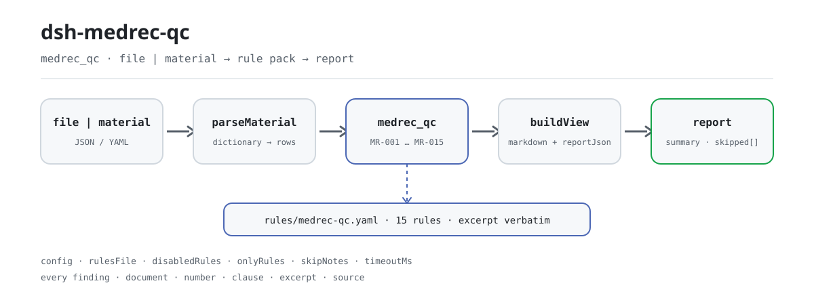

<div align="center">

<picture>
  <source media="(prefers-color-scheme: dark)" srcset="docs/assets/dsh-medrec-qc-flow-dark.svg">
  
</picture>

# dsh-medrec-qc

**Revisa una exportación de la hoja frontal del historial clínico y devuelve una lista fila por fila: qué fila, qué columna, qué difiere y qué cláusula lo respalda.**

Un verificador de DeepSeek Harness para archivos clínicos y equipos de control de calidad: el paquete de reglas es dato, cada hallazgo lleva su cita, y solo enumera diferencias — nunca dictamina.

[Instalar](#instalación-en-tres-pasos) · [Configuración](#configuración) · [FAQ](#faq) · [简体中文](README.md) · [English](README.en.md) · [Español](README.es.md) · [Português](README.pt.md) · [हिन्दी](README.hi.md)

[](LICENSE)
[](#compatibilidad)
[](https://www.npmjs.com/package/dsh-medrec-qc)
[](https://github.com/PerryLink/dsh-medrec-qc/actions/workflows/ci.yml)
[](#compatibilidad)

[](https://github.com/PerryLink/dsh-medrec-qc/stargazers)
[](https://www.npmjs.com/package/dsh-medrec-qc)
[](https://dshfind.com/plugins/PerryLink/dsh-medrec-qc?ref=badge)
[](https://securityscorecards.dev/viewer/?uri=github.com/PerryLink/dsh-medrec-qc)
[](https://dsh.market/)
[](https://gitee.com/perrylink/dsh-medrec-qc)

```sh
dsh plugin --profile <name> add dsh-medrec-qc
```

</div>

<sub>Plugin de la comunidad, no afiliado a DeepSeek. Repositorio canónico: <https://github.com/PerryLink/dsh-medrec-qc> (Gitee es un espejo).</sub>

## Qué es

`dsh-medrec-qc` lee una exportación de la hoja frontal del historial clínico de hospitalización —una fila por alta, con nombres de columna de la exportación de evaluación nacional, de la exportación estadística sanitaria o de una variante local del hospital—. Comprueba esa exportación contra sí misma: ¿está completo el formulario?, ¿cuadra la aritmética interna?, ¿están escritos los códigos como dice el paquete de reglas? — cada columna obligatoria con contenido o con el marcador `-`, las horas de ingreso y alta presentes, precisas al minuto y sin invertirse, la estancia declarada coherente con las dos fechas, el nombre y el código del diagnóstico principal y los de la operación principal rellenados juntos, el bloque de firmas con la responsabilidad de tres niveles, el modo de alta entre los códigos definidos, la edad y los pesos neonatales en la forma prescrita, y el número de otros diagnósticos dentro del límite configurado.

Los casos que requieren juicio humano —un diagnóstico incompatible con el sexo registrado, dos horas que no concuerdan en un alta por fallecimiento— se señalan para revisión, nunca se deciden.

Lee un archivo y devuelve una lista: sin red, sin llamadas al modelo, sin escrituras; el mismo material puede revisarse tantas veces como quieras, y cambiar el paquete de reglas cambia todo el conjunto de comprobaciones.

## Instalación en tres pasos

1. **Instala** (publicado en npm):

   ```sh
   # canal npm (versiones publicadas)
   dsh plugin --profile web add dsh-medrec-qc
   # canal tarball: tras pnpm pack en este repositorio
   dsh plugin --profile web add ./dsh-medrec-qc-<version>.tgz
   ```

   Ejecutar desde un checkout del código exige antes `pnpm install && pnpm run build`: la entrada `main` apunta al artefacto `lib/index.mjs`, no al código fuente.

2. **Configuración mínima** (los valores por defecto bastan; el parche del bundle solo inserta una fila):

   ```yaml
   - insert:
       - id: dsh-medrec-qc
         name: dsh-medrec-qc
   ```

3. **Verifica que se monta**:

   ```sh
   dsh --profile web --dump-config | grep -A2 'id: dsh-medrec-qc'
   ```

   Después ejecuta el ejemplo incluido; esta es su salida real (registrada en `docs/assets/quickstart.log`):

   ```sh
   pnpm run build && node samples/quickstart/run.mjs
   ```

   ```
   $ node samples/quickstart/run.mjs
   medrec_qc: 1 issue(s) — error 1, warn 0, info 0
   skipped: 14
   ```

   El material está en `samples/quickstart/input/MR-001-unsafe.yaml`, el resumen esperado en `samples/quickstart/expected/result.json`, y la captura en [docs/assets/quickstart.png](docs/assets/quickstart.png).

**Desinstalar**: `dsh plugin --profile web remove dsh-medrec-qc` (o borra la fila del parche del perfil).

<details>
<summary>Instalar desde el mercado de DSH Desktop</summary>

Todos los plugins de PerryLink aparecen en el mercado integrado de DSH Desktop: **Mercado → Fuentes → Añadir fuente → pegar** `https://perrylink-dsh-catalog.perrylink.workers.dev/catalog-source.json` **→ seleccionar**. La instalación sigue pasando por la verificación de identidad npm del mercado y por tu confirmación.

</details>

## Capacidades clave

- **Un comando, un lote completo** — registra la herramienta `medrec_qc`, que acepta `file` o `material` (JSON / YAML) y revisa de una vez todos los casos de alta de la exportación.
- **El paquete de reglas es dato, no código** — 15 reglas viven en `rules/medrec-qc.yaml` (versión `2026.1`); sustituir ese archivo cambia el conjunto de reglas sin tocar TypeScript.
- **Cada diferencia es trazable** — cada hallazgo lleva `document` / `number` / `clause` / `excerpt` / `source`: qué documento, qué cláusula, qué dice el texto y de dónde se leyó.
- **La severidad sigue a la evidencia** — solo una comprobación cuyo texto se leyó literalmente puede ser `error`; lo deducido de un principio queda limitado a `warn`, y un umbral institucional a `info`. El cargador del paquete lo impone en vez de confiar en el autor.
- **Un resultado vacío no es un certificado** — una comprobación que no pudo ejecutarse aparece en `skipped` con su motivo (columna ausente, ningún registro de operación en el lote, desactivada por configuración), nunca como aprobación silenciosa.
- **Diferencias, nunca veredictos** — sin juicio de cumplimiento, sin atribución de responsabilidad, sin sustituir al revisor; todo informe lleva el descargo y un guardián de redacción bloquea el lenguaje sentencioso.
- **Solo local** — sin red, sin llamadas al modelo, sin escrituras; el material y el informe se quedan en tu máquina y en el registro de sesión del host.

### Cómo se ve la salida

| Campo | Significado |
|---|---|
| `summary` | recuentos de `error` / `warn` / `info` |
| `issueCount` / `skippedCount` | hallazgos / comprobaciones que no pudieron ejecutarse |
| `markdown` | la lista legible por personas (lo que renderiza la herramienta) |
| `reportJson` | el mismo informe como cadena JSON, para procesos posteriores |
| `rulesetVersion` | versión del paquete de reglas, premisa de un informe reproducible |

### Ejemplos

**Recorrido detallado** — herramienta `medrec_qc`.

**Entrada**

~~~yaml
target: 2026 年 3 月出院病案首页导出
cases:
  - row: 1
    病案号: ""
    入院时间: "2026-03-01 08:30"
    出院时间: "2026-03-06 10:00"
~~~

**Salida**

~~~json
{
  "id": "dsh-medrec-qc.MR-001.a58905f0",
  "ruleId": "MR-001",
  "severity": "error",
  "locator": {
    "row": 1,
    "column": "病案号"
  },
  "found": "「病案号」为空",
  "expected": "附件1 必填栏不能为空项，没有可填写内容时填写\"-\""
}
~~~

*Observed from `tests/fixtures/MR-001/MR-001-unsafe.yaml`*

El paquete nunca inventa una cita, así que cada hallazgo declara también la cláusula de la que procede y si el texto se obtuvo en esta revisión.

| Preguntas | Qué responde |
|---|---|
| Falta una columna obligatoria, pero escribí `-`. ¿Se reporta? | No. `MR-001` trata un `-` solo como la marca de «nada que registrar» y reporta únicamente las columnas realmente vacías. Comprueba que la columna tenga contenido, no que el contenido sea correcto. Es `error` porque la nota al final del Apéndice 1 del Documento 24/2016 se leyó **literalmente el 2026-10-13**. El mismo `-` sigue contando como firma ausente en `MR-009`. |
| La hora de ingreso está escrita como fecha sin hora ni minuto, y en una fila el alta es anterior al ingreso. | `MR-002` reporta un valor de ingreso o alta que solo puede leerse hasta el día (la hora registrada debe ser precisa al minuto) y cualquier valor que no pueda analizarse como fecha y hora. `MR-003` compara el orden literal de los dos campos y reporta la fila en la que el alta aparece primero. Ambos trabajan sobre los valores literales y ninguno decide cuál de las dos horas es la verdadera. |
| La hoja dice `5` días, pero las fechas son ingreso el 12 de junio y alta el 15 de junio. | `MR-004` recalcula los días como fecha de alta menos fecha de ingreso y reporta la fila cuando la estancia declarada no coincide; ingreso y alta el mismo día cuentan como `0` días, y un valor que no sea un número entero de días también se reporta. Compara solo los tres valores almacenados y no decide cuál es el erróneo. |
| El nombre del diagnóstico principal está relleno pero su código está vacío, y otra fila trae un código con una forma extraña. | `MR-005` exige que ambos se rellenen juntos y nombra el que falta; solo comprueba que existan los dos, no que el código corresponda al diagnóstico. `MR-006` contrasta después el código con la forma escrita configurada en el paquete, y no verifica que el código exista en ninguna versión del directorio de clasificación. |
| Un lote no contiene ningún registro de operación. ¿Las reglas de operación pasan en silencio? | No. `MR-007` se reporta a sí misma en `skipped` con el motivo de que el material no contiene registros de operación y la comprobación de emparejamiento no aplica, en lugar de pasar en silencio. Cuando una fila sí registra una operación, la regla exige el nombre y el código de la operación principal juntos, y `MR-008` comprueba solo la forma escrita del código de operación. |
| El diagnóstico principal de un paciente masculino es una afección del embarazo. ¿Bloquea la exportación? | `MR-014` lo reporta como diferencia de nivel `warn` para confirmación humana, nunca como bloqueo: los documentos sanitarios no contienen cláusula que haga incompatible un diagnóstico con el sexo registrado, y el detalle publicado de ese tipo de regla del seguro médico no cubre el capítulo de embarazo, parto y puerperio y admite excepciones clínicas. Confirma con el clínico si el error está en el sexo o en el diagnóstico. |

### Formato del material

Una lista `cases` (también se acepta una lista desnuda). Los nombres de campo se resuelven mediante un diccionario compartido, de modo que las grafías de la evaluación nacional, la estadística sanitaria y el hospital local llegan a las claves canónicas que leen las reglas.

~~~yaml
cases:
  - row: 1
    病案号: "A2026030001"
    入院时间: "2026-03-01 08:30"
    出院时间: "2026-03-06 10:00"
    实际住院天数: "5"
    性别: "1"
    出生日期: "1972-05-04"
    年龄: "53"
    离院方式: "1"
    科主任: "赵主任"
    主任医师: "钱主任医师"
    主治医师: "孙主治"
    住院医师: "李医师"
    责任护士: "周护士"
    编码员: "吴编码"
    主要诊断名称: "2型糖尿病"
    主要诊断编码: "E11.900"
    其他诊断: "高血压;慢性肾功能不全"
    主要手术名称: "腹腔镜胆囊切除术"
    主要手术编码: "51.2300"
    有手术操作: "1"
~~~

También se aceptan encabezados ingleses como `MEDICAL_RECORD_NO`, `ADMISSION_TIME`, `DISCHARGE_TIME` y `MAIN_DIAGNOSIS_CODE`, así que un hospital que ya exporta encabezados ASCII no necesita convertir nada. Una columna que el diccionario no puede mapear nunca se adivina: aparece en `warnings` y `unknownColumns`, porque una columna sin mapear es exactamente cómo una comprobación desaparece sin que nadie lo note.

## Reglas y fuentes

### Las 15 reglas

| Regla | Comprobación | Severidad |
|---|---|---|
| `MR-001` | ninguna columna obligatoria está vacía (un `-` solo es la marca aprobada) | error |
| `MR-002` | las horas de ingreso y alta están presentes y son precisas al minuto | error |
| `MR-003` | la hora de alta no es anterior a la de ingreso | error |
| `MR-004` | la estancia registrada coincide con las dos fechas | error |
| `MR-005` | el nombre y el código del diagnóstico principal se rellenan juntos | error |
| `MR-006` | el código del diagnóstico principal tiene forma ICD-10 | error |
| `MR-007` | cuando hay operación, su nombre y su código se rellenan juntos | error |
| `MR-008` | el código de la operación principal tiene forma ICD-9-CM-3 | error |
| `MR-009` | el bloque de firmas refleja la responsabilidad de tres niveles | error |
| `MR-010` | el modo de alta es uno de los códigos definidos | error |
| `MR-011` | la edad usa años enteros o la fracción de meses `N M/30 月` | warn |
| `MR-012` | los pesos neonatales se registran al múltiplo de 10 gramos | warn |
| `MR-013` | el número de otros diagnósticos se mantiene dentro del límite configurado | warn |
| `MR-014` | un diagnóstico que no coincide con el sexo registrado requiere revisión humana | warn |
| `MR-015` | un alta por fallecimiento registra la hora del fallecimiento como hora de alta | info |

### Las normas que las sustentan

| Documento | Número | Reglas que lo citan |
|---|---|---|
| Indicadores de control de calidad de los datos de la hoja frontal (edición 2016) | NHC Doc. 24/2016 | MR-001 |
| Normas provisionales de calidad del llenado de la hoja frontal | NHC Doc. 24/2016 | MR-002, MR-003, MR-005, MR-006, MR-007, MR-008, MR-013, MR-015 |
| Aviso sobre la revisión de la hoja frontal del historial clínico | MOH Doc. 84/2011 | MR-004, MR-009, MR-010, MR-011, MR-012 |
| Punto de conocimiento del «doble banco» de la NHSA (diagnóstico incompatible con el sexo) | Anuncio de la NHSA (21.º lote) | MR-014 |

**Frontera:** este plugin revisa la **hoja frontal del historial clínico de hospitalización** —el resumen de alta de una página que leen los codificadores y el sistema nacional de evaluación— en cuanto a integridad del formulario, contradicciones internas y forma de codificación. No es `dsh-nurse-record-check` (que revisa la puntualidad de la documentación de enfermería), ni `dsh-icd-rule-check` (que revisa las reglas de codificación ICD y el emparejamiento daga/asterisco), y no juzga si un diagnóstico fue clínicamente correcto. Lee una exportación de la hoja frontal y reporta discrepancias literales frente a cláusulas citadas.

### Por qué `MR-001` vuelve a ser `error` (2026-10-13)

<details>
<summary>Desplegar: la degradación, la evidencia y la corrección</summary>

**Cada regla `error` de este paquete se apoya en dos cosas: un documento que impone el requisito y el texto literal de la cláusula leído.** El Documento 24/2016 (obtenido completo) y el Documento 84/2011 (obtenido completo, con sus tres apéndices) cumplen lo segundo. `MR-001` era la excepción duradera: su única base es **la nota al final del Apéndice 1**, y ese apéndice estuvo registrado como un PDF que este entorno no podía decodificar, así que la regla se **degradó a `warn` el 2026-10-07** bajo la misma disciplina: una cláusula que no se puede leer no puede sostener un bloqueo.

**El apéndice sí tiene capa de texto.** Se leyó literalmente el 2026-10-13: 328 páginas, 205.847 caracteres extraíbles, **sin usar OCR**. La nota dice:

```text
注：必填栏不能为空项，没有可填写内容时填写“-”
```

Coincide exactamente con el `excerpt` de la regla, salvo que el PDF imprime comillas curvas donde la regla usa rectas: una diferencia tipográfica registrada en lugar de disimulada (la puerta de citas elimina ambas formas, por eso el segmento coincide). **Así que la regla vuelve a `error`, corregida por la evidencia.**

⚠️ **Nivel de la fuente, dicho sin rodeos**: `www.nhc.gov.cn` devuelve **HTTP 412** a las peticiones automatizadas (medido el 2026-10-13; la raíz del sitio también da 412). El texto se leyó de una compilación del **centro provincial de control de calidad de historiales de Henan** —la misma URL que el `source` de esta regla siempre ha llevado—. Es el mismo nivel que las reimpresiones provinciales o universitarias que usan las otras catorce reglas, así que **no es motivo para tratar esta regla de forma distinta**. El registro completo está en `rules/evidence/clause-verification-homepage-attachment1.md` y la clasificación en `rules/evidence/authority-class-audit.md`.

</details>

### Fuentes y verificación de las reglas

Los datos de las reglas viven en `rules/medrec-qc.yaml`. Cada regla lleva documento, número, cláusula en la numeración propia de la fuente, extracto literal y la URL de donde se leyó. El cargador exige que el extracto sea una cita real de al menos ocho caracteres, y que una comprobación cuya base sea solo un principio general (`kind: derived-from-principle`, limitada a `warn`) o una política local (`kind: institutional-configuration`, limitada a `info`) nunca pueda declararse `error`. Un paquete que exagera su base falla al cargar en lugar de producir un informe de tono seguro.

Los números de cláusula se contrastaron con los textos completos de las normas provisionales de calidad del llenado, los indicadores de control de calidad de 2016 (NHC Doc. 24/2016), los apéndices del aviso de revisión de la hoja frontal (MOH Doc. 84/2011), las disposiciones de gestión de historiales de 2013 (NHC Doc. 31/2013) y las reglas de llenado de la lista de liquidación del seguro médico (NHSA Doc. 20/2020). Cuatro hallazgos dieron forma al paquete y se registran aquí para que quien revise vea lo que deliberadamente **no** se afirmó:

1. **La lista de campos obligatorios es el Apéndice 1, y no tiene una columna llamada «firma del médico».** La lista de 76 ítems obligatorios del Apéndice 1 desglosa el bloque de firmas en jefe de departamento / médico jefe (adjunto) / médico adjunto / médico residente. `MR-009` se vincula por tanto a esas columnas concretas y cita el Apéndice 2 (28) 1 del Documento 84/2011 para el requisito de responsabilidad de tres niveles, en lugar de escribir «el Documento 24/2016 exige la firma del médico».
2. **El formato de la edad está en el Documento 84/2011, no en la norma de redacción de historiales de 2010.** La regla para menores de un año (`N M/30 月`) es el Apéndice 2 (6) del MOH Doc. 84/2011; el Documento 11/2010 menciona la edad solo como campo de la nota de ingreso. `MR-011` cita el Documento 84/2011 y **no** comprueba una regla de «escribir edad en días por debajo de un mes», porque ningún documento nacional la establece; y la NHSA Doc. 20/2020 fija otra regla (edad en días enteros) para el canal del seguro, así que no se hacen mutuamente excluyentes.
3. **«Un paciente masculino no puede tener un diagnóstico de embarazo» no es una cláusula nacional.** La Administración Nacional del Seguro Médico publica un tipo de regla «el diagnóstico no coincide con el sexo del paciente», pero el detalle divulgado cubre once capítulos ICD-10 (A/B/C/D/E/F/I/J/K/L/M) y **no contiene ninguna entrada del capítulo O**; la nota de prensa que lo acompaña permite explícitamente excepciones clínicas. `MR-014` es por tanto una pista de nivel `warn` para revisión humana, nunca un bloqueo.
4. **Un alta por fallecimiento no tiene una cláusula independiente que la ate a una hora de fallecimiento.** El artículo 8 del Documento 24/2016 solo define la hora de alta como la hora del fallecimiento para los pacientes fallecidos. `MR-015` se apoya en esa definición, está limitada a `info` y lo dice en su propia nota.

## Configuración

Todo lo ajustable vive en el esquema Schemastery de `src/config.ts`, de modo que puede cambiarse desde `cordis.yml` sin editar código. Las listas de campos y los umbrales por regla viven en `rules/medrec-qc.yaml`.

| Clave | Tipo | Por defecto | Descripción |
|---|---|---|---|
| `rulesFile` | string | `rules/medrec-qc.yaml` | Ruta del paquete de reglas relativa a la raíz del paquete; sustituir ese archivo cambia la versión del conjunto de reglas |
| `disabledRules` | string[] | `[]` | Ids de regla que se dejan de ejecutar; cada uno aparece en `skipped` |
| `onlyRules` | string[] | `[]` | Ejecutar solo estos ids de regla; vacío ejecuta todas |
| `skipNotes` | string | `""` | Nota añadida a cada motivo de `skipped`, p. ej. las reglas de tu institución |
| `timeoutMs` | number | `120000` | Presupuesto de tiempo de espera cooperativo de la herramienta, en milisegundos |

Parámetros por regla que conviene conocer:

- `MR-001` `fields` — la lista de columnas obligatorias, tomada del Apéndice 1 del Documento 24/2016. Añade tus propias columnas obligatorias en el paquete, sin tocar el código.
- `MR-011` `underOnePattern` / `adultPattern` — las grafías de edad aceptadas.
- `MR-013` `maxChecked` — el número de otros diagnósticos por encima del cual se avisa para revisar el orden.
- `MR-014` `rules` — las listas de términos de sexo frente a diagnóstico, con la forma `{ sex, label, pattern }`.

Ejemplo de sobrescritura en el parche del perfil:

~~~yaml
- insert:
    - id: dsh-medrec-qc
      name: dsh-medrec-qc
      config:
        disabledRules: [MR-012]
        onlyRules: []
        skipNotes: 本机构实施细则 2026 版
        timeoutMs: 120000
~~~

## FAQ

<details>
<summary>¿Se sube o se envía a algún sitio el material? ¿Dónde viven los datos?</summary>

No. Lee el contenido del documento que le pasas a la herramienta: sin red, sin telemetría, sin escrituras, sin subidas. Aparte del resultado de la herramienta y del almacenamiento de sesión/registro propio del host DSH, este paquete no guarda nada; ese almacenamiento lo controla el host, que decide su retención, y este paquete nunca añade una segunda copia. Ver [PRIVACY.md](PRIVACY.md).

</details>

<details>
<summary>¿«0 diferencias» equivale a «no hay nada mal»? ¿Y si una regla no se ejecutó?</summary>

«0 diferencias» solo significa que **las comprobaciones ejecutadas no hallaron diferencias literales**; no es un certificado. Toda comprobación que no pudo ejecutarse aparece en `skipped` con su motivo (columna ausente, ningún registro de operación en el lote, desactivada con `disabledRules`), así que un resultado vacío no debe leerse como «no hay nada mal». Si la herramienta no aparece en absoluto, confirma que `main` resuelve a `lib/index.mjs`: un checkout del código necesita `pnpm run build` antes, mientras que el tarball publicado ya trae el artefacto.

</details>

<details>
<summary>¿Va a dictaminar sobre el cumplimiento o bloquear un envío?</summary>

No. No juzga el cumplimiento, la responsabilidad ni la corrección clínica, y nunca bloquea ningún flujo; todo informe lleva el descargo y un guardián de redacción bloquea el lenguaje sentencioso. Lo que obtienes es una lista de diferencias para revisión humana: qué fila, qué columna, qué difiere y en qué cláusula se apoya.

</details>

<details>
<summary>¿Y si la instalación rechaza el paquete por incompatibilidad? ¿Y un `manifest-peers` fallido en `check`?</summary>

El rango de pares cubre las líneas `0.1.x` y `0.2.x`. Si tu entorno queda fuera, concede una exención explícita: `dsh plugin --profile <name> allow-version dsh-medrec-qc@0.2.13 --dsh-version <runtime> --accept-risk`. Un `manifest-peers` fallido en `check` es un problema conocido de `dsh-plugin-dev`: el verificador estático compara con un rango fijo anterior a la línea 0.2, mientras que la comprobación de instalación usa el entorno. Más en [TROUBLESHOOTING.md](TROUBLESHOOTING.md).

</details>

<details>
<summary>¿Choca con `dsh-nurse-record-check` o `dsh-icd-rule-check`?</summary>

No, y el reparto de trabajo es distinto. Este plugin revisa la **exportación de la hoja frontal** en cuanto a integridad del formulario, aritmética interna y forma de codificación; `dsh-nurse-record-check` revisa la puntualidad de la documentación de enfermería y `dsh-icd-rule-check` las reglas de codificación ICD y el emparejamiento daga/asterisco. Pueden convivir en el mismo perfil: este plugin registra una herramienta, no aporta ninguna clave de servicio, no registra slots de cliente ni rutas HTTP, y lee solo el material que le pasas sin modificar el original.

</details>

## Límites de seguridad

- **Solo local, sin superficie de salida.** Sin peticiones de red, sin llamadas al modelo, sin telemetría; `package.json#dsh.demo` declara `network: false`, `writes: []` y `external: []` precisamente por eso.
- **Una regla con evidencia insuficiente nunca puede ser `error`.** El cargador exige que el `excerpt` sea una cita literal de al menos ocho caracteres y limita la severidad según `kind`: `derived-from-principle` a `warn`, `institutional-configuration` a `info`. Una puerta de citas aparte comprueba que todo extracto sea rastreable en el registro de `rules/evidence/`.
- **Diferencias, no veredictos.** Los informes no contienen afirmaciones de cumplimiento, infracción, responsabilidad o corrección; un guardián de redacción lo impone al renderizar.
- **Un resultado vacío no es inocencia.** Una comprobación que no pudo ejecutarse debe aparecer en `skipped` con un motivo; cuando la lista requerida de una regla no está configurada, la regla se reporta como no ejecutada en lugar de aprobar por defecto.
- **Los registros son efectos.** La herramienta se registra con `ctx.tools.register` y se devuelve su disposer, así que detener o recargar en caliente el plugin la retira sin dejar un registro colgado.
- **Sin escrituras.** Aparte del resultado de la herramienta y del almacenamiento de sesión del host, este paquete no crea ni modifica ningún archivo.

## Permisos y datos

- **Permisos**: solo lee el material que pasa quien llama (una ruta `file` o `material` en línea); no aporta ninguna clave de servicio ni registra slots de cliente o rutas HTTP. `package.json#dsh.capabilities` declara solo `tools:register`.
- **Datos**: el contenido del material participa en la comparación dentro de este proceso; el plugin no guarda copia, caché ni archivo. Cómo registre el host el resultado de una herramienta es asunto del host, y este paquete no añade una segunda copia.
- **Dependencias**: cero dependencias de ejecución (`dependencies` está vacío); los pares son Cordis, `dsh-tools` y Schemastery, todos ya presentes en el host.

## Limitaciones conocidas

- **Solo diferencias literales.** No decide cuál de dos valores en conflicto es verdadero, no juzga la corrección clínica y no decide por el revisor; cuando dos campos discrepan, reporta la discrepancia misma.
- **Los códigos se comprueban solo de forma.** `MR-006` / `MR-008` contrastan la forma escrita ICD-10 e ICD-9-CM-3 con el paquete y **no verifican** que un código exista en ninguna versión del directorio de clasificación, ni que la versión del directorio coincida.
- **El diccionario de campos es deliberadamente conservador.** Una columna sin mapear se reporta en `warnings` y `unknownColumns`; el lector se niega a adivinar. Para admitir un nombre local, amplía `CASE_FIELDS` en `src/parse.ts` o la lista de campos del paquete de reglas.
- **15 reglas no son una revisión completa de la hoja frontal.** Cubren los problemas de forma y aritmética que pueden atarse a una cláusula; las comprobaciones con evidencia más débil quedan deliberadamente en `warn` / `info`, y el resto está fuera de alcance.
- **El nivel de la fuente tiene límites.** `www.nhc.gov.cn` devuelve HTTP 412 a las peticiones automatizadas (medido el 2026-10-13), así que algunas disposiciones se leyeron de reimpresiones provinciales o universitarias; el registro de evidencia está en `rules/evidence/`. Es un nivel declarado, no una licencia para tratar una reimpresión como el original.
- **La forma de desarrollo exige compilar.** En un checkout del código `main` apunta a `lib/index.mjs`, así que `pnpm run build` debe ejecutarse antes; el tarball publicado de npm incluye `lib/` y funciona al instalar.
- **El tiempo es de reloj de pared.** Toda la aritmética de fechas y horas opera sobre las cadenas de entrada como valores de reloj de pared sin conversión de zona horaria; un desfase en la entrada nunca participa en una comparación.
- **Una falsa alarma conocida del verificador estático.** `manifest-peers` en `check` compara con un rango de pares fijo anterior a la línea 0.2, que no concuerda con la comprobación de entorno en la instalación.

## Interoperabilidad con otros plugins DSH

Este plugin **no interfiere** con otros plugins del mismo perfil:

- **Añade exactamente una herramienta.** Solo `medrec_qc`, registrada con `ctx.tools.register` y con su disposer devuelto; no toma ningún nombre desnudo de una herramienta integrada ni de otro plugin, y la descarga la retira.
- **No aporta ninguna clave de servicio.** `inject` es solo `['tools']` y no se registra ninguna clave de servicio de Cordis, así que no hay colisión de claves de servicio posible.
- **Sin slot, sin ruta.** El paquete no tiene mitad de navegador (no hay `client/`), no registra claves de slot de cliente ni ningún prefijo `webServer`.
- **La capa de parche solo inserta su propia fila.** `cordis.patch.yml` añade una fila `id: dsh-medrec-qc` y nunca sobrescribe el `config` de una fila integrada o ajena.
- **Sin mutación global.** No parchea prototipos, no escribe `process.env` y no sustituye el fetch global.
- **Los verificadores hermanos reparten el trabajo en vez de competir.** El mismo material puede ir a `dsh-medrec-qc` (forma y contradicciones lógicas de la hoja frontal), `dsh-nurse-record-check` (puntualidad de la documentación de enfermería) y `dsh-icd-rule-check` (reglas de codificación ICD y emparejamiento daga/asterisco); cada uno lee el archivo, escribe su propio informe, deja el original intacto y no comparte estado.

## Compatibilidad

| Superficie | Estado |
|---|---|
| Harness | Rango de pares `>=0.1.2-rc.1 <0.2.0 \|\| >=0.2.0-0 <0.3.0`, medido para aceptar tanto `0.2.0-rc.2` como `0.2.1-rc.2`; `engines.dsh` declara `>=0.2.1-0 <0.3.0` y el host lo impone desde 0.2.1 |
| Node | `^22.19.0 \|\| >=24.0.0` |
| Plataformas | Todas (ESM puro; sin código nativo, sin red, sin llamadas al modelo) |
| Modo de herramienta | Funciona en `native` y `ptc`; para un mes entero de altas usa `ptc`, el coste del esquema se paga una vez |
| Material | JSON / YAML; una lista `cases` o una lista desnuda |

## Ecosistema y calidad

- [Espejo en Gitee](https://gitee.com/perrylink/dsh-medrec-qc) (espejo sincronizado; GitHub es el canónico)
- [Página del plugin en dshfind](https://dshfind.com/plugins/PerryLink/dsh-medrec-qc) (instalaciones y clasificación)
- [Informe OpenSSF Scorecard](https://securityscorecards.dev/viewer/?uri=github.com/PerryLink/dsh-medrec-qc) (impulsado por [.github/workflows/scorecard.yml](.github/workflows/scorecard.yml))
- [DSH Market](https://dsh.market/) (publicado)
- **Canal de la tienda 1024**: `npm i -g dsh1024` una vez y luego `dsh1024 plugin --profile web add dsh-medrec-qc` (cuenta para la clasificación de instalaciones de [deepseek1024.com](https://deepseek1024.com))
- [Base de conocimiento del ecosistema](https://perrylink.github.io/dsh-plugin-guide/) — datos medidos, no marketing: guía de desarrollo de plugins · datos de selección · criterios de mantenimiento

## Desarrollo

```sh
pnpm install
pnpm run typecheck          # tsc --noEmit
pnpm test                   # vitest, un par de fixtures conforme/violador por regla
pnpm run build              # tsdown -> lib/index.mjs + lib/index.d.mts
pnpm run check:readmes      # consistencia de los README en cinco idiomas
pnpm run check:citations    # todo extracto es rastreable en rules/evidence/
pnpm run verify:self-contained
pnpm run check:lockfile
pnpm pack                   # el tarball publicado
node samples/quickstart/run.mjs   # tras compilar
```

Estructura:

| Ruta | Papel |
|---|---|
| `src/index.ts` | entrada del plugin de función: `name` / `inject` / `Config` / `apply`, registra `medrec_qc` y resuelve el paquete de reglas |
| `src/config.ts` | el esquema Schemastery; todo lo ajustable vive aquí |
| `src/check.ts` | el núcleo de comprobación puro, `(input, ruleset, options) => Report`; sin contexto de plugin, sin E/S, sin reloj, sin modelo |
| `src/parse.ts` | lector de material (JSON / YAML) y diccionario de columnas |
| `src/view.ts` | la proyección del informe orientada al modelo; `output.schema` la refleja |
| `src/shared/` | kit compartido (cargador de reglas, forma del informe, subconjunto YAML, aritmética de calendario, guardián de redacción, utilidades de tabla), copiado dentro y no importado |
| `rules/medrec-qc.yaml` | el paquete de reglas, 15 reglas; `rules/evidence/` registra cómo se obtuvo cada cita |
| `tests/` | vitest; un par de fixtures conforme/violador por regla |

Topics: `dsh`, `dsh-plugin`, `deepseek-harness`, `deepseek`, `cordis`, `medrec`

Las imágenes del README se generan programáticamente con [`scripts/gen-readme-assets.py`](scripts/gen-readme-assets.py) (Python + Pillow, diagrama de flujo SVG en claro/oscuro) y es seguro volver a ejecutarlo; el antiguo `dsh-medrec-qc-flow.svg` de una sola versión y las capturas de terminal se conservan tal cual para que los enlaces externos no se rompan.

## Familia y agradecimientos

Este proyecto forma parte de la familia de plugins de DeepSeek Harness de [PerryLink](https://github.com/PerryLink) (todos Apache-2.0). Si te resulta útil, **una estrella ayuda a que la siguiente persona lo encuentre** — no desbloquea ninguna función.

- [@PerryLink](https://github.com/PerryLink) — creador y mantenedor: el paquete de reglas y el núcleo de comprobación, la puerta de citas y el registro de evidencia, la herramienta `medrec_qc` y la documentación en cinco idiomas.

Elige un verificador por material (índice completo de la familia): <https://perrylink.github.io/zh/checkers/choose/>

<details>
<summary>Desplegar todos los plugins</summary>

| Plugin | Estado |
|---|---|
| **[dsh-aqua-input-check](https://github.com/PerryLink/dsh-aqua-input-check)** |  |
| **[dsh-archive-check](https://github.com/PerryLink/dsh-archive-check)** |  |
| **[dsh-auto-review](https://github.com/PerryLink/dsh-auto-review)** |  |
| **[dsh-autotier](https://github.com/PerryLink/dsh-autotier)** | 🧊 CONGELADO — ver el README del repo |
| **[dsh-bid-ca-precheck](https://github.com/PerryLink/dsh-bid-ca-precheck)** |  |
| **[dsh-bid-qual-check](https://github.com/PerryLink/dsh-bid-qual-check)** |  |
| **[dsh-cert-mcp](https://github.com/PerryLink/dsh-cert-mcp)** | 🧊 CONGELADO — ver el README del repo |
| **[dsh-checkpoint-rewind](https://github.com/PerryLink/dsh-checkpoint-rewind)** |  |
| **[dsh-click](https://github.com/PerryLink/dsh-click)** |  |
| **[dsh-composer-history](https://github.com/PerryLink/dsh-composer-history)** |  |
| **[dsh-contract-stance](https://github.com/PerryLink/dsh-contract-stance)** |  |
| **[dsh-customs-doc-check](https://github.com/PerryLink/dsh-customs-doc-check)** |  |
| **[dsh-data-quality](https://github.com/PerryLink/dsh-data-quality)** | 🧊 CONGELADO — ver el README del repo |
| **[dsh-demurrage-ledger](https://github.com/PerryLink/dsh-demurrage-ledger)** |  |
| **[dsh-doublecheck](https://github.com/PerryLink/dsh-doublecheck)** |  |
| **[dsh-drill-script-check](https://github.com/PerryLink/dsh-drill-script-check)** |  |
| **[dsh-eia-guide-check](https://github.com/PerryLink/dsh-eia-guide-check)** |  |
| **[dsh-emergency-plan](https://github.com/PerryLink/dsh-emergency-plan)** |  |
| **[dsh-essay-rubric-check](https://github.com/PerryLink/dsh-essay-rubric-check)** |  |
| **[dsh-evidence-check](https://github.com/PerryLink/dsh-evidence-check)** |  |
| **[dsh-export-ctl-check](https://github.com/PerryLink/dsh-export-ctl-check)** |  |
| **[dsh-fast](https://github.com/PerryLink/dsh-fast)** |  |
| **[dsh-fmea-table-check](https://github.com/PerryLink/dsh-fmea-table-check)** |  |
| **[dsh-forecast-penalty](https://github.com/PerryLink/dsh-forecast-penalty)** |  |
| **[dsh-fund-research](https://github.com/PerryLink/dsh-fund-research)** |  |
| **[dsh-github](https://github.com/PerryLink/dsh-github)** |  |
| **[dsh-gongwen-flow-check](https://github.com/PerryLink/dsh-gongwen-flow-check)** |  |
| **[dsh-gongwen-word-check](https://github.com/PerryLink/dsh-gongwen-word-check)** |  |
| **[dsh-guard-plan-qc](https://github.com/PerryLink/dsh-guard-plan-qc)** |  |
| **[dsh-hazchem-check](https://github.com/PerryLink/dsh-hazchem-check)** |  |
| **[dsh-hazplan-check](https://github.com/PerryLink/dsh-hazplan-check)** |  |
| **[dsh-hidden-risk-map](https://github.com/PerryLink/dsh-hidden-risk-map)** |  |
| **[dsh-hs-classify](https://github.com/PerryLink/dsh-hs-classify)** |  |
| **[dsh-icd-rule-check](https://github.com/PerryLink/dsh-icd-rule-check)** |  |
| **[dsh-industry-research](https://github.com/PerryLink/dsh-industry-research)** |  |
| **[dsh-lawcite-adapter](https://github.com/PerryLink/dsh-lawcite-adapter)** |  |
| **[dsh-laya](https://github.com/PerryLink/dsh-laya)** |  |
| **[dsh-lc-doc-check](https://github.com/PerryLink/dsh-lc-doc-check)** |  |
| **[dsh-learning-gap-check](https://github.com/PerryLink/dsh-learning-gap-check)** |  |
| **[dsh-library](https://github.com/PerryLink/dsh-library)** |  |
| **[dsh-local-ai](https://github.com/PerryLink/dsh-local-ai)** |  |
| **[dsh-lsp-actions](https://github.com/PerryLink/dsh-lsp-actions)** |  |
| **[dsh-mask](https://github.com/PerryLink/dsh-mask)** |  |
| **[dsh-mcp-panel](https://github.com/PerryLink/dsh-mcp-panel)** |  |
| **[dsh-medrec-qc](https://github.com/PerryLink/dsh-medrec-qc)** |  |
| **[dsh-memento](https://github.com/PerryLink/dsh-memento)** | 🧊 CONGELADO — ver el README del repo |
| **[dsh-nsfc-form-check](https://github.com/PerryLink/dsh-nsfc-form-check)** |  |
| **[dsh-nurse-record-check](https://github.com/PerryLink/dsh-nurse-record-check)** |  |
| **[dsh-observe](https://github.com/PerryLink/dsh-observe)** |  |
| **[dsh-origin-rvc-check](https://github.com/PerryLink/dsh-origin-rvc-check)** |  |
| **[dsh-ota-review-check](https://github.com/PerryLink/dsh-ota-review-check)** |  |
| **[dsh-output-styles](https://github.com/PerryLink/dsh-output-styles)** |  |
| **[dsh-paper-doc-adapter](https://github.com/PerryLink/dsh-paper-doc-adapter)** |  |
| **[dsh-permission-rules](https://github.com/PerryLink/dsh-permission-rules)** |  |
| **[dsh-permit-report-check](https://github.com/PerryLink/dsh-permit-report-check)** |  |
| **[dsh-pipeline-check](https://github.com/PerryLink/dsh-pipeline-check)** |  |
| **[dsh-pleading-draft](https://github.com/PerryLink/dsh-pleading-draft)** |  |
| **[dsh-plugin-doctor](https://github.com/PerryLink/dsh-plugin-doctor)** | 🚫 RETIRADO (repo archivado) |
| **[dsh-plugin-guide](https://github.com/PerryLink/dsh-plugin-guide)** |  |
| **[dsh-plugin-kit](https://github.com/PerryLink/dsh-plugin-kit)** | 🚫 RETIRADO (repo archivado) |
| **[dsh-plugin-upgrade](https://github.com/PerryLink/dsh-plugin-upgrade)** | 🚫 RETIRADO (repo archivado) |
| **[dsh-policy-brief-draft](https://github.com/PerryLink/dsh-policy-brief-draft)** |  |
| **[dsh-power-loss-split](https://github.com/PerryLink/dsh-power-loss-split)** |  |
| **[dsh-power-ticket-check](https://github.com/PerryLink/dsh-power-ticket-check)** |  |
| **[dsh-ppap-check](https://github.com/PerryLink/dsh-ppap-check)** |  |
| **[dsh-protest-deadline](https://github.com/PerryLink/dsh-protest-deadline)** |  |
| **[dsh-railway-window](https://github.com/PerryLink/dsh-railway-window)** |  |
| **[dsh-repair-order-qc](https://github.com/PerryLink/dsh-repair-order-qc)** |  |
| **[dsh-research-report](https://github.com/PerryLink/dsh-research-report)** |  |
| **[dsh-review-reply-check](https://github.com/PerryLink/dsh-review-reply-check)** |  |
| **[dsh-rulefile-check](https://github.com/PerryLink/dsh-rulefile-check)** |  |
| **[dsh-safety-brief-check](https://github.com/PerryLink/dsh-safety-brief-check)** |  |
| **[dsh-score](https://github.com/PerryLink/dsh-score)** | 🧊 CONGELADO — ver el README del repo |
| **[dsh-session-sync](https://github.com/PerryLink/dsh-session-sync)** |  |
| **[dsh-site-log-check](https://github.com/PerryLink/dsh-site-log-check)** |  |
| **[dsh-skill-pack-security](https://github.com/PerryLink/dsh-skill-pack-security)** |  |
| **[dsh-soe-decision-check](https://github.com/PerryLink/dsh-soe-decision-check)** |  |
| **[dsh-soilwater-check](https://github.com/PerryLink/dsh-soilwater-check)** |  |
| **[dsh-sop-sync-check](https://github.com/PerryLink/dsh-sop-sync-check)** |  |
| **[dsh-spc-gbt-adapter](https://github.com/PerryLink/dsh-spc-gbt-adapter)** |  |
| **[dsh-talk](https://github.com/PerryLink/dsh-talk)** |  |
| **[dsh-tender-extract](https://github.com/PerryLink/dsh-tender-extract)** |  |
| **[dsh-tender-matrix](https://github.com/PerryLink/dsh-tender-matrix)** |  |
| **[dsh-test-drive](https://github.com/PerryLink/dsh-test-drive)** |  |
| **[dsh-ticktick](https://github.com/PerryLink/dsh-ticktick)** | 🚫 RETIRADO (repo archivado) |
| **[dsh-translate](https://github.com/PerryLink/dsh-translate)** |  |
| **[dsh-warranty-calc](https://github.com/PerryLink/dsh-warranty-calc)** |  |
| **[dsh-budget](https://github.com/PerryLink/dsh-budget)** | 🧊 CONGELADO — ver el README del repo |
| **[dsh-claude-move](https://github.com/PerryLink/dsh-claude-move)** | 🧊 CONGELADO — ver el README del repo |
| **[dsh-defend](https://github.com/PerryLink/dsh-defend)** | 🧊 CONGELADO — ver el README del repo |
| **[dsh-draw](https://github.com/PerryLink/dsh-draw)** | 🧊 CONGELADO — ver el README del repo |
| **[dsh-reach](https://github.com/PerryLink/dsh-reach)** | 🧊 CONGELADO — ver el README del repo |
| **[dsh-background-agents](https://github.com/PerryLink/dsh-background-agents)** | 🚫 RETIRADO (repo archivado) |
| **[dsh-session-pin](https://github.com/PerryLink/dsh-session-pin)** | 🚫 RETIRADO (repo archivado) |
| **[dsh-team-rooms](https://github.com/PerryLink/dsh-team-rooms)** | 🚫 RETIRADO (repo archivado) |

</details>

## Licencia

[LICENSE](LICENSE) (Apache License 2.0) © 2026 dsh-medrec-qc contributors

<p align="center"><sub>Apache-2.0 · Plugin de la comunidad, sin relación con DeepSeek.</sub></p>
