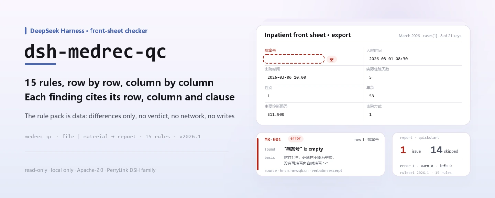
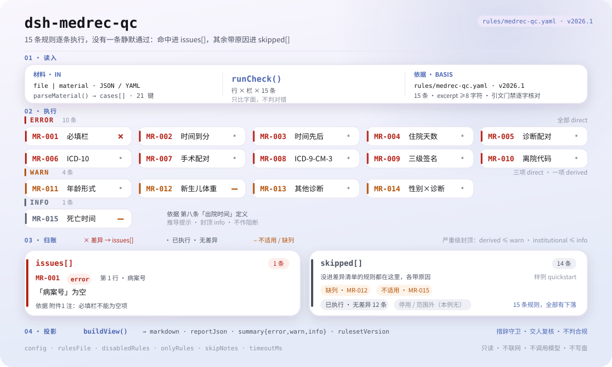

<div align="center">

<picture>
  <source media="(prefers-color-scheme: dark)" srcset="docs/assets/dsh-medrec-qc-hero-en-dark.webp">
  
</picture>

# dsh-medrec-qc

**इनपेशेंट मेडिकल रिकॉर्ड की फ़्रंट शीट के एक्सपोर्ट की जाँच करें और पंक्ति-दर-पंक्ति सूची पाएँ: कौन-सी पंक्ति, कौन-सा कॉलम, क्या अंतर है और कौन-सी धारा उसका आधार है।**

मेडिकल रिकॉर्ड विभाग और गुणवत्ता-नियंत्रण टीमों के लिए DeepSeek Harness चेकर: नियम पैक डेटा है, हर निष्कर्ष के साथ उसका उद्धरण आता है, और यह केवल अंतर गिनाता है — कभी फ़ैसला नहीं करता।

[इंस्टॉल](#तीन-चरणों-में-शुरुआत) · [कॉन्फ़िगरेशन](#कॉन्फ़िगरेशन) · [FAQ](#faq) · [简体中文](README.md) · [English](README.en.md) · [Español](README.es.md) · [Português](README.pt.md) · [हिन्दी](README.hi.md)

[](LICENSE)
[](#संगतता)
[](https://www.npmjs.com/package/dsh-medrec-qc)
[](https://github.com/PerryLink/dsh-medrec-qc/actions/workflows/ci.yml)
[](#संगतता)

[](https://github.com/PerryLink/dsh-medrec-qc/stargazers)
[](https://www.npmjs.com/package/dsh-medrec-qc)
[](https://dshfind.com/plugins/PerryLink/dsh-medrec-qc?ref=badge)
[](https://securityscorecards.dev/viewer/?uri=github.com/PerryLink/dsh-medrec-qc)
[](https://dsh.market/)
[](https://gitee.com/perrylink/dsh-medrec-qc)

```sh
dsh plugin --profile <name> add dsh-medrec-qc
```

</div>

<sub>समुदाय द्वारा बनाया गया प्लगइन, DeepSeek से संबद्ध नहीं। मुख्य रेपो: <https://github.com/PerryLink/dsh-medrec-qc> (Gitee एक मिरर है)।</sub>

## यह क्या है

`dsh-medrec-qc` इनपेशेंट मेडिकल रिकॉर्ड की फ़्रंट शीट के एक्सपोर्ट को पढ़ता है — हर डिस्चार्ज के लिए एक पंक्ति, कॉलम नाम राष्ट्रीय मूल्यांकन एक्सपोर्ट, स्वास्थ्य सांख्यिकी एक्सपोर्ट या अस्पताल की स्थानीय लिखावट में। यह उस एक्सपोर्ट को उसी के भीतर जाँचता है: फ़ॉर्म पूरा है या नहीं, भीतरी गणित सुसंगत है या नहीं, कोड उस रूप में लिखे गए हैं जो नियम पैक कहता है या नहीं — हर अनिवार्य कॉलम में सामग्री या स्वीकृत `-` चिह्न, भर्ती और छुट्टी के समय मौजूद, मिनट तक सटीक और उलटे नहीं, घोषित ठहराव दोनों तारीखों से मेल खाता, प्राथमिक निदान का नाम और कोड तथा प्राथमिक ऑपरेशन का नाम और कोड साथ भरे गए, तीन-स्तरीय चिकित्सक हस्ताक्षर ब्लॉक पूरा, छुट्टी का तरीका निर्धारित कोड में, आयु और नवजात भार निर्धारित रूप में, और अन्य निदानों की संख्या कॉन्फ़िगर की गई सीमा के भीतर।

जिन मामलों में मनुष्य का निर्णय चाहिए — दर्ज लिंग से असंगत निदान, मृत्यु-आधारित डिस्चार्ज में दो अलग समय — उन्हें केवल समीक्षा के लिए सामने रखा जाता है, तय कभी नहीं किया जाता।

यह फ़ाइल पढ़ता है और सूची देता है: कोई नेटवर्क नहीं, कोई मॉडल कॉल नहीं, कोई फ़ाइल लेखन नहीं; वही सामग्री जितनी बार चाहें जाँची जा सकती है, और नियम पैक बदलने से पूरा नियम-समूह बदल जाता है।

<picture>
  <source media="(prefers-color-scheme: dark)" srcset="docs/assets/dsh-medrec-qc-flow-v5-dark.svg">
  
</picture>

## तीन चरणों में शुरुआत

1. **इंस्टॉल करें** (npm पर प्रकाशित):

   ```sh
   # npm चैनल (प्रकाशित संस्करण)
   dsh plugin --profile web add dsh-medrec-qc
   # tarball चैनल: इस रेपो में pnpm pack के बाद
   dsh plugin --profile web add ./dsh-medrec-qc-<version>.tgz
   ```

   सोर्स चेकआउट से सीधे चलाने पर पहले `pnpm install && pnpm run build` चाहिए: प्रवेश बिंदु `main` बिल्ड आउटपुट `lib/index.mjs` की ओर इशारा करता है, सोर्स की ओर नहीं।

2. **न्यूनतम कॉन्फ़िगरेशन** (डिफ़ॉल्ट ही काफ़ी हैं; बंडल पैच केवल एक पंक्ति जोड़ता है):

   ```yaml
   - insert:
       - id: dsh-medrec-qc
         name: dsh-medrec-qc
   ```

3. **जाँचें कि माउंट हुआ**:

   ```sh
   dsh --profile web --dump-config | grep -A2 'id: dsh-medrec-qc'
   ```

   फिर साथ दिया नमूना चलाएँ; यह उसका वास्तविक आउटपुट है (`docs/assets/quickstart.log` में दर्ज):

   ```sh
   pnpm run build && node samples/quickstart/run.mjs
   ```

   ```
   $ node samples/quickstart/run.mjs
   medrec_qc: 1 issue(s) — error 1, warn 0, info 0
   skipped: 14
   ```

   सामग्री `samples/quickstart/input/MR-001-unsafe.yaml` में है, अपेक्षित सारांश `samples/quickstart/expected/result.json` में, और स्क्रीनशॉट [docs/assets/quickstart.png](docs/assets/quickstart.png) पर।

**अनइंस्टॉल**: `dsh plugin --profile web remove dsh-medrec-qc` (या प्रोफ़ाइल पैच से वह पंक्ति हटा दें)।

<details>
<summary>DSH Desktop मार्केट से इंस्टॉल करें</summary>

सभी PerryLink प्लगइन DSH Desktop के अंतर्निहित मार्केट में मिलते हैं: **मार्केट → स्रोत → स्रोत जोड़ें → चिपकाएँ** `https://perrylink-dsh-catalog.perrylink.workers.dev/catalog-source.json` **→ चुनें**। इंस्टॉल फिर भी मार्केट के npm पहचान सत्यापन और आपकी पुष्टि से गुज़रता है।

</details>

## मुख्य क्षमताएँ

- **एक आदेश, पूरा बैच** — `medrec_qc` टूल पंजीकृत करता है, जो `file` या `material` (JSON / YAML) लेता है और एक्सपोर्ट के सभी डिस्चार्ज मामलों की एक बार में जाँच करता है।
- **नियम पैक डेटा है, कोड नहीं** — 15 नियम `rules/medrec-qc.yaml` में हैं (पैक संस्करण `2026.1`); वह फ़ाइल बदलने से TypeScript छुए बिना नियम-समूह बदल जाता है।
- **हर अंतर का स्रोत मिलता है** — हर निष्कर्ष के साथ `document` / `number` / `clause` / `excerpt` / `source` आता है: कौन-सा दस्तावेज़, कौन-सी धारा, पाठ क्या कहता है और कहाँ से पढ़ा गया।
- **गंभीरता साक्ष्य के साथ चलती है** — जिस जाँच की धारा शब्दशः पढ़ी गई हो, केवल वही `error` हो सकती है; सिद्धांत से निकाली गई जाँच अधिकतम `warn`, और संस्थागत सीमा अधिकतम `info`। यह नियम पैक लोडर लागू करता है, लेखक पर भरोसा नहीं।
- **खाली परिणाम क्लीन चिट नहीं** — जो जाँच नहीं चल सकी वह कारण के साथ `skipped` में आती है (कॉलम अनुपस्थित, बैच में कोई ऑपरेशन रिकॉर्ड नहीं, कॉन्फ़िग से बंद), कभी चुपचाप पास नहीं।
- **अंतर, कभी फ़ैसला नहीं** — अनुपालन या उत्तरदायित्व का निर्णय नहीं, समीक्षक का विकल्प नहीं; हर रिपोर्ट में अस्वीकरण रहता है और शब्द-रक्षक निर्णायक भाषा रोकता है।
- **पूरी तरह स्थानीय** — कोई नेटवर्क नहीं, कोई मॉडल कॉल नहीं, कोई लेखन नहीं; सामग्री और रिपोर्ट आपकी मशीन और होस्ट के अपने सत्र रिकॉर्ड में रहते हैं।

### आउटपुट कैसा दिखता है

| फ़ील्ड | अर्थ |
|---|---|
| `summary` | `error` / `warn` / `info` की गिनती |
| `issueCount` / `skippedCount` | निष्कर्ष / वे जाँचें जो नहीं चल सकीं |
| `markdown` | मनुष्य के लिए पठनीय सूची (टूल यही प्रस्तुत करता है) |
| `reportJson` | वही रिपोर्ट JSON स्ट्रिंग के रूप में, आगे की प्रक्रिया के लिए |
| `rulesetVersion` | नियम पैक संस्करण, पुनरुत्पाद्य रिपोर्ट की शर्त |

### उदाहरण

**विस्तृत पड़ताल** — टूल `medrec_qc`.

**इनपुट**

~~~yaml
target: 2026 年 3 月出院病案首页导出
cases:
  - row: 1
    病案号: ""
    入院时间: "2026-03-01 08:30"
    出院时间: "2026-03-06 10:00"
~~~

**आउटपुट**

~~~json
{
  "id": "dsh-medrec-qc.MR-001.a58905f0",
  "ruleId": "MR-001",
  "severity": "error",
  "locator": {
    "row": 1,
    "column": "病案号"
  },
  "found": "「病案号」为空",
  "expected": "附件1 必填栏不能为空项，没有可填写内容时填写\"-\""
}
~~~

*Observed from `tests/fixtures/MR-001/MR-001-unsafe.yaml`*

नियम पैक कभी उद्धरण नहीं गढ़ता, इसलिए हर निष्कर्ष यह भी बताता है कि वह किस धारा से आया है और उस धारा का पाठ इस बार मिला या नहीं।

| आप पूछते हैं | यह क्या उत्तर देता है |
|---|---|
| कोई अनिवार्य कॉलम खाली है, पर मैंने उसमें `-` भर दिया। क्या वह रिपोर्ट होगा? | नहीं। `MR-001` अकेले `-` को «यहाँ दर्ज करने को कुछ नहीं» का चिह्न मानता है और केवल वास्तव में खाली कॉलम बताता है। यह जाँचता है कि अनिवार्य कॉलम में सामग्री है या नहीं, यह नहीं कि सामग्री सही है या नहीं। यह `error` है क्योंकि दस्तावेज़ 24/2016 के परिशिष्ट 1 के अंत की टिप्पणी **2026-10-13 को शब्दशः पढ़ी गई**। वही `-` `MR-009` में हस्ताक्षर अनुपस्थित ही गिना जाता है। |
| भर्ती का समय केवल तारीख तक लिखा है, घंटा-मिनट नहीं, और एक पंक्ति में छुट्टी का समय भर्ती से पहले है। | `MR-002` उस भर्ती या छुट्टी मान को बताता है जो केवल दिन तक पढ़ा जा सकता है (दर्ज समय मिनट तक सटीक होना चाहिए), और ऐसे मान को भी जो तारीख-समय के रूप में पढ़ा ही न जाए। `MR-003` दोनों फ़ील्ड के शाब्दिक क्रम की तुलना करता है और वह पंक्ति बताता है जहाँ छुट्टी पहले आती है। दोनों शाब्दिक मानों पर काम करते हैं और कोई भी यह तय नहीं करता कि सच्चा समय कौन-सा है। |
| फ़्रंट शीट में `5` दिन लिखा है, पर तारीखें 12 जून भर्ती और 15 जून छुट्टी हैं। | `MR-004` दिनों को छुट्टी की तारीख घटा भर्ती की तारीख से फिर गिनता है और वह पंक्ति बताता है जहाँ घोषित ठहराव मेल नहीं खाता; उसी दिन भर्ती और छुट्टी `0` दिन गिनी जाती है, और पूर्ण दिनों में न होने वाला मान भी रिपोर्ट होता है। यह केवल तीनों दर्ज मानों की तुलना करता है और तय नहीं करता कि उनमें से कौन ग़लत है। |
| प्राथमिक निदान का नाम भरा है पर कोड खाली है, और दूसरी पंक्ति में कोड किसी अजीब रूप में है। | `MR-005` दोनों को साथ भरने की माँग करता है और बताता है कि कौन-सा छूटा; यह केवल यह जाँचता है कि दोनों मौजूद हैं, यह नहीं कि कोड निदान से मेल खाता है। फिर `MR-006` कोड को पैक में कॉन्फ़िगर लिखित रूप से मिलाता है, और यह सत्यापित नहीं करता कि कोड वर्गीकरण निर्देशिका के किसी संस्करण में मौजूद है। |
| किसी बैच में कोई ऑपरेशन रिकॉर्ड ही नहीं है। क्या ऑपरेशन के नियम चुपचाप पास हो जाएँगे? | नहीं। `MR-007` स्वयं को `skipped` में इस कारण के साथ बताता है कि सामग्री में कोई ऑपरेशन रिकॉर्ड नहीं है और जोड़ी-जाँच लागू नहीं होती, बजाय चुपचाप पास होने के। जब किसी पंक्ति में ऑपरेशन दर्ज है, तो नियम प्राथमिक ऑपरेशन का नाम और कोड साथ भरने की माँग करता है, और `MR-008` केवल ऑपरेशन कोड का लिखित रूप जाँचता है। |
| किसी पुरुष रोगी का प्राथमिक निदान गर्भावस्था से जुड़ी स्थिति है। क्या यह एक्सपोर्ट रोक देगा? | `MR-014` इसे `warn` स्तर का अंतर बताकर मनुष्य की पुष्टि के लिए रखता है, कभी रोकता नहीं: स्वास्थ्य पक्ष के दस्तावेज़ों में ऐसी कोई धारा नहीं जो निदान को दर्ज लिंग से असंगत ठहराए, और उस बीमा नियम-प्रकार का प्रकाशित विवरण गर्भावस्था, प्रसव और प्रसवोत्तर अध्याय को सम्मिलित नहीं करता तथा नैदानिक अपवादों की अनुमति देता है। चिकित्सक से पुष्टि करें कि लिंग ग़लत है या निदान। |

### सामग्री का प्रारूप

`cases` सूची (सादी सूची भी स्वीकार्य)। फ़ील्ड नाम साझा शब्दकोश से हल होते हैं, इसलिए राष्ट्रीय मूल्यांकन, स्वास्थ्य सांख्यिकी और अस्पताल-स्थानीय लिखावट उन विहित कुंजियों पर पहुँच जाती हैं जिन्हें नियम पढ़ते हैं।

~~~yaml
cases:
  - row: 1
    病案号: "A2026030001"
    入院时间: "2026-03-01 08:30"
    出院时间: "2026-03-06 10:00"
    实际住院天数: "5"
    性别: "1"
    出生日期: "1972-05-04"
    年龄: "53"
    离院方式: "1"
    科主任: "赵主任"
    主任医师: "钱主任医师"
    主治医师: "孙主治"
    住院医师: "李医师"
    责任护士: "周护士"
    编码员: "吴编码"
    主要诊断名称: "2型糖尿病"
    主要诊断编码: "E11.900"
    其他诊断: "高血压;慢性肾功能不全"
    主要手术名称: "腹腔镜胆囊切除术"
    主要手术编码: "51.2300"
    有手术操作: "1"
~~~

`MEDICAL_RECORD_NO`, `ADMISSION_TIME`, `DISCHARGE_TIME`, `MAIN_DIAGNOSIS_CODE` जैसे अंग्रेज़ी हेडर भी स्वीकार्य हैं, इसलिए जो अस्पताल पहले से ASCII हेडर निर्यात करता है उसे रूपांतरण की ज़रूरत नहीं। जिस कॉलम को शब्दकोश मैप नहीं कर पाता, उसका अनुमान कभी नहीं लगाया जाता: वह `warnings` और `unknownColumns` में आता है, क्योंकि बिना मैप हुआ कॉलम ही वह तरीका है जिससे कोई जाँच चुपचाप गायब हो जाती है।

## नियम और स्रोत

### 15 नियम

| नियम | जाँच | गंभीरता |
|---|---|---|
| `MR-001` | कोई अनिवार्य कॉलम खाली न हो (अकेला `-` स्वीकृत चिह्न है) | error |
| `MR-002` | भर्ती और छुट्टी के समय मौजूद और मिनट तक सटीक | error |
| `MR-003` | छुट्टी का समय भर्ती से पहले न हो | error |
| `MR-004` | दर्ज ठहराव दोनों तारीखों से मेल खाए | error |
| `MR-005` | प्राथमिक निदान का नाम और कोड साथ भरे जाएँ | error |
| `MR-006` | प्राथमिक निदान कोड का रूप ICD-10 हो | error |
| `MR-007` | ऑपरेशन हो तो उसका नाम और कोड साथ भरे जाएँ | error |
| `MR-008` | प्राथमिक ऑपरेशन कोड का रूप ICD-9-CM-3 हो | error |
| `MR-009` | हस्ताक्षर ब्लॉक तीन-स्तरीय चिकित्सक उत्तरदायित्व दर्शाए | error |
| `MR-010` | छुट्टी का तरीका निर्धारित कोड में से हो | error |
| `MR-011` | आयु पूर्ण वर्षों या `N M/30 月` माह-भिन्न में हो | warn |
| `MR-012` | नवजात भार 10 ग्राम के गुणक तक दर्ज हो | warn |
| `MR-013` | अन्य निदानों की संख्या कॉन्फ़िगर सीमा के भीतर हो | warn |
| `MR-014` | दर्ज लिंग से न मेल खाता निदान मनुष्य की समीक्षा चाहता है | warn |
| `MR-015` | मृत्यु-आधारित डिस्चार्ज में छुट्टी का समय मृत्यु का समय हो | info |

### जिन मानकों पर ये टिके हैं

| दस्तावेज़ | संख्या | इन्हें उद्धृत करने वाले नियम |
|---|---|---|
| फ़्रंट शीट डेटा के गुणवत्ता-नियंत्रण संकेतक (2016 संस्करण) | NHC Doc. 24/2016 | MR-001 |
| फ़्रंट शीट भरने की गुणवत्ता के अस्थायी नियम | NHC Doc. 24/2016 | MR-002, MR-003, MR-005, MR-006, MR-007, MR-008, MR-013, MR-015 |
| इनपेशेंट मेडिकल रिकॉर्ड फ़्रंट शीट के संशोधन पर सूचना | MOH Doc. 84/2011 | MR-004, MR-009, MR-010, MR-011, MR-012 |
| NHSA «दोहरे भंडार» का ज्ञान-बिंदु (निदान रोगी के लिंग से मेल न खाए) | NHSA घोषणा (21वाँ बैच) | MR-014 |

**सीमा:** यह प्लगइन **इनपेशेंट मेडिकल रिकॉर्ड की फ़्रंट शीट** — वह एक पृष्ठ का डिस्चार्ज सार जिसे कोडर और राष्ट्रीय मूल्यांकन प्रणाली पढ़ते हैं — की फ़ॉर्म पूर्णता, भीतरी विरोधाभास और कोडिंग रूप जाँचता है। यह `dsh-nurse-record-check` नहीं है (वह नर्सिंग दस्तावेज़ की समयबद्धता जाँचता है), `dsh-icd-rule-check` नहीं है (वह ICD कोडिंग नियम और कटार/तारा जोड़ी जाँचता है), और यह नहीं आँकता कि कोई निदान नैदानिक रूप से सही था या नहीं। यह फ़्रंट शीट के एक्सपोर्ट को पढ़ता है और उद्धृत धाराओं के सामने शाब्दिक असंगतियाँ बताता है।

### `MR-001` फिर से `error` क्यों है (2026-10-13)

<details>
<summary>खोलें: अवनयन, साक्ष्य और सुधार</summary>

**यहाँ हर `error` नियम दो बातों पर टिका है: एक दस्तावेज़ जो आवश्यकता रखता है, और उस धारा का शब्दशः पढ़ा गया पाठ।** दस्तावेज़ 24/2016 (पूरा प्राप्त) और दस्तावेज़ 84/2011 (पूरा प्राप्त, तीनों परिशिष्टों सहित) दूसरी बात पूरी करते हैं। `MR-001` लंबे समय का अपवाद था: उसका एकमात्र आधार **परिशिष्ट 1 के अंत की टिप्पणी** है, और वह परिशिष्ट एक ऐसी PDF के रूप में दर्ज था जिसे यह वातावरण डिकोड नहीं कर सकता था, इसलिए नियम **2026-10-07 को `warn` कर दिया गया** उसी अनुशासन के तहत: जो धारा पढ़ी न जा सके वह रोक का आधार नहीं बन सकती।

**उस परिशिष्ट में पाठ-परत है।** उसे 2026-10-13 को शब्दशः पढ़ा गया: 328 पृष्ठ, 205,847 निकाले जा सकने वाले अक्षर, **कोई OCR नहीं**। टिप्पणी है:

```text
注：必填栏不能为空项，没有可填写内容时填写“-”
```

यह नियम के `excerpt` से बिल्कुल मेल खाती है, सिवाय इसके कि PDF में घुमावदार उद्धरण-चिह्न हैं जहाँ नियम सीधे चिह्न प्रयोग करता है — यह लिपि-भेद छुपाया नहीं, दर्ज किया गया (उद्धरण-द्वार दोनों रूप हटा देता है, इसलिए खंड मेल खाता है)। **इसलिए नियम साक्ष्य के आधार पर `error` पर लौट आया।**

⚠️ **स्रोत का स्तर, स्पष्ट शब्दों में**: `www.nhc.gov.cn` स्वचालित अनुरोधों को **HTTP 412** लौटाता है (2026-10-13 को मापा; साइट रूट भी 412 देता है)। पाठ **हेनान प्रांतीय मेडिकल रिकॉर्ड गुणवत्ता-नियंत्रण केंद्र** के संकलन से पढ़ा गया — वही URL जो इस नियम का `source` हमेशा से ले जाता रहा है। यह उसी स्तर का है जो बाकी चौदह नियमों के प्रांतीय या विश्वविद्यालय पुनर्मुद्रण हैं, इसलिए **यह इस नियम को अलग तरह से देखने का कारण नहीं**। पूरा प्रयास-लॉग `rules/evidence/clause-verification-homepage-attachment1.md` में और वर्गीकरण `rules/evidence/authority-class-audit.md` में है।

</details>

### नियमों के स्रोत और सत्यापन

नियम-डेटा `rules/medrec-qc.yaml` में रहता है। हर नियम में दस्तावेज़, दस्तावेज़-संख्या, स्रोत की अपनी क्रम-संख्या में धारा, शब्दशः उद्धरण और वह URL होता है जहाँ से उद्धरण पढ़ा गया। लोडर अनिवार्य करता है कि उद्धरण कम से कम आठ अक्षरों का वास्तविक अवतरण हो, और जिस जाँच का आधार केवल सामान्य सिद्धांत (`kind: derived-from-principle`, अधिकतम `warn`) या स्थानीय नीति (`kind: institutional-configuration`, अधिकतम `info`) हो, उसे कभी `error` घोषित न किया जाए। अपने आधार को बढ़ा-चढ़ाकर बताने वाला पैक लोड होते ही विफल होता है, आत्मविश्वास से भरी रिपोर्ट नहीं देता।

धारा-संख्याएँ इनके पूर्ण पाठों से मिलाई गईं: फ़्रंट शीट भरने की गुणवत्ता के अस्थायी नियम, 2016 के गुणवत्ता-नियंत्रण संकेतक (NHC Doc. 24/2016), फ़्रंट शीट संशोधन सूचना के परिशिष्ट (MOH Doc. 84/2011), 2013 के मेडिकल रिकॉर्ड प्रबंधन प्रावधान (NHC Doc. 31/2013) और चिकित्सा-बीमा निपटान-सूची भरने के नियम (NHSA Doc. 20/2020)। चार निष्कर्षों ने इस पैक को आकार दिया, और वे यहाँ दर्ज हैं ताकि समीक्षक देख सके कि जानबूझकर **क्या दावा नहीं** किया गया:

1. **अनिवार्य-फ़ील्ड सूची परिशिष्ट 1 है, और उसमें «चिकित्सक हस्ताक्षर» नाम का कोई कॉलम नहीं।** परिशिष्ट 1 की 76 अनिवार्य मदों की सूची हस्ताक्षर ब्लॉक को विभाग प्रमुख / प्रमुख (उप-प्रमुख) चिकित्सक / सहायक चिकित्सक / रेज़िडेंट चिकित्सक में बाँटती है। इसलिए `MR-009` उन विशिष्ट कॉलमों से बँधता है और तीन-स्तरीय उत्तरदायित्व की माँग के लिए दस्तावेज़ 84/2011 के परिशिष्ट 2 (28) 1 का उद्धरण देता है, न कि «दस्तावेज़ 24/2016 चिकित्सक हस्ताक्षर माँगता है» लिखता है।
2. **आयु का प्रारूप दस्तावेज़ 84/2011 में है, 2010 के रिकॉर्ड-लेखन मानक में नहीं।** एक वर्ष से कम आयु के लिए `N M/30 月` का नियम MOH Doc. 84/2011 के परिशिष्ट 2 (6) में है; दस्तावेज़ 11/2010 आयु का उल्लेख केवल भर्ती-टिप्पणी के फ़ील्ड के रूप में करता है। `MR-011` दस्तावेज़ 84/2011 का उद्धरण देता है और «एक माह से कम पर दिन-आयु लिखें» जैसा नियम **नहीं** जाँचता, क्योंकि कोई राष्ट्रीय दस्तावेज़ ऐसा नहीं कहता — और NHSA Doc. 20/2020 बीमा चैनल के लिए अलग नियम (पूर्ण दिन-आयु) देता है, इसलिए दोनों को परस्पर-अनन्य नहीं बनाया गया।
3. **«पुरुष रोगी का गर्भावस्था निदान नहीं हो सकता» राष्ट्रीय धारा नहीं है।** राष्ट्रीय चिकित्सा बीमा प्रशासन «निदान रोगी के लिंग से मेल न खाए» नाम का नियम-प्रकार प्रकाशित करता है, पर जारी विवरण ग्यारह ICD-10 अध्यायों (A/B/C/D/E/F/I/J/K/L/M) को कवर करता है और उसमें **O अध्याय की एक भी प्रविष्टि नहीं**; साथ की प्रेस-ब्रीफ़िंग नैदानिक अपवादों की स्पष्ट अनुमति देती है। इसलिए `MR-014` मनुष्य की समीक्षा के लिए `warn` स्तर का संकेत है, कभी रोक नहीं।
4. **मृत्यु-आधारित डिस्चार्ज को मृत्यु-समय से बाँधने वाली कोई स्वतंत्र धारा नहीं।** दस्तावेज़ 24/2016 का अनुच्छेद 8 केवल मृत रोगियों के लिए छुट्टी के समय को मृत्यु का समय परिभाषित करता है। `MR-015` उसी परिभाषा पर टिका है, `info` तक सीमित है, और अपने `note` में यह कहता है।

## कॉन्फ़िगरेशन

हर समायोज्य वस्तु `src/config.ts` के Schemastery स्कीमा में है, इसलिए कोड बदले बिना `cordis.yml` से बदली जा सकती है। प्रति-नियम फ़ील्ड सूचियाँ और सीमाएँ `rules/medrec-qc.yaml` में हैं।

| कुंजी | प्रकार | डिफ़ॉल्ट | विवरण |
|---|---|---|---|
| `rulesFile` | string | `rules/medrec-qc.yaml` | पैक रूट के सापेक्ष नियम पैक पथ; वह फ़ाइल बदलने से नियम-समूह संस्करण बदल जाता है |
| `disabledRules` | string[] | `[]` | जिन नियम ids को चलाना बंद करना है; हर एक `skipped` में आता है |
| `onlyRules` | string[] | `[]` | केवल ये नियम ids चलाएँ; खाली का अर्थ सभी नियम |
| `skipNotes` | string | `""` | हर `skipped` कारण के आगे जोड़ी जाने वाली टिप्पणी, जैसे आपकी संस्था के नियम |
| `timeoutMs` | number | `120000` | टूल का सहकारी टाइमआउट बजट, मिलीसेकंड में |

प्रति-नियम कुछ जानने योग्य पैरामीटर:

- `MR-001` `fields` — अनिवार्य कॉलमों की सूची, दस्तावेज़ 24/2016 के परिशिष्ट 1 से। अपने अनिवार्य कॉलम पैक में जोड़ें, कोड छुए बिना।
- `MR-011` `underOnePattern` / `adultPattern` — स्वीकृत आयु-लिखावटें।
- `MR-013` `maxChecked` — अन्य निदानों की वह संख्या जिसके ऊपर क्रम की समीक्षा का संकेत दिया जाता है।
- `MR-014` `rules` — लिंग बनाम निदान की शब्द-सूचियाँ, `{ sex, label, pattern }` रूप में।

प्रोफ़ाइल पैच में ओवरराइड का उदाहरण:

~~~yaml
- insert:
    - id: dsh-medrec-qc
      name: dsh-medrec-qc
      config:
        disabledRules: [MR-012]
        onlyRules: []
        skipNotes: 本机构实施细则 2026 版
        timeoutMs: 120000
~~~

## FAQ

<details>
<summary>क्या सामग्री कहीं अपलोड या भेजी जाती है? डेटा कहाँ रहता है?</summary>

नहीं। यह केवल वह दस्तावेज़-सामग्री पढ़ता है जो आप टूल को देते हैं: कोई नेटवर्क नहीं, कोई टेलीमेट्री नहीं, कोई लेखन नहीं, कोई अपलोड नहीं। टूल परिणाम और DSH होस्ट के अपने सत्र/लॉग भंडारण के अलावा यह पैक कुछ नहीं रखता; वह भंडारण होस्ट के नियंत्रण में है, वही उसकी अवधि तय करता है, और यह पैक कभी दूसरी प्रति नहीं जोड़ता। देखें [PRIVACY.md](PRIVACY.md)।

</details>

<details>
<summary>«0 अंतर» का अर्थ «कुछ भी ग़लत नहीं» है क्या? और अगर कोई नियम नहीं चला?</summary>

«0 अंतर» का अर्थ केवल यह है कि **जो जाँचें चलीं उन्हें कोई शाब्दिक अंतर नहीं मिला**; यह क्लीन चिट नहीं है। जो भी जाँच नहीं चल सकी वह कारण के साथ `skipped` में आती है (कॉलम अनुपस्थित, बैच में कोई ऑपरेशन रिकॉर्ड नहीं, `disabledRules` से बंद), इसलिए खाली परिणाम को «कुछ भी ग़लत नहीं» नहीं पढ़ना चाहिए। अगर टूल बिल्कुल दिखे ही नहीं, तो पुष्टि करें कि `main` `lib/index.mjs` पर हल होता है: सोर्स चेकआउट में पहले `pnpm run build` चाहिए, जबकि प्रकाशित tarball में बिल्ड आउटपुट पहले से है।

</details>

<details>
<summary>क्या यह अनुपालन पर फ़ैसला देगा या सबमिशन रोकेगा?</summary>

नहीं। यह अनुपालन, उत्तरदायित्व या नैदानिक सत्यता पर निर्णय नहीं देता, और कभी कोई कार्यप्रवाह नहीं रोकता; हर रिपोर्ट में अस्वीकरण रहता है और शब्द-रक्षक निर्णायक भाषा रोकता है। आपको मनुष्य की समीक्षा के लिए अंतर-सूची मिलती है: कौन-सी पंक्ति, कौन-सा कॉलम, क्या अंतर है और किस धारा पर टिका है।

</details>

<details>
<summary>अगर इंस्टॉल असंगति कहकर पैकेज न ले? और `check` में `manifest-peers` विफल हो तो?</summary>

पीयर-रेंज `0.1.x` और `0.2.x` दोनों पंक्तियों को कवर करती है। यदि आपका रनटाइम उससे बाहर है, तो स्पष्ट छूट दें: `dsh plugin --profile <name> allow-version dsh-medrec-qc@0.2.13 --dsh-version <runtime> --accept-risk`। `check` में `manifest-peers` विफल होना `dsh-plugin-dev` की ज्ञात अपस्ट्रीम समस्या है: स्थिर चेकर 0.2 पंक्ति से पुरानी कठोर-कोडित रेंज से तुलना करता है, जबकि इंस्टॉल-समय की जाँच रनटाइम का उपयोग करती है। अधिक [TROUBLESHOOTING.md](TROUBLESHOOTING.md) में।

</details>

<details>
<summary>क्या यह `dsh-nurse-record-check` या `dsh-icd-rule-check` से टकराता है?</summary>

नहीं, और काम का बँटवारा भी अलग है। यह प्लगइन **फ़्रंट शीट के एक्सपोर्ट** की फ़ॉर्म पूर्णता, भीतरी गणित और कोडिंग रूप जाँचता है; `dsh-nurse-record-check` नर्सिंग दस्तावेज़ की समयबद्धता जाँचता है और `dsh-icd-rule-check` ICD कोडिंग नियम तथा कटार/तारा जोड़ी। ये एक ही प्रोफ़ाइल में साथ रह सकते हैं: यह प्लगइन एक टूल पंजीकृत करता है, कोई सेवा-कुंजी नहीं देता, कोई क्लाइंट स्लॉट या HTTP रूट पंजीकृत नहीं करता, और केवल वही सामग्री पढ़ता है जो आप देते हैं, मूल को बदले बिना।

</details>

## सुरक्षा सीमाएँ

- **पूरी तरह स्थानीय, कोई बाहरी सतह नहीं।** कोई नेटवर्क अनुरोध नहीं, कोई मॉडल कॉल नहीं, कोई टेलीमेट्री नहीं; `package.json#dsh.demo` इसी कारण `network: false`, `writes: []` और `external: []` घोषित करता है।
- **अपर्याप्त साक्ष्य वाला नियम कभी `error` नहीं हो सकता।** पैक लोडर माँग करता है कि `excerpt` कम से कम आठ अक्षरों का शब्दशः अवतरण हो, और `kind` के अनुसार गंभीरता सीमित करता है: `derived-from-principle` अधिकतम `warn`, `institutional-configuration` अधिकतम `info`। अलग उद्धरण-द्वार जाँचता है कि हर उद्धरण `rules/evidence/` रिकॉर्ड में खोजा जा सके।
- **अंतर, फ़ैसला नहीं।** रिपोर्ट में अनुपालन, उल्लंघन, उत्तरदायित्व या सत्यता के दावे नहीं होते; प्रस्तुति के समय शब्द-रक्षक इसे लागू करता है।
- **खाली परिणाम निर्दोषता नहीं।** जो जाँच नहीं चल सकी उसे कारण के साथ `skipped` में आना ही चाहिए; जब किसी नियम की आवश्यक सूची कॉन्फ़िगर न हो, वह नियम स्वयं को अन-रन बताता है, डिफ़ॉल्ट पास नहीं।
- **पंजीकरण इफ़ेक्ट हैं।** टूल `ctx.tools.register` से पंजीकृत होता है और उसका disposer लौटाया जाता है, इसलिए प्लगइन रोकने या हॉट-रीलोड करने पर वह बिना लटके पंजीकरण के हट जाता है।
- **कोई लेखन नहीं।** टूल परिणाम और होस्ट के अपने सत्र भंडारण के अलावा यह पैक कोई फ़ाइल न बनाता है न बदलता है।

## अनुमतियाँ और डेटा

- **अनुमतियाँ**: यह केवल वह सामग्री पढ़ता है जो कॉलर देता है (`file` पथ या इनलाइन `material`); कोई सेवा-कुंजी नहीं देता और कोई क्लाइंट स्लॉट या HTTP रूट पंजीकृत नहीं करता। `package.json#dsh.capabilities` केवल `tools:register` घोषित करता है।
- **डेटा**: सामग्री इसी प्रक्रिया के भीतर तुलना में भाग लेती है; प्लगइन कोई प्रति, कैश या फ़ाइल नहीं रखता। होस्ट टूल परिणाम को कैसे दर्ज करता है यह होस्ट का विषय है, और यह पैक दूसरी प्रति नहीं जोड़ता।
- **निर्भरताएँ**: रनटाइम पर शून्य निर्भरताएँ (`dependencies` खाली है); पीयर Cordis, `dsh-tools` और Schemastery हैं, जो सब होस्ट में पहले से मौजूद हैं।

## ज्ञात सीमाएँ

- **केवल शाब्दिक अंतर।** यह नहीं तय करता कि दो टकराते मानों में सच्चा कौन है, नैदानिक सत्यता नहीं आँकता, और समीक्षक की जगह निर्णय नहीं देता; जब दो फ़ील्ड असहमत हों, वह असहमति ही बताता है।
- **कोड केवल रूप में जाँचे जाते हैं।** `MR-006` / `MR-008` ICD-10 और ICD-9-CM-3 का लिखित रूप पैक से मिलाते हैं और **यह सत्यापित नहीं करते** कि कोई कोड वर्गीकरण निर्देशिका के किसी संस्करण में मौजूद है, न ही यह कि निर्देशिका का संस्करण मेल खाता है।
- **फ़ील्ड शब्दकोश जानबूझकर रूढ़िवादी है।** जो कॉलम मैप न हो वह `warnings` और `unknownColumns` में आता है; पाठक अनुमान लगाने से इंकार करता है। स्थानीय कॉलम नाम समर्थित करने के लिए `src/parse.ts` में `CASE_FIELDS` या नियम पैक की फ़ील्ड-सूची बढ़ाएँ।
- **15 नियम फ़्रंट शीट की पूरी अनुपालन-जाँच नहीं हैं।** ये उन रूप और गणित की समस्याओं को कवर करते हैं जिन्हें किसी धारा से जोड़ा जा सके; कमज़ोर साक्ष्य वाली जाँचें जानबूझकर `warn` / `info` तक सीमित हैं, और शेष दायरे से बाहर।
- **स्रोत का स्तर सीमित है।** `www.nhc.gov.cn` स्वचालित अनुरोधों को HTTP 412 लौटाता है (2026-10-13 को मापा), इसलिए कुछ प्रावधान प्रांतीय या विश्वविद्यालय पुनर्मुद्रणों से पढ़े गए; साक्ष्य-रिकॉर्ड `rules/evidence/` में है। यह घोषित स्तर है, पुनर्मुद्रण को मूल मानने का लाइसेंस नहीं।
- **विकास-रूप में बिल्ड चाहिए।** सोर्स चेकआउट में `main` `lib/index.mjs` की ओर इशारा करता है, इसलिए पहले `pnpm run build` चलाना होगा; प्रकाशित npm tarball में `lib/` पहले से है और इंस्टॉल पर चलता है।
- **समय वॉल-क्लॉक है।** सारी तारीख-समय गणना इनपुट स्ट्रिंग्स पर वॉल-क्लॉक मान के रूप में होती है, कोई टाइमज़ोन रूपांतरण नहीं; इनपुट का ऑफ़सेट तुलना में कभी नहीं आता।
- **स्थिर चेकर का ज्ञात झूठा अलार्म।** `check` का `manifest-peers` 0.2 पंक्ति से पुरानी कठोर-कोडित पीयर रेंज से तुलना करता है, जो इंस्टॉल-समय की रनटाइम जाँच से मेल नहीं खाता।

## अन्य DSH प्लगइनों के साथ इंटरऑपरेबिलिटी

यह प्लगइन उसी प्रोफ़ाइल के दूसरे प्लगइनों में **हस्तक्षेप नहीं करता**:

- **ठीक एक टूल जोड़ता है।** केवल `medrec_qc`, `ctx.tools.register` से पंजीकृत और उसका disposer लौटाया गया; किसी अंतर्निहित टूल या दूसरे प्लगइन का सादा नाम नहीं लेता, और अनलोड पर हट जाता है।
- **कोई सेवा-कुंजी नहीं देता।** `inject` केवल `['tools']` है, और कोई Cordis सेवा-कुंजी पंजीकृत नहीं होती, इसलिए सेवा-कुंजी टकराव का प्रश्न ही नहीं।
- **न स्लॉट, न रूट।** पैक में ब्राउज़र-आधा नहीं है (कोई `client/` नहीं), कोई क्लाइंट स्लॉट कुंजी या `webServer` उपसर्ग पंजीकृत नहीं।
- **पैच परत केवल अपनी पंक्ति जोड़ती है।** `cordis.patch.yml` एक `id: dsh-medrec-qc` पंक्ति जोड़ता है और कभी अंतर्निहित या दूसरे प्लगइन की `config` को अधिलेखित नहीं करता।
- **कोई वैश्विक परिवर्तन नहीं।** न प्रोटोटाइप बदलता है, न `process.env` लिखता है, न वैश्विक fetch बदलता है।
- **सहोदर चेकर प्रतिस्पर्धा नहीं, काम बाँटते हैं।** वही सामग्री `dsh-medrec-qc` (फ़्रंट शीट का रूप और तार्किक विरोधाभास), `dsh-nurse-record-check` (नर्सिंग दस्तावेज़ की समयबद्धता) और `dsh-icd-rule-check` (ICD कोडिंग नियम और कटार/तारा जोड़ी) को दी जा सकती है; हर एक फ़ाइल पढ़ता है, अपनी रिपोर्ट लिखता है, मूल को अछूता छोड़ता है और कोई स्थिति साझा नहीं करता।

## संगतता

| सतह | स्थिति |
|---|---|
| Harness | पीयर रेंज `>=0.1.2-rc.1 <0.2.0 \|\| >=0.2.0-0 <0.3.0`, `0.2.0-rc.2` और `0.2.1-rc.2` दोनों को स्वीकारते हुए मापी गई; `engines.dsh` `>=0.2.1-0 <0.3.0` घोषित करता है और 0.2.1 से होस्ट इसे लागू करता है |
| Node | `^22.19.0 \|\| >=24.0.0` |
| प्लेटफ़ॉर्म | सभी (शुद्ध ESM; कोई नेटिव कोड नहीं, कोई नेटवर्क नहीं, कोई मॉडल कॉल नहीं) |
| टूल मोड | `native` और `ptc` दोनों में चलता है; पूरे महीने के डिस्चार्ज के लिए `ptc` उपयोग करें, स्कीमा लागत एक बार चुकाई जाती है |
| सामग्री | JSON / YAML; `cases` सूची या सादी सूची |

## इकोसिस्टम और गुणवत्ता

- [Gitee मिरर](https://gitee.com/perrylink/dsh-medrec-qc) (समकालिक मिरर; GitHub मुख्य है)
- [dshfind प्लगइन पृष्ठ](https://dshfind.com/plugins/PerryLink/dsh-medrec-qc) (इंस्टॉल और रैंकिंग)
- [OpenSSF Scorecard रिपोर्ट](https://securityscorecards.dev/viewer/?uri=github.com/PerryLink/dsh-medrec-qc) ([.github/workflows/scorecard.yml](.github/workflows/scorecard.yml) से संचालित)
- [DSH Market](https://dsh.market/) (सूचीबद्ध)
- **1024 स्टोर चैनल**: एक बार `npm i -g dsh1024`, फिर `dsh1024 plugin --profile web add dsh-medrec-qc` ([deepseek1024.com](https://deepseek1024.com) की इंस्टॉल रैंकिंग में गिना जाता है)
- [इकोसिस्टम ज्ञान-आधार](https://perrylink.github.io/dsh-plugin-guide/) — मापा गया डेटा, विपणन नहीं: प्लगइन विकास गाइड · चयन-डेटा · रखरखाव के मानदंड

## डेवलपमेंट

```sh
pnpm install
pnpm run typecheck          # tsc --noEmit
pnpm test                   # vitest, प्रति नियम एक अनुरूप/उल्लंघन फ़िक्सचर जोड़ी
pnpm run build              # tsdown -> lib/index.mjs + lib/index.d.mts
pnpm run check:readmes      # पाँच भाषाओं के README की सुसंगति
pnpm run check:citations    # हर उद्धरण rules/evidence/ में खोजा जा सके
pnpm run verify:self-contained
pnpm run check:lockfile
pnpm pack                   # प्रकाशित tarball
node samples/quickstart/run.mjs   # बिल्ड के बाद
```

संरचना:

| पथ | भूमिका |
|---|---|
| `src/index.ts` | फ़ंक्शन-प्लगइन प्रवेश: `name` / `inject` / `Config` / `apply`, `medrec_qc` पंजीकृत करता है और नियम पैक हल करता है |
| `src/config.ts` | Schemastery स्कीमा; हर समायोज्य वस्तु यहीं |
| `src/check.ts` | शुद्ध जाँच-कोर, `(input, ruleset, options) => Report`; कोई प्लगइन संदर्भ नहीं, कोई I/O नहीं, कोई घड़ी नहीं, कोई मॉडल नहीं |
| `src/parse.ts` | सामग्री पाठक (JSON / YAML) और कॉलम शब्दकोश |
| `src/view.ts` | रिपोर्ट का मॉडल-उन्मुख प्रक्षेपण; `output.schema` उसी का प्रतिबिंब |
| `src/shared/` | साझा किट (नियम-लोडर, रिपोर्ट आकार, YAML उपसमुच्चय, कैलेंडर गणित, शब्द-रक्षक, तालिका सहायक), अंदर प्रतिलिपि, बाहरी आयात नहीं |
| `rules/medrec-qc.yaml` | नियम पैक, 15 नियम; `rules/evidence/` दर्ज करता है कि हर उद्धरण कैसे मिला |
| `tests/` | vitest; प्रति नियम एक अनुरूप/उल्लंघन फ़िक्सचर जोड़ी |

Topics: `dsh`, `dsh-plugin`, `deepseek-harness`, `deepseek`, `cordis`, `medrec`

README की तस्वीरें [`scripts/gen-readme-assets.py`](scripts/gen-readme-assets.py) से क्रमादेशित रूप से बनती हैं — hero बैनर Pillow से और संरचना-चित्र हाथ से लिखे SVG से — दोबारा चलाना सुरक्षित है; पुराना एक-संस्करण `dsh-medrec-qc-flow.svg` और टर्मिनल कैप्चर मौजूदा लिंक के लिए `docs/assets/` में रखे गए हैं, जबकि README केवल नए hero (चार फ़ाइलें, zh/en × हल्का/गहरा) और flow-v5 चित्र (हल्का और गहरा) का संदर्भ देते हैं।

## परिवार और आभार

यह परियोजना [PerryLink](https://github.com/PerryLink) द्वारा अनुरक्षित DeepSeek Harness प्लगइन परिवार का हिस्सा है (सभी Apache-2.0)। अगर यह उपयोगी हो, तो **एक स्टार अगली व्यक्ति को इसे खोजने में मदद करता है** — इससे कोई सुविधा अनलॉक नहीं होती।

- [@PerryLink](https://github.com/PerryLink) — निर्माता और अनुरक्षक: नियम पैक और जाँच-कोर, उद्धरण-द्वार और साक्ष्य-रिकॉर्ड, `medrec_qc` टूल, और पाँच-भाषा दस्तावेज़।

सामग्री के अनुसार चेकर चुनें (परिवार की पूरी सूची): <https://perrylink.github.io/zh/checkers/choose/>

<details>
<summary>सभी प्लगइन खोलें</summary>

| प्लगइन | स्थिति |
|---|---|
| **[dsh-aqua-input-check](https://github.com/PerryLink/dsh-aqua-input-check)** |  |
| **[dsh-archive-check](https://github.com/PerryLink/dsh-archive-check)** |  |
| **[dsh-auto-review](https://github.com/PerryLink/dsh-auto-review)** |  |
| **[dsh-autotier](https://github.com/PerryLink/dsh-autotier)** | 🧊 फ़्रोज़न — रेपो README देखें |
| **[dsh-bid-ca-precheck](https://github.com/PerryLink/dsh-bid-ca-precheck)** |  |
| **[dsh-bid-qual-check](https://github.com/PerryLink/dsh-bid-qual-check)** |  |
| **[dsh-cert-mcp](https://github.com/PerryLink/dsh-cert-mcp)** | 🧊 फ़्रोज़न — रेपो README देखें |
| **[dsh-checkpoint-rewind](https://github.com/PerryLink/dsh-checkpoint-rewind)** |  |
| **[dsh-click](https://github.com/PerryLink/dsh-click)** |  |
| **[dsh-composer-history](https://github.com/PerryLink/dsh-composer-history)** |  |
| **[dsh-contract-stance](https://github.com/PerryLink/dsh-contract-stance)** |  |
| **[dsh-customs-doc-check](https://github.com/PerryLink/dsh-customs-doc-check)** |  |
| **[dsh-data-quality](https://github.com/PerryLink/dsh-data-quality)** | 🧊 फ़्रोज़न — रेपो README देखें |
| **[dsh-demurrage-ledger](https://github.com/PerryLink/dsh-demurrage-ledger)** |  |
| **[dsh-doublecheck](https://github.com/PerryLink/dsh-doublecheck)** |  |
| **[dsh-drill-script-check](https://github.com/PerryLink/dsh-drill-script-check)** |  |
| **[dsh-eia-guide-check](https://github.com/PerryLink/dsh-eia-guide-check)** |  |
| **[dsh-emergency-plan](https://github.com/PerryLink/dsh-emergency-plan)** |  |
| **[dsh-essay-rubric-check](https://github.com/PerryLink/dsh-essay-rubric-check)** |  |
| **[dsh-evidence-check](https://github.com/PerryLink/dsh-evidence-check)** |  |
| **[dsh-export-ctl-check](https://github.com/PerryLink/dsh-export-ctl-check)** |  |
| **[dsh-fast](https://github.com/PerryLink/dsh-fast)** |  |
| **[dsh-fmea-table-check](https://github.com/PerryLink/dsh-fmea-table-check)** |  |
| **[dsh-forecast-penalty](https://github.com/PerryLink/dsh-forecast-penalty)** |  |
| **[dsh-fund-research](https://github.com/PerryLink/dsh-fund-research)** |  |
| **[dsh-github](https://github.com/PerryLink/dsh-github)** |  |
| **[dsh-gongwen-flow-check](https://github.com/PerryLink/dsh-gongwen-flow-check)** |  |
| **[dsh-gongwen-word-check](https://github.com/PerryLink/dsh-gongwen-word-check)** |  |
| **[dsh-guard-plan-qc](https://github.com/PerryLink/dsh-guard-plan-qc)** |  |
| **[dsh-hazchem-check](https://github.com/PerryLink/dsh-hazchem-check)** |  |
| **[dsh-hazplan-check](https://github.com/PerryLink/dsh-hazplan-check)** |  |
| **[dsh-hidden-risk-map](https://github.com/PerryLink/dsh-hidden-risk-map)** |  |
| **[dsh-hs-classify](https://github.com/PerryLink/dsh-hs-classify)** |  |
| **[dsh-icd-rule-check](https://github.com/PerryLink/dsh-icd-rule-check)** |  |
| **[dsh-industry-research](https://github.com/PerryLink/dsh-industry-research)** |  |
| **[dsh-lawcite-adapter](https://github.com/PerryLink/dsh-lawcite-adapter)** |  |
| **[dsh-laya](https://github.com/PerryLink/dsh-laya)** |  |
| **[dsh-lc-doc-check](https://github.com/PerryLink/dsh-lc-doc-check)** |  |
| **[dsh-learning-gap-check](https://github.com/PerryLink/dsh-learning-gap-check)** |  |
| **[dsh-library](https://github.com/PerryLink/dsh-library)** |  |
| **[dsh-local-ai](https://github.com/PerryLink/dsh-local-ai)** |  |
| **[dsh-lsp-actions](https://github.com/PerryLink/dsh-lsp-actions)** |  |
| **[dsh-mask](https://github.com/PerryLink/dsh-mask)** |  |
| **[dsh-mcp-panel](https://github.com/PerryLink/dsh-mcp-panel)** |  |
| **[dsh-medrec-qc](https://github.com/PerryLink/dsh-medrec-qc)** |  |
| **[dsh-memento](https://github.com/PerryLink/dsh-memento)** | 🧊 फ़्रोज़न — रेपो README देखें |
| **[dsh-nsfc-form-check](https://github.com/PerryLink/dsh-nsfc-form-check)** |  |
| **[dsh-nurse-record-check](https://github.com/PerryLink/dsh-nurse-record-check)** |  |
| **[dsh-observe](https://github.com/PerryLink/dsh-observe)** |  |
| **[dsh-origin-rvc-check](https://github.com/PerryLink/dsh-origin-rvc-check)** |  |
| **[dsh-ota-review-check](https://github.com/PerryLink/dsh-ota-review-check)** |  |
| **[dsh-output-styles](https://github.com/PerryLink/dsh-output-styles)** |  |
| **[dsh-paper-doc-adapter](https://github.com/PerryLink/dsh-paper-doc-adapter)** |  |
| **[dsh-permission-rules](https://github.com/PerryLink/dsh-permission-rules)** |  |
| **[dsh-permit-report-check](https://github.com/PerryLink/dsh-permit-report-check)** |  |
| **[dsh-pipeline-check](https://github.com/PerryLink/dsh-pipeline-check)** |  |
| **[dsh-pleading-draft](https://github.com/PerryLink/dsh-pleading-draft)** |  |
| **[dsh-plugin-doctor](https://github.com/PerryLink/dsh-plugin-doctor)** | 🚫 रिटायर्ड (रेपो संग्रहीत) |
| **[dsh-plugin-guide](https://github.com/PerryLink/dsh-plugin-guide)** |  |
| **[dsh-plugin-kit](https://github.com/PerryLink/dsh-plugin-kit)** | 🚫 रिटायर्ड (रेपो संग्रहीत) |
| **[dsh-plugin-upgrade](https://github.com/PerryLink/dsh-plugin-upgrade)** | 🚫 रिटायर्ड (रेपो संग्रहीत) |
| **[dsh-policy-brief-draft](https://github.com/PerryLink/dsh-policy-brief-draft)** |  |
| **[dsh-power-loss-split](https://github.com/PerryLink/dsh-power-loss-split)** |  |
| **[dsh-power-ticket-check](https://github.com/PerryLink/dsh-power-ticket-check)** |  |
| **[dsh-ppap-check](https://github.com/PerryLink/dsh-ppap-check)** |  |
| **[dsh-protest-deadline](https://github.com/PerryLink/dsh-protest-deadline)** |  |
| **[dsh-railway-window](https://github.com/PerryLink/dsh-railway-window)** |  |
| **[dsh-repair-order-qc](https://github.com/PerryLink/dsh-repair-order-qc)** |  |
| **[dsh-research-report](https://github.com/PerryLink/dsh-research-report)** |  |
| **[dsh-review-reply-check](https://github.com/PerryLink/dsh-review-reply-check)** |  |
| **[dsh-rulefile-check](https://github.com/PerryLink/dsh-rulefile-check)** |  |
| **[dsh-safety-brief-check](https://github.com/PerryLink/dsh-safety-brief-check)** |  |
| **[dsh-score](https://github.com/PerryLink/dsh-score)** | 🧊 फ़्रोज़न — रेपो README देखें |
| **[dsh-session-sync](https://github.com/PerryLink/dsh-session-sync)** |  |
| **[dsh-site-log-check](https://github.com/PerryLink/dsh-site-log-check)** |  |
| **[dsh-skill-pack-security](https://github.com/PerryLink/dsh-skill-pack-security)** |  |
| **[dsh-soe-decision-check](https://github.com/PerryLink/dsh-soe-decision-check)** |  |
| **[dsh-soilwater-check](https://github.com/PerryLink/dsh-soilwater-check)** |  |
| **[dsh-sop-sync-check](https://github.com/PerryLink/dsh-sop-sync-check)** |  |
| **[dsh-spc-gbt-adapter](https://github.com/PerryLink/dsh-spc-gbt-adapter)** |  |
| **[dsh-talk](https://github.com/PerryLink/dsh-talk)** |  |
| **[dsh-tender-extract](https://github.com/PerryLink/dsh-tender-extract)** |  |
| **[dsh-tender-matrix](https://github.com/PerryLink/dsh-tender-matrix)** |  |
| **[dsh-test-drive](https://github.com/PerryLink/dsh-test-drive)** |  |
| **[dsh-ticktick](https://github.com/PerryLink/dsh-ticktick)** | 🚫 रिटायर्ड (रेपो संग्रहीत) |
| **[dsh-translate](https://github.com/PerryLink/dsh-translate)** |  |
| **[dsh-warranty-calc](https://github.com/PerryLink/dsh-warranty-calc)** |  |
| **[dsh-budget](https://github.com/PerryLink/dsh-budget)** | 🧊 फ़्रोज़न — रेपो README देखें |
| **[dsh-claude-move](https://github.com/PerryLink/dsh-claude-move)** | 🧊 फ़्रोज़न — रेपो README देखें |
| **[dsh-defend](https://github.com/PerryLink/dsh-defend)** | 🧊 फ़्रोज़न — रेपो README देखें |
| **[dsh-draw](https://github.com/PerryLink/dsh-draw)** | 🧊 फ़्रोज़न — रेपो README देखें |
| **[dsh-reach](https://github.com/PerryLink/dsh-reach)** | 🧊 फ़्रोज़न — रेपो README देखें |
| **[dsh-background-agents](https://github.com/PerryLink/dsh-background-agents)** | 🚫 रिटायर्ड (रेपो संग्रहीत) |
| **[dsh-session-pin](https://github.com/PerryLink/dsh-session-pin)** | 🚫 रिटायर्ड (रेपो संग्रहीत) |
| **[dsh-team-rooms](https://github.com/PerryLink/dsh-team-rooms)** | 🚫 रिटायर्ड (रेपो संग्रहीत) |

</details>

## लाइसेंस

[LICENSE](LICENSE) (Apache License 2.0) © 2026 dsh-medrec-qc contributors

<p align="center"><sub>Apache-2.0 · समुदाय प्लगइन, DeepSeek से संबद्ध नहीं।</sub></p>
