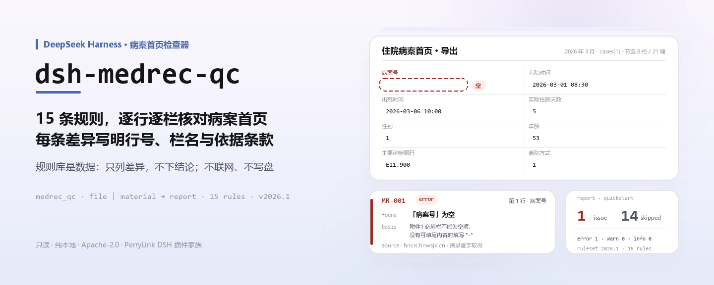
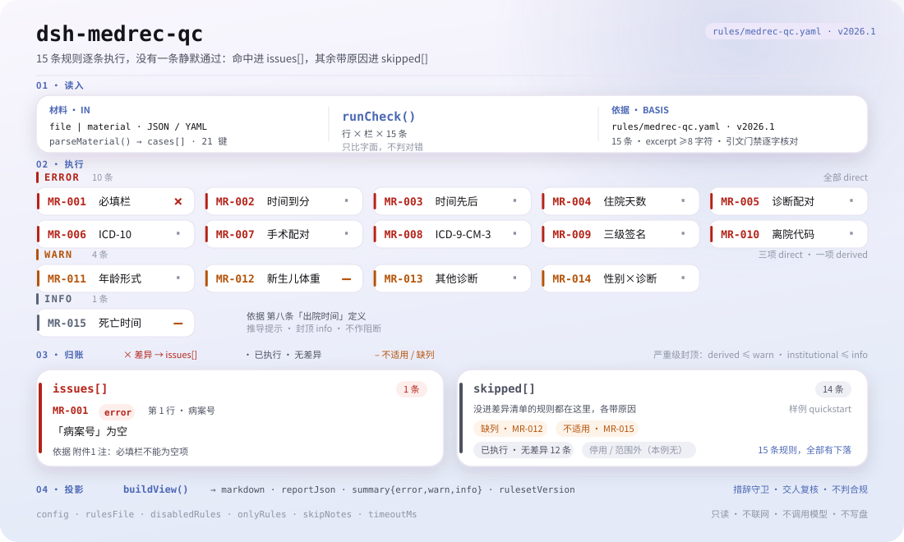

<div align="center">

<picture>
  <source media="(prefers-color-scheme: dark)" srcset="docs/assets/dsh-medrec-qc-hero-zh-dark.webp">
  
</picture>

# dsh-medrec-qc

**核对一份病案首页导出表，逐条列出哪一行、哪一栏、差什么、依据哪条。**

面向病案室与质控科的 DeepSeek Harness 检查器：规则库与代码分离，每条差异都带条款出处；只列差异，不下结论。

[安装](#三步上手) · [配置](#配置) · [FAQ](#faq) · [简体中文](README.md) · [English](README.en.md) · [Español](README.es.md) · [Português](README.pt.md) · [हिन्दी](README.hi.md)

[](LICENSE)
[](#兼容性)
[](https://www.npmjs.com/package/dsh-medrec-qc)
[](https://github.com/PerryLink/dsh-medrec-qc/actions/workflows/ci.yml)
[](#兼容性)

[](https://github.com/PerryLink/dsh-medrec-qc/stargazers)
[](https://www.npmjs.com/package/dsh-medrec-qc)
[](https://dshfind.com/plugins/PerryLink/dsh-medrec-qc?ref=badge)
[](https://securityscorecards.dev/viewer/?uri=github.com/PerryLink/dsh-medrec-qc)
[](https://dsh.market/)
[](https://gitee.com/perrylink/dsh-medrec-qc)

```sh
dsh plugin --profile <name> add dsh-medrec-qc
```

</div>

<sub>社区插件，与 DeepSeek 官方无关。唯一仓库：<https://github.com/PerryLink/dsh-medrec-qc>（Gitee 为镜像）。</sub>

## 它是什么

`dsh-medrec-qc` 读取一份住院病案首页导出表，每行一例出院病例，列名可以是国家绩效考核导出、卫生统计导出或医院本地导出的写法。它只核对这份材料自身：表格是否齐备、内部算术是否自洽、编码是否写成规则库规定的形式——必填栏有没有内容或按规范填 `-`，入出院时间是否填写、精确到分钟且前后不倒置，填写的实际住院天数是否与两个日期一致，主要诊断与主要手术的名称和编码是否同时填写，三级医师签名栏是否齐全，离院方式是否为规定代码，年龄与新生儿体重是否使用规定形式，其他诊断条数是否在配置上限内。

诊断与性别不相容、死亡病例两条时间不一致这类需要人判断的情形，它只列出来交给人核实，不给结论。

它读文件、出清单：不联网、不调用模型、不写盘，同一份材料可反复核对；换一份规则库就换一套检查。

<picture>
  <source media="(prefers-color-scheme: dark)" srcset="docs/assets/dsh-medrec-qc-flow-v5-dark.svg">
  
</picture>

## 三步上手

1. **安装**（已发布到 npm）：

   ```sh
   # npm 通道（已发布版本）
   dsh plugin --profile web add dsh-medrec-qc
   # tarball 通道：本仓库 pnpm pack 后
   dsh plugin --profile web add ./dsh-medrec-qc-<version>.tgz
   ```

   从源码 checkout 直接运行要先 `pnpm install && pnpm run build`：入口 `main` 指向构建产物 `lib/index.mjs`，不对着源码跑。

2. **最小配置**（默认即可用；bundle patch 只 insert 一行，不需要额外配置）：

   ```yaml
   - insert:
       - id: dsh-medrec-qc
         name: dsh-medrec-qc
   ```

3. **验证已生效**：

   ```sh
   dsh --profile web --dump-config | grep -A2 'id: dsh-medrec-qc'
   ```

   再跑一遍自带样例，真实输出如下（原样录自 `docs/assets/quickstart.log`）：

   ```sh
   pnpm run build && node samples/quickstart/run.mjs
   ```

   ```
   $ node samples/quickstart/run.mjs
   medrec_qc: 1 issue(s) — error 1, warn 0, info 0
   skipped: 14
   ```

   材料在 `samples/quickstart/input/MR-001-unsafe.yaml`，期望摘要见 `samples/quickstart/expected/result.json`，截图见 [docs/assets/quickstart.png](docs/assets/quickstart.png)。

**卸载**：`dsh plugin --profile web remove dsh-medrec-qc`（或删掉 profile patch 里那一行）。

<details>
<summary>从 DSH Desktop 市场安装</summary>

所有 PerryLink 插件均可在 DSH Desktop 内置市场中浏览：**市场 → 来源 → 添加来源 → 粘贴** `https://perrylink-dsh-catalog.perrylink.workers.dev/catalog-source.json` **→ 选中**。安装仍需通过市场的 npm 身份校验与你的确认。

</details>

## 核心能力

- **一条命令核对整批病例** —— 注册 `medrec_qc` 工具，接收 `file` 或 `material`（JSON / YAML），一次核对一份导出表里的全部出院病例。
- **规则库是数据，不是代码** —— 15 条规则写在 `rules/medrec-qc.yaml`（规则库版本 `2026.1`），替换该文件即切换规则集，不用改 TypeScript。
- **每条差异都可溯源** —— 报告里的每条发现都带 `document` / `number` / `clause` / `excerpt` / `source`，写明依据哪份文件、哪一条、原文怎么写的、从哪读到的。
- **严重级跟证据走** —— 只有逐字读到条款原文的检查才允许 `error`；只能由原则推论的封顶 `warn`，本机构阈值封顶 `info`，这条纪律在规则库加载期强制，不靠自觉。
- **空结果不等于没问题** —— 跑不了的检查进 `skipped` 并写明原因（缺列、整批无手术记录、被配置停用……），不会静默通过。
- **只列差异，不下结论** —— 不判合规、不认定责任、不替代审核人；报告固定带免责声明，措辞守卫会拦下定语式表述。
- **纯本地** —— 不联网、不调用模型、不写盘；材料与报告都留在你自己的机器和宿主的会话记录里。

### 输出长什么样

| 字段 | 含义 |
|---|---|
| `summary` | `error` / `warn` / `info` 三档计数 |
| `issueCount` / `skippedCount` | 差异条数 / 未执行检查条数 |
| `markdown` | 给人看的清单（工具渲染的就是它） |
| `reportJson` | 同一份报告的 JSON 串，便于下游处理 |
| `rulesetVersion` | 规则库版本，报告可复现的前提 |

### 示例

**详细走查** —— 工具 `medrec_qc`。

**输入**

~~~yaml
target: 2026 年 3 月出院病案首页导出
cases:
  - row: 1
    病案号: ""
    入院时间: "2026-03-01 08:30"
    出院时间: "2026-03-06 10:00"
~~~

**输出**

~~~json
{
  "id": "dsh-medrec-qc.MR-001.a58905f0",
  "ruleId": "MR-001",
  "severity": "error",
  "locator": {
    "row": 1,
    "column": "病案号"
  },
  "found": "「病案号」为空",
  "expected": "附件1 必填栏不能为空项，没有可填写内容时填写\"-\""
}
~~~

*Observed from `tests/fixtures/MR-001/MR-001-unsafe.yaml`*

规则库不伪造引文，因此每条发现都会同时写明所引条款，以及该条款原文本次是否取得。

| 你会问 | 它怎么答 |
|---|---|
| 某个必填栏目是空的，但我填了 `-`，会被报出来吗？ | 不会。`MR-001` 把单独一个 `-` 视为「没有可填写内容」的标注，只报真正留空的栏目。它核对的是必填栏目有没有内容，不判断内容填得对不对。本条为 `error`：24 号文附件1 的表末注释已于 **2026-10-13 逐字取得**。同一个 `-` 在 `MR-009` 里仍然算签名缺失。 |
| 入院时间只写到日、没有时分，还有一行的出院时间早于入院时间。 | `MR-002` 会报出只能读到日的 `入院时间` 或 `出院时间`（记录时间应当精确到分钟），完全解析不成日期时间的取值也一并报出。`MR-003` 按两个字段本身的字面先后关系，报出出院时间在前的那一行。两条都只看字面取值，不判断哪个时间才是真实时间。 |
| 首页上写的是 5 天，而入出院日期是 6 月 12 日入院、6 月 15 日出院。 | `MR-004` 按「出院日 − 入院日」重算天数，与填写的 `实际住院天数` 不符即报出该行；同日入出院计 `0` 天，填的不是整数天也会报出。它只比对这三个已填的值，不判断其中哪一个填错了。 |
| `主要诊断名称` 填了、`主要诊断编码` 空着；另一行的编码写法很怪。 | `MR-005` 要求两者同时填写，并指出缺的是哪一项；它只核对两者是否同时存在，不判断编码与诊断是否对应。`MR-006` 再按规则库中配置的书写形式核对编码，不校验该编码是否存在于某一版本的分类目录中。 |
| 一批材料里完全没有手术操作记录，手术类规则会静默通过吗？ | 不会。`MR-007` 会在 `skipped` 中报告「材料中没有手术或操作记录、配对检查不适用」，而不是静默通过。某一病例确实记录了手术时，本条要求 `主要手术名称` 与 `主要手术编码` 同时填写，`MR-008` 只核对手术编码的书写形式。 |
| 男性患者的主要诊断是妊娠相关疾病，会阻断上报吗？ | `MR-014` 只作为 `warn` 级差异提示人工核实，从不作阻断：卫生口径文件中没有「诊断必须与性别相容」的条款，医保侧该规则类型的已公开明细未覆盖妊娠分娩产褥期章节，并允许临床合理性例外。请与临床确认是性别填错还是诊断填错。 |

### 材料格式

`cases` 列表（裸列表也接受）；字段名通过共享字典解析，因此国家绩效考核、卫生统计与医院本地的列名写法能落到规则读取的规范键上。

~~~yaml
cases:
  - row: 1
    病案号: "A2026030001"
    入院时间: "2026-03-01 08:30"
    出院时间: "2026-03-06 10:00"
    实际住院天数: "5"
    性别: "1"
    出生日期: "1972-05-04"
    年龄: "53"
    离院方式: "1"
    科主任: "赵主任"
    主任医师: "钱主任医师"
    主治医师: "孙主治"
    住院医师: "李医师"
    责任护士: "周护士"
    编码员: "吴编码"
    主要诊断名称: "2型糖尿病"
    主要诊断编码: "E11.900"
    其他诊断: "高血压;慢性肾功能不全"
    主要手术名称: "腹腔镜胆囊切除术"
    主要手术编码: "51.2300"
    有手术操作: "1"
~~~

也接受 `MEDICAL_RECORD_NO`、`ADMISSION_TIME`、`DISCHARGE_TIME`、`MAIN_DIAGNOSIS_CODE` 这类英文表头，已经导出 ASCII 列名的医院不必先做转换。字典映射不了的列不会猜：它出现在 `warnings` 与 `unknownColumns` 里——某个列名没对上，正是检查悄悄失效的方式。

## 规则与依据

### 15 条规则

| 规则 | 检查 | 级别 |
|---|---|---|
| `MR-001` | 必填栏不得为空（单个 `-` 是规范允许的标注） | error |
| `MR-002` | 入院时间与出院时间应填写且精确到分钟 | error |
| `MR-003` | 出院时间不应早于入院时间 | error |
| `MR-004` | 实际住院天数应与入出院日期一致 | error |
| `MR-005` | 主要诊断名称与编码应同时填写 | error |
| `MR-006` | 主要诊断编码应使用 ICD-10 形式 | error |
| `MR-007` | 有手术或操作时，主要手术名称与编码应同时填写 | error |
| `MR-008` | 主要手术编码应使用 ICD-9-CM-3 形式 | error |
| `MR-009` | 医师签名应体现三级医师负责制 | error |
| `MR-010` | 离院方式应填写规定代码 | error |
| `MR-011` | 年龄应按实足年龄与月龄分数形式填写 | warn |
| `MR-012` | 新生儿体重应精确到 10 克 | warn |
| `MR-013` | 其他诊断应按病情与治疗顺序填写 | warn |
| `MR-014` | 诊断与患者性别不符的情形需人工核实 | warn |
| `MR-015` | 离院方式为死亡时，出院时间应为死亡时间 | info |

### 依据的标准

| 文件 | 文号 | 引用它的规则 |
|---|---|---|
| 《住院病案首页数据质量管理与控制指标（2016版）》 | 国卫办医发〔2016〕24号 | MR-001 |
| 《住院病案首页数据填写质量规范（暂行）》 | 国卫办医发〔2016〕24号 | MR-002, MR-003, MR-005, MR-006, MR-007, MR-008, MR-013, MR-015 |
| 《卫生部关于修订住院病案首页的通知》 | 卫医政发〔2011〕84号 | MR-004, MR-009, MR-010, MR-011, MR-012 |
| 国家医疗保障局「两库」知识点（诊断与患者性别不符） | 国家医疗保障局公告（第二十一批） | MR-014 |

**边界：** 本插件核对**住院病案首页**——编码员与国家考核体系所阅读的那一页出院摘要——的表格完整性、内部矛盾与编码形态。它不是 `dsh-nurse-record-check`（后者核对护理文书的及时性），不是 `dsh-icd-rule-check`（后者核对 ICD 编码规则与剑号/星号配对），也不判定诊断在临床上是否正确。它读取病案首页的导出数据，报出与所引条款之间的字面不符。

### 为什么 `MR-001` 又是 `error`（2026-10-13）

<details>
<summary>展开：降级、取证与回正的全过程</summary>

**这里每条 `error` 规则都同时满足两个条件：有一份文件规定了该要求，且该文件的条款原文已被逐字读到。** 国卫办医发〔2016〕24号（已取得全文）与卫医政发〔2011〕84号（已取得全文，含三个附件）满足后者。`MR-001` 曾是长期例外：它唯一的依据是**附件1 的表末注释**，而该附件一度被记录为「本环境无法解码的 PDF」，于是这条规则在 2026-10-07 按同一纪律**降级为 `warn`**——读不到的条款不能支撑阻断。

**该附件其实有文字层。** 2026-10-13 逐字读取：328 页、205,847 个可提取字符，**全程未使用 OCR**。注释原文为「注：必填栏不能为空项，没有可填写内容时填写“-”」，与本规则 `excerpt` 完全一致，仅 PDF 用弯引号、规则用直引号这一处排版差异——已留档而不是抹平（引文门禁会同时去掉两种引号，因此片段仍然匹配）。**所以这条规则按证据回正为 `error`。**

⚠️ **来源层级如实说明**：`www.nhc.gov.cn` 对自动访问返回 **HTTP 412**（2026-10-13 实测，站点根路径同样 412）。本次采用**河南省病案质量控制中心**的汇编件——即本规则 `source` 一直指向的那份文件。这与其余十四条规则所用的高校／省级转载源属同一层级，**不构成本条特有的降级理由**。完整取证日志见 `rules/evidence/clause-verification-homepage-attachment1.md`，层级判定见 `rules/evidence/authority-class-audit.md`。

</details>

### 规则来源与核验

规则数据在 `rules/medrec-qc.yaml`。每条规则都带文件名、文号、按原文自身编号体系的条款号、逐字摘录与来源地址。加载期强制：摘录必须是真实引文且不少于八个字符；依据仅为原则性条款（`kind: derived-from-principle`，严重级上限 `warn`）或本机构配置（`kind: institutional-configuration`，上限 `info`）的检查不得标为 `error`。夸大依据的规则库会在加载期失败，而不会产出一份看起来很有底气的报告。

条款号已对照以下文件全文核验：《住院病案首页数据填写质量规范（暂行）》《住院病案首页数据质量管理与控制指标（2016版）》（国卫办医发〔2016〕24号）、《卫生部关于修订住院病案首页的通知》（卫医政发〔2011〕84号）附件、《医疗机构病历管理规定（2013年版）》（国卫医发〔2013〕31号）、《医疗保障基金结算清单填写规范（试行）》（医保办发〔2020〕20号）。四条结论塑造了这份规则库，记录在此，便于复核者看清**刻意没有主张**的东西：

1. **必填项清单出自附件1，而附件1没有名为「医师签名」的列。** 附件1 的「住院病案首页必填项目列表」共 76 项，签名栏分列为科主任 / 主任（副主任）医师 / 主治医师 / 住院医师。`MR-009` 因此绑定到这几个具体列，并引 84号文附件 二（二十八）1 的「三级医师负责制」要求，而不是写成「24号文要求医师签名」。
2. **年龄书写格式在 84号文，不在 2010 年的病历书写规范。** 不满一周岁写 `N M/30 月` 的规则出自卫医政发〔2011〕84号 附件 二（六）；11号文只把「年龄」列为入院记录的一般情况项。`MR-011` 引 84号文，且**不检查**「不满一个月写日龄」——没有任何国家文件这样规定；医保办发〔2020〕20号 对医保通道另定「整数日龄」，两者不互相排斥。
3. **「男性患者不得有妊娠诊断」不是国家条款。** 国家医保局公开了「诊断与患者性别不符」的规则类型，但已公开明细只覆盖 A/B/C/D/E/F/I/J/K/L/M 十一个 ICD-10 章节，**完全没有 O 章（妊娠分娩产褥期）条目**，随附的新闻发布稿还明确允许临床合理性例外。`MR-014` 因此只是 `warn` 级的人工核实线索，从不阻断。
4. **死亡病例没有独立条款把它绑到死亡时间上。** 24号文 第八条只把死亡患者的出院时间定义为死亡时间。`MR-015` 依据这个定义，上限 `info`，并在自己的 `note` 里写明这一点。

## 配置

所有可调项都在 `src/config.ts` 的 Schemastery schema 里，只改 `cordis.yml` 即可生效，无需改代码。逐条阈值在规则库文件 `rules/medrec-qc.yaml` 里。

| 键 | 类型 | 默认值 | 说明 |
|---|---|---|---|
| `rulesFile` | string | `rules/medrec-qc.yaml` | 规则库文件路径，相对插件包根目录；替换该文件即可切换规则集版本 |
| `disabledRules` | string[] | `[]` | 要停用的规则 id 列表；每条都会出现在 `skipped` 中 |
| `onlyRules` | string[] | `[]` | 只执行这些规则 id；留空表示执行全部规则 |
| `skipNotes` | string | `""` | 附加到每条 `skipped` 说明后的备注，例如标注本机构实施细则 |
| `timeoutMs` | number | `120000` | 工具协作式超时预算（毫秒） |

规则级参数值得知道：

- `MR-001` `fields` —— 必填栏目清单，取自国卫办医发〔2016〕24号 附件1。要把本院的自定义必填栏也加进去，改规则库即可，不动代码。
- `MR-011` `underOnePattern` / `adultPattern` —— 认可的年龄写法。
- `MR-013` `maxChecked` —— 其他诊断条数超过多少即提示核对排序。
- `MR-014` `rules` —— 性别与诊断的术语表，形如 `{ sex, label, pattern }`。

profile patch 覆盖示例：

~~~yaml
- insert:
    - id: dsh-medrec-qc
      name: dsh-medrec-qc
      config:
        disabledRules: [MR-012]
        onlyRules: []
        skipNotes: 本机构实施细则 2026 版
        timeoutMs: 120000
~~~

## FAQ

<details>
<summary>材料会被上传或外发吗？数据存在哪？</summary>

不会。它只读你传给工具的文档内容：不联网、不带遥测、不写盘、不上传。除了工具返回值与 DSH 宿主自己的会话/日志存储之外，本包不落任何数据；那份存储由宿主控制、由宿主决定保留期，本包不会多留第二份副本。详见 [PRIVACY.md](PRIVACY.md)。

</details>

<details>
<summary>结果是「0 条差异」，是不是就没问题？某条规则没执行呢？</summary>

「0 条差异」只说明**跑了的检查没发现字面差异**，不等于材料合规。跑不了的检查一律进 `skipped` 并写明原因（缺列、整批无手术记录、被 `disabledRules` 停用……），空结果读不成「什么都没问题」。如果工具整个没出现，先确认 `main` 指向的 `lib/index.mjs` 存在：源码 checkout 要先 `pnpm run build`，发布的 tarball 自带构建产物。

</details>

<details>
<summary>它会替我下合规结论、或者阻断上报吗？</summary>

不会。它不判合规、不认定责任、不评价诊断在临床上是否正确，也从不阻断任何流程；每条报告固定带免责声明，措辞守卫会拦下定语式表述。它给出的是一份可供人工复核的差异清单：哪一行、哪一栏、差什么、依据哪条。

</details>

<details>
<summary>装的时候报版本不兼容怎么办？`check` 报 `manifest-peers` 失败呢？</summary>

对等范围覆盖 `0.1.x` 与 `0.2.x` 两代。若运行时在其之外，可显式豁免：`dsh plugin --profile <name> allow-version dsh-medrec-qc@0.2.13 --dsh-version <runtime> --accept-risk`。`check` 报 `manifest-peers` 失败是 `dsh-plugin-dev` 的已知上游问题：静态检查器比对的是一份早于 0.2 世代的硬编码范围，安装期以运行时校验为准。更多排障见 [TROUBLESHOOTING.md](TROUBLESHOOTING.md)。

</details>

<details>
<summary>和 `dsh-nurse-record-check`、`dsh-icd-rule-check` 会打架吗？</summary>

不会，分工也不同。本插件只核对**病案首页导出**的表格完整性、内部算术与编码书写形式；`dsh-nurse-record-check` 核对护理文书及时性，`dsh-icd-rule-check` 核对 ICD 编码规则与剑号/星号配对。它们可以同时装在同一个 profile 里：本插件只注册一个工具、不提供任何服务键、不注册客户端 slot 或 HTTP 路由，读的是你显式传给它的材料，不改原件。

</details>

## 安全边界

- **纯本地，无外发面。** 不发起网络请求、不调用模型、不带遥测；`package.json#dsh.demo` 也如实标注 `network: false`、`writes: []`、`external: []`。
- **依据不足的规则不可能标成 `error`。** 规则库加载期校验 `excerpt` 必须是不少于八个字符的逐字引文，并按 `kind` 封顶严重级：`derived-from-principle` 最多 `warn`，`institutional-configuration` 最多 `info`。引文门禁还会回归检查每条摘录能否在 `rules/evidence/` 的取证记录里找到原文。
- **只列差异，不下定性结论。** 报告不出现合规、违规、责任、正确性之类的断言；措辞守卫在渲染层强制这一点。
- **空结果不等于无罪。** 未执行的检查必须出现在 `skipped` 里并带原因；某条规则所需字段未配置时，它报告自己未执行，而不是默认通过。
- **注册即 effect。** 工具通过 `ctx.tools.register` 注册并返回 disposer，插件停用或热重载即撤销，不留悬挂注册。
- **不写盘。** 除工具返回值与宿主自身的会话存储外，本包不创建、不修改任何文件。

## 权限与数据

- **权限**：只读调用方传入的材料（`file` 路径或内联 `material`）；不提供任何服务键，不注册客户端 slot 或 HTTP 路由。`package.json#dsh.capabilities` 只声明 `tools:register`。
- **数据**：材料内容只在本进程内参与比对；插件不保留副本、不缓存、不落盘。宿主如何记录工具结果是宿主的事，本包不追加第二份。
- **依赖**：运行时零依赖（`dependencies` 为空），peer 只依赖 Cordis、`dsh-tools` 与 Schemastery，均为宿主已装载的组件。

## 已知限制

- **只报字面差异。** 它不判断哪个值才是真的，不判断诊断在临床上是否正确，也不替审核人做决定；两个字段冲突时，它只列出冲突本身。
- **编码只查书写形式。** `MR-006` / `MR-008` 按规则库配置的形式核对 ICD-10 与 ICD-9-CM-3 编码写法，**不校验**编码是否存在于某一版本的分类目录中，也不查目录版本是否匹配。
- **字段字典偏保守。** 映射不了的列进 `warnings` 与 `unknownColumns`，读取层拒绝猜。要支持本院列名，改 `src/parse.ts` 的 `CASE_FIELDS`，或在规则库字段表里补写法。
- **15 条规则不是一份完整的病案首页合规检查。** 它覆盖的是能逐条指认依据的形式与算术问题；依据不足的检查被刻意压到 `warn` / `info`，其余不在范围内。
- **来源层级有边界。** `www.nhc.gov.cn` 对自动访问返回 HTTP 412（2026-10-13 实测），部分条文采自省级／高校转载件，取证记录在 `rules/evidence/`；这不是把转载件当原文的理由，而是如实标注的层级。
- **开发形态要构建。** 源码 checkout 的 `main` 指向 `lib/index.mjs`，必须先 `pnpm run build`；发布的 npm tarball 自带 `lib/`，安装即用。
- **时间是墙上时钟。** 全部日期时间计算只对输入字符串做墙上时钟运算，不做时区换算；输入里的时区偏移不会参与比较。
- **上游静态检查器的已知误报。** `check` 的 `manifest-peers` 比对一份早于 0.2 世代的硬编码 peer 范围，与安装期的运行时校验不一致。

## 与其他 DSH 插件的互操作性

本插件**不干扰**同 profile 的其他插件：

- **工具面只加一个。** 只注册 `medrec_qc`，经 `ctx.tools.register` 返回 disposer；不占用任何内置工具的裸名，卸载即撤销。
- **不提供服务键。** `inject` 只有 `tools`，不向 Cordis 注册任何 service key，因此不存在服务键冲突。
- **不占 slot、不占路由。** 包内没有浏览器半（无 `client/`），不注册客户端 slot key；也不注册任何 `webServer` 前缀。
- **patch 层只 insert 自己那一行。** `cordis.patch.yml` 只追加 `id: dsh-medrec-qc` 一行，从不覆写内置行或他人行的 `config`。
- **无全局改写。** 不改原型、不写 `process.env`、不替换全局 fetch。
- **与兄弟检查器分工而非竞争。** 同一份材料可以同时交给 `dsh-medrec-qc`（病案首页形式与逻辑矛盾）、`dsh-nurse-record-check`（护理文书及时性）、`dsh-icd-rule-check`（ICD 编码规则与剑星号配对）；三者各自读文件、各自出报告，不改原件、不共享状态。

## 兼容性

| 维度 | 状态 |
|---|---|
| Harness | 对等范围 `>=0.1.2-rc.1 <0.2.0 \|\| >=0.2.0-0 <0.3.0`，已实测接受 `0.2.0-rc.2` 与 `0.2.1-rc.2`；`engines.dsh` 声明 `>=0.2.1-0 <0.3.0`，0.2.1 起由宿主强制执行 |
| Node | `^22.19.0 \|\| >=24.0.0` |
| 平台 | 全平台（纯 ESM；无原生代码、无联网、不调用模型） |
| 工具模式 | `native` / `ptc` 均可；批量校验整个月的出院病例建议 `ptc`，schema 成本只付一次 |
| 材料 | JSON / YAML；`cases` 列表，或裸列表 |

## 生态与质量

- [Gitee 镜像](https://gitee.com/perrylink/dsh-medrec-qc)（同步镜像，以 GitHub 为准）
- [dshfind 插件页](https://dshfind.com/plugins/PerryLink/dsh-medrec-qc)（安装量与排名）
- [OpenSSF Scorecard 报告](https://securityscorecards.dev/viewer/?uri=github.com/PerryLink/dsh-medrec-qc)（由 [.github/workflows/scorecard.yml](.github/workflows/scorecard.yml) 驱动）
- [DSH Market](https://dsh.market/)（已上架）
- **1024 商店渠道**：先 `npm i -g dsh1024`，再 `dsh1024 plugin --profile web add dsh-medrec-qc`（计入 [deepseek1024.com](https://deepseek1024.com) 安装排行）
- [生态实测知识库](https://perrylink.github.io/dsh-plugin-guide/)：插件开发指南 · 选型实测数据 · 维护取舍判据

## 开发

```sh
pnpm install
pnpm run typecheck          # tsc --noEmit
pnpm test                   # vitest，逐条规则一对合规/违规夹具
pnpm run build              # tsdown -> lib/index.mjs + lib/index.d.mts
pnpm run check:readmes      # 五语 README 一致性
pnpm run check:citations    # 每条摘录都能在 rules/evidence/ 里找到原文
pnpm run verify:self-contained
pnpm run check:lockfile
pnpm pack                   # 发布 tarball
node samples/quickstart/run.mjs   # 需要先 build
```

目录布局：

| 路径 | 作用 |
|---|---|
| `src/index.ts` | 函数式插件入口：`name` / `inject` / `Config` / `apply`，注册 `medrec_qc` 并解析规则库 |
| `src/config.ts` | Schemastery schema，全部可调项都在这 |
| `src/check.ts` | 纯检查内核：`(input, ruleset, options) => Report`，无插件上下文、无 I/O、无时钟、无模型 |
| `src/parse.ts` | 材料读取（JSON / YAML）与列名字典 |
| `src/view.ts` | 面向模型的报告投影，`output.schema` 与它对齐 |
| `src/shared/` | 共享件（规则库加载、报告形状、YAML 子集、日历运算、措辞守卫、表格工具），复制进来而非外部依赖 |
| `rules/medrec-qc.yaml` | 规则库，15 条规则；`rules/evidence/` 是每条引文的取证记录 |
| `tests/` | vitest；每条规则一对合规/违规夹具 |

Topics：`dsh`, `dsh-plugin`, `deepseek-harness`, `deepseek`, `cordis`, `medrec`

README 配图由 [`scripts/gen-readme-assets.py`](scripts/gen-readme-assets.py) 程序化生成——hero 横幅用 Pillow 画、结构图用手写 SVG 画——可重复执行；旧的单版 `dsh-medrec-qc-flow.svg` 与终端截图保留在 `docs/assets/` 供外链使用，README 只引用新生成的 hero（`zh`/`en` × 深浅四版）与 flow-v5 结构图（深浅双版）。

## 家族与致谢

本项目是 [PerryLink](https://github.com/PerryLink) 维护的 DeepSeek Harness 插件家族成员（全部 Apache-2.0）。如果这个插件帮到了你，**给个 star**——它不解锁任何功能，但会让下一个人更容易找到它。

- [@PerryLink](https://github.com/PerryLink) —— 创建者与维护者：规则库与检查内核、引文门禁与取证记录、`medrec_qc` 工具、五语文档。

按材料选核查器（家族完整索引）：<https://perrylink.github.io/zh/checkers/choose/>

<details>
<summary>展开全部插件</summary>

| 插件 | 状态 |
|---|---|
| **[dsh-aqua-input-check](https://github.com/PerryLink/dsh-aqua-input-check)** |  |
| **[dsh-archive-check](https://github.com/PerryLink/dsh-archive-check)** |  |
| **[dsh-auto-review](https://github.com/PerryLink/dsh-auto-review)** |  |
| **[dsh-autotier](https://github.com/PerryLink/dsh-autotier)** | 🧊 已冻结 — 见仓库 README |
| **[dsh-bid-ca-precheck](https://github.com/PerryLink/dsh-bid-ca-precheck)** |  |
| **[dsh-bid-qual-check](https://github.com/PerryLink/dsh-bid-qual-check)** |  |
| **[dsh-cert-mcp](https://github.com/PerryLink/dsh-cert-mcp)** | 🧊 已冻结 — 见仓库 README |
| **[dsh-checkpoint-rewind](https://github.com/PerryLink/dsh-checkpoint-rewind)** |  |
| **[dsh-click](https://github.com/PerryLink/dsh-click)** |  |
| **[dsh-composer-history](https://github.com/PerryLink/dsh-composer-history)** |  |
| **[dsh-contract-stance](https://github.com/PerryLink/dsh-contract-stance)** |  |
| **[dsh-customs-doc-check](https://github.com/PerryLink/dsh-customs-doc-check)** |  |
| **[dsh-data-quality](https://github.com/PerryLink/dsh-data-quality)** | 🧊 已冻结 — 见仓库 README |
| **[dsh-demurrage-ledger](https://github.com/PerryLink/dsh-demurrage-ledger)** |  |
| **[dsh-doublecheck](https://github.com/PerryLink/dsh-doublecheck)** |  |
| **[dsh-drill-script-check](https://github.com/PerryLink/dsh-drill-script-check)** |  |
| **[dsh-eia-guide-check](https://github.com/PerryLink/dsh-eia-guide-check)** |  |
| **[dsh-emergency-plan](https://github.com/PerryLink/dsh-emergency-plan)** |  |
| **[dsh-essay-rubric-check](https://github.com/PerryLink/dsh-essay-rubric-check)** |  |
| **[dsh-evidence-check](https://github.com/PerryLink/dsh-evidence-check)** |  |
| **[dsh-export-ctl-check](https://github.com/PerryLink/dsh-export-ctl-check)** |  |
| **[dsh-fast](https://github.com/PerryLink/dsh-fast)** |  |
| **[dsh-fmea-table-check](https://github.com/PerryLink/dsh-fmea-table-check)** |  |
| **[dsh-forecast-penalty](https://github.com/PerryLink/dsh-forecast-penalty)** |  |
| **[dsh-fund-research](https://github.com/PerryLink/dsh-fund-research)** |  |
| **[dsh-github](https://github.com/PerryLink/dsh-github)** |  |
| **[dsh-gongwen-flow-check](https://github.com/PerryLink/dsh-gongwen-flow-check)** |  |
| **[dsh-gongwen-word-check](https://github.com/PerryLink/dsh-gongwen-word-check)** |  |
| **[dsh-guard-plan-qc](https://github.com/PerryLink/dsh-guard-plan-qc)** |  |
| **[dsh-hazchem-check](https://github.com/PerryLink/dsh-hazchem-check)** |  |
| **[dsh-hazplan-check](https://github.com/PerryLink/dsh-hazplan-check)** |  |
| **[dsh-hidden-risk-map](https://github.com/PerryLink/dsh-hidden-risk-map)** |  |
| **[dsh-hs-classify](https://github.com/PerryLink/dsh-hs-classify)** |  |
| **[dsh-icd-rule-check](https://github.com/PerryLink/dsh-icd-rule-check)** |  |
| **[dsh-industry-research](https://github.com/PerryLink/dsh-industry-research)** |  |
| **[dsh-lawcite-adapter](https://github.com/PerryLink/dsh-lawcite-adapter)** |  |
| **[dsh-laya](https://github.com/PerryLink/dsh-laya)** |  |
| **[dsh-lc-doc-check](https://github.com/PerryLink/dsh-lc-doc-check)** |  |
| **[dsh-learning-gap-check](https://github.com/PerryLink/dsh-learning-gap-check)** |  |
| **[dsh-library](https://github.com/PerryLink/dsh-library)** |  |
| **[dsh-local-ai](https://github.com/PerryLink/dsh-local-ai)** |  |
| **[dsh-lsp-actions](https://github.com/PerryLink/dsh-lsp-actions)** |  |
| **[dsh-mask](https://github.com/PerryLink/dsh-mask)** |  |
| **[dsh-mcp-panel](https://github.com/PerryLink/dsh-mcp-panel)** |  |
| **[dsh-medrec-qc](https://github.com/PerryLink/dsh-medrec-qc)** |  |
| **[dsh-memento](https://github.com/PerryLink/dsh-memento)** | 🧊 已冻结 — 见仓库 README |
| **[dsh-nsfc-form-check](https://github.com/PerryLink/dsh-nsfc-form-check)** |  |
| **[dsh-nurse-record-check](https://github.com/PerryLink/dsh-nurse-record-check)** |  |
| **[dsh-observe](https://github.com/PerryLink/dsh-observe)** |  |
| **[dsh-origin-rvc-check](https://github.com/PerryLink/dsh-origin-rvc-check)** |  |
| **[dsh-ota-review-check](https://github.com/PerryLink/dsh-ota-review-check)** |  |
| **[dsh-output-styles](https://github.com/PerryLink/dsh-output-styles)** |  |
| **[dsh-paper-doc-adapter](https://github.com/PerryLink/dsh-paper-doc-adapter)** |  |
| **[dsh-permission-rules](https://github.com/PerryLink/dsh-permission-rules)** |  |
| **[dsh-permit-report-check](https://github.com/PerryLink/dsh-permit-report-check)** |  |
| **[dsh-pipeline-check](https://github.com/PerryLink/dsh-pipeline-check)** |  |
| **[dsh-pleading-draft](https://github.com/PerryLink/dsh-pleading-draft)** |  |
| **[dsh-plugin-doctor](https://github.com/PerryLink/dsh-plugin-doctor)** | 🚫 已退役（仓库已归档） |
| **[dsh-plugin-guide](https://github.com/PerryLink/dsh-plugin-guide)** |  |
| **[dsh-plugin-kit](https://github.com/PerryLink/dsh-plugin-kit)** | 🚫 已退役（仓库已归档） |
| **[dsh-plugin-upgrade](https://github.com/PerryLink/dsh-plugin-upgrade)** | 🚫 已退役（仓库已归档） |
| **[dsh-policy-brief-draft](https://github.com/PerryLink/dsh-policy-brief-draft)** |  |
| **[dsh-power-loss-split](https://github.com/PerryLink/dsh-power-loss-split)** |  |
| **[dsh-power-ticket-check](https://github.com/PerryLink/dsh-power-ticket-check)** |  |
| **[dsh-ppap-check](https://github.com/PerryLink/dsh-ppap-check)** |  |
| **[dsh-protest-deadline](https://github.com/PerryLink/dsh-protest-deadline)** |  |
| **[dsh-railway-window](https://github.com/PerryLink/dsh-railway-window)** |  |
| **[dsh-repair-order-qc](https://github.com/PerryLink/dsh-repair-order-qc)** |  |
| **[dsh-research-report](https://github.com/PerryLink/dsh-research-report)** |  |
| **[dsh-review-reply-check](https://github.com/PerryLink/dsh-review-reply-check)** |  |
| **[dsh-rulefile-check](https://github.com/PerryLink/dsh-rulefile-check)** |  |
| **[dsh-safety-brief-check](https://github.com/PerryLink/dsh-safety-brief-check)** |  |
| **[dsh-score](https://github.com/PerryLink/dsh-score)** | 🧊 已冻结 — 见仓库 README |
| **[dsh-session-sync](https://github.com/PerryLink/dsh-session-sync)** |  |
| **[dsh-site-log-check](https://github.com/PerryLink/dsh-site-log-check)** |  |
| **[dsh-skill-pack-security](https://github.com/PerryLink/dsh-skill-pack-security)** |  |
| **[dsh-soe-decision-check](https://github.com/PerryLink/dsh-soe-decision-check)** |  |
| **[dsh-soilwater-check](https://github.com/PerryLink/dsh-soilwater-check)** |  |
| **[dsh-sop-sync-check](https://github.com/PerryLink/dsh-sop-sync-check)** |  |
| **[dsh-spc-gbt-adapter](https://github.com/PerryLink/dsh-spc-gbt-adapter)** |  |
| **[dsh-talk](https://github.com/PerryLink/dsh-talk)** |  |
| **[dsh-tender-extract](https://github.com/PerryLink/dsh-tender-extract)** |  |
| **[dsh-tender-matrix](https://github.com/PerryLink/dsh-tender-matrix)** |  |
| **[dsh-test-drive](https://github.com/PerryLink/dsh-test-drive)** |  |
| **[dsh-ticktick](https://github.com/PerryLink/dsh-ticktick)** | 🚫 已退役（仓库已归档） |
| **[dsh-translate](https://github.com/PerryLink/dsh-translate)** |  |
| **[dsh-warranty-calc](https://github.com/PerryLink/dsh-warranty-calc)** |  |
| **[dsh-budget](https://github.com/PerryLink/dsh-budget)** | 🧊 已冻结 — 见仓库 README |
| **[dsh-claude-move](https://github.com/PerryLink/dsh-claude-move)** | 🧊 已冻结 — 见仓库 README |
| **[dsh-defend](https://github.com/PerryLink/dsh-defend)** | 🧊 已冻结 — 见仓库 README |
| **[dsh-draw](https://github.com/PerryLink/dsh-draw)** | 🧊 已冻结 — 见仓库 README |
| **[dsh-reach](https://github.com/PerryLink/dsh-reach)** | 🧊 已冻结 — 见仓库 README |
| **[dsh-background-agents](https://github.com/PerryLink/dsh-background-agents)** | 🚫 已退役（仓库已归档） |
| **[dsh-session-pin](https://github.com/PerryLink/dsh-session-pin)** | 🚫 已退役（仓库已归档） |
| **[dsh-team-rooms](https://github.com/PerryLink/dsh-team-rooms)** | 🚫 已退役（仓库已归档） |

</details>

## License

[LICENSE](LICENSE)（Apache License 2.0）© 2026 dsh-medrec-qc contributors

<p align="center"><sub>Apache-2.0 · 社区插件，与 DeepSeek 无关。</sub></p>
