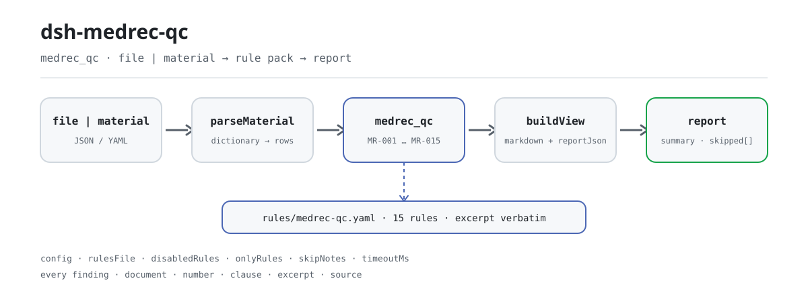

<div align="center">

<picture>
  <source media="(prefers-color-scheme: dark)" srcset="docs/assets/dsh-medrec-qc-flow-dark.svg">
  
</picture>

# dsh-medrec-qc

**Verifique uma exportação da folha frontal do prontuário e receba uma lista linha a linha: qual linha, qual coluna, o que diverge e qual cláusula sustenta.**

Um verificador do DeepSeek Harness para arquivos médicos e equipes de controle de qualidade: o pacote de regras é dado, cada achado carrega sua citação, e ele apenas lista diferenças — nunca julga.

[Instalar](#instalação-em-três-passos) · [Configuração](#configuração) · [FAQ](#faq) · [简体中文](README.md) · [English](README.en.md) · [Español](README.es.md) · [Português](README.pt.md) · [हिन्दी](README.hi.md)

[](LICENSE)
[](#compatibilidade)
[](https://www.npmjs.com/package/dsh-medrec-qc)
[](https://github.com/PerryLink/dsh-medrec-qc/actions/workflows/ci.yml)
[](#compatibilidade)

[](https://github.com/PerryLink/dsh-medrec-qc/stargazers)
[](https://www.npmjs.com/package/dsh-medrec-qc)
[](https://dshfind.com/plugins/PerryLink/dsh-medrec-qc?ref=badge)
[](https://securityscorecards.dev/viewer/?uri=github.com/PerryLink/dsh-medrec-qc)
[](https://dsh.market/)
[](https://gitee.com/perrylink/dsh-medrec-qc)

```sh
dsh plugin --profile <name> add dsh-medrec-qc
```

</div>

<sub>Plugin da comunidade, sem afiliação com a DeepSeek. Repositório canônico: <https://github.com/PerryLink/dsh-medrec-qc> (o Gitee é um espelho).</sub>

## O que é

O `dsh-medrec-qc` lê uma exportação da folha frontal do prontuário de internação — uma linha por alta, com nomes de coluna da exportação de avaliação nacional, da exportação estatística sanitária ou de uma grafia local do hospital. Ele confere essa exportação contra ela mesma: o formulário está completo, a aritmética interna fecha, os códigos estão escritos como o pacote de regras exige — cada coluna obrigatória com conteúdo ou com o marcador `-`, as horas de admissão e alta presentes, precisas ao minuto e sem inversão, a permanência declarada coerente com as duas datas, o nome e o código do diagnóstico principal e os da cirurgia principal preenchidos juntos, o bloco de assinaturas com a responsabilidade de três níveis, o modo de alta entre os códigos definidos, a idade e os pesos neonatais na forma prescrita, e o número de outros diagnósticos dentro do limite configurado.

Os casos que exigem julgamento humano — um diagnóstico incompatível com o sexo registrado, dois horários que não concordam numa alta por óbito — são apenas sinalizados para revisão, nunca decididos.

Ele lê um arquivo e devolve uma lista: sem rede, sem chamada ao modelo, sem gravações; o mesmo material pode ser conferido quantas vezes quiser, e trocar o pacote de regras troca todo o conjunto de verificações.

## Instalação em três passos

1. **Instale** (publicado no npm):

   ```sh
   # canal npm (versões publicadas)
   dsh plugin --profile web add dsh-medrec-qc
   # canal tarball: após pnpm pack neste repositório
   dsh plugin --profile web add ./dsh-medrec-qc-<version>.tgz
   ```

   Executar a partir de um checkout do código exige antes `pnpm install && pnpm run build`: a entrada `main` aponta para o artefato `lib/index.mjs`, não para o código-fonte.

2. **Configuração mínima** (os padrões bastam; o patch do bundle apenas insere uma linha):

   ```yaml
   - insert:
       - id: dsh-medrec-qc
         name: dsh-medrec-qc
   ```

3. **Confirme que monta**:

   ```sh
   dsh --profile web --dump-config | grep -A2 'id: dsh-medrec-qc'
   ```

   Depois rode o exemplo incluído; esta é a saída real (registrada em `docs/assets/quickstart.log`):

   ```sh
   pnpm run build && node samples/quickstart/run.mjs
   ```

   ```
   $ node samples/quickstart/run.mjs
   medrec_qc: 1 issue(s) — error 1, warn 0, info 0
   skipped: 14
   ```

   O material está em `samples/quickstart/input/MR-001-unsafe.yaml`, o resumo esperado em `samples/quickstart/expected/result.json`, e a captura em [docs/assets/quickstart.png](docs/assets/quickstart.png).

**Desinstalar**: `dsh plugin --profile web remove dsh-medrec-qc` (ou remova a linha do patch do perfil).

<details>
<summary>Instalar pelo mercado do DSH Desktop</summary>

Todos os plugins PerryLink aparecem no mercado embutido do DSH Desktop: **Mercado → Fontes → Adicionar fonte → colar** `https://perrylink-dsh-catalog.perrylink.workers.dev/catalog-source.json` **→ selecionar**. A instalação continua passando pela verificação de identidade npm do mercado e pela sua confirmação.

</details>

## Capacidades principais

- **Um comando, o lote inteiro** — registra a ferramenta `medrec_qc`, que aceita `file` ou `material` (JSON / YAML) e confere de uma vez todos os casos de alta da exportação.
- **O pacote de regras é dado, não código** — 15 regras vivem em `rules/medrec-qc.yaml` (versão `2026.1`); substituir esse arquivo troca o conjunto de regras sem tocar em TypeScript.
- **Cada diferença é rastreável** — todo achado carrega `document` / `number` / `clause` / `excerpt` / `source`: qual documento, qual cláusula, o que o texto diz e de onde foi lido.
- **A severidade segue a evidência** — só uma verificação cujo texto foi lido literalmente pode ser `error`; o que deriva de um princípio fica limitado a `warn`, e um limite institucional a `info`. O carregador do pacote impõe isso em vez de confiar no autor.
- **Resultado vazio não é atestado** — uma verificação que não pôde rodar aparece em `skipped` com o motivo (coluna ausente, nenhum registro de cirurgia no lote, desativada por configuração), nunca como aprovação silenciosa.
- **Diferenças, nunca veredictos** — sem juízo de conformidade, sem atribuição de responsabilidade, sem substituir o revisor; todo relatório leva o aviso e um guardião de redação bloqueia linguagem sentenciosa.
- **Somente local** — sem rede, sem chamada ao modelo, sem gravações; o material e o relatório ficam na sua máquina e no registro de sessão do host.

### Como é a saída

| Campo | Significado |
|---|---|
| `summary` | contagens de `error` / `warn` / `info` |
| `issueCount` / `skippedCount` | achados / verificações que não puderam rodar |
| `markdown` | a lista legível por pessoas (o que a ferramenta renderiza) |
| `reportJson` | o mesmo relatório como string JSON, para processamento a jusante |
| `rulesetVersion` | versão do pacote de regras, premissa de um relatório reproduzível |

### Exemplos

**Percurso detalhado** — ferramenta `medrec_qc`.

**Entrada**

~~~yaml
target: 2026 年 3 月出院病案首页导出
cases:
  - row: 1
    病案号: ""
    入院时间: "2026-03-01 08:30"
    出院时间: "2026-03-06 10:00"
~~~

**Saída**

~~~json
{
  "id": "dsh-medrec-qc.MR-001.a58905f0",
  "ruleId": "MR-001",
  "severity": "error",
  "locator": {
    "row": 1,
    "column": "病案号"
  },
  "found": "「病案号」为空",
  "expected": "附件1 必填栏不能为空项，没有可填写内容时填写\"-\""
}
~~~

*Observed from `tests/fixtures/MR-001/MR-001-unsafe.yaml`*

O pacote nunca inventa uma citação, então cada achado também declara a cláusula de onde vem e se o texto foi obtido nesta revisão.

| Você pergunta | O que ele responde |
|---|---|
| Falta uma coluna obrigatória, mas eu digitei `-` nela. Isso é reportado? | Não. O `MR-001` trata um `-` sozinho como a marca de «nada a registrar» e reporta apenas as colunas realmente vazias. Ele confere se a coluna tem conteúdo, não se o conteúdo está correto. É `error` porque a nota ao final do Anexo 1 do Documento 24/2016 foi lida **literalmente em 2026-10-13**. O mesmo `-` continua contando como assinatura ausente no `MR-009`. |
| A hora de admissão está escrita como data sem hora nem minuto, e numa linha a alta é anterior à admissão. | O `MR-002` reporta um valor de admissão ou alta que só pode ser lido até o dia (a hora registrada deve ser precisa ao minuto) e qualquer valor que não possa ser analisado como data e hora. O `MR-003` compara a ordem literal dos dois campos e reporta a linha em que a alta vem primeiro. Ambos trabalham sobre os valores literais e nenhum decide qual das duas horas é a verdadeira. |
| A folha diz `5` dias, mas as datas são admissão em 12 de junho e alta em 15 de junho. | O `MR-004` recalcula os dias como data de alta menos data de admissão e reporta a linha quando a permanência declarada não bate; admissão e alta no mesmo dia contam como `0` dias, e um valor que não seja número inteiro de dias também é reportado. Ele compara apenas os três valores armazenados e não decide qual deles está errado. |
| O nome do diagnóstico principal está preenchido mas o código está vazio, e outra linha traz um código com forma estranha. | O `MR-005` exige que os dois sejam preenchidos juntos e nomeia o que falta; confere apenas que ambos existam, não que o código corresponda ao diagnóstico. O `MR-006` então testa o código contra a forma escrita configurada no pacote, e não verifica se o código existe em alguma versão do diretório de classificação. |
| Um lote não tem nenhum registro de cirurgia. As regras de cirurgia passam em silêncio? | Não. O `MR-007` se reporta em `skipped` com o motivo de que o material não contém registro de cirurgia e a checagem de pareamento não se aplica, em vez de passar em silêncio. Quando uma linha registra uma cirurgia, a regra exige o nome e o código da cirurgia principal juntos, e o `MR-008` confere apenas a forma escrita do código de cirurgia. |
| O diagnóstico principal de um paciente masculino é uma condição da gravidez. Isso bloqueia a exportação? | O `MR-014` reporta como diferença de nível `warn` para confirmação humana, nunca como bloqueio: os documentos sanitários não têm cláusula que torne um diagnóstico incompatível com o sexo registrado, e o detalhe publicado desse tipo de regra do seguro-saúde não cobre o capítulo de gravidez, parto e puerpério e admite exceções clínicas. Confirme com o clínico se o erro está no sexo ou no diagnóstico. |

### Formato do material

Uma lista `cases` (uma lista nua também é aceita). Os nomes de campo são resolvidos por um dicionário compartilhado, então as grafias da avaliação nacional, da estatística sanitária e do hospital local chegam às chaves canônicas que as regras leem.

~~~yaml
cases:
  - row: 1
    病案号: "A2026030001"
    入院时间: "2026-03-01 08:30"
    出院时间: "2026-03-06 10:00"
    实际住院天数: "5"
    性别: "1"
    出生日期: "1972-05-04"
    年龄: "53"
    离院方式: "1"
    科主任: "赵主任"
    主任医师: "钱主任医师"
    主治医师: "孙主治"
    住院医师: "李医师"
    责任护士: "周护士"
    编码员: "吴编码"
    主要诊断名称: "2型糖尿病"
    主要诊断编码: "E11.900"
    其他诊断: "高血压;慢性肾功能不全"
    主要手术名称: "腹腔镜胆囊切除术"
    主要手术编码: "51.2300"
    有手术操作: "1"
~~~

Cabeçalhos em inglês como `MEDICAL_RECORD_NO`, `ADMISSION_TIME`, `DISCHARGE_TIME` e `MAIN_DIAGNOSIS_CODE` também são aceitos, então um hospital que já exporta cabeçalhos ASCII não precisa de conversão. Uma coluna que o dicionário não consegue mapear nunca é adivinhada: ela aparece em `warnings` e `unknownColumns`, porque uma coluna sem mapeamento é exatamente como uma verificação some sem ninguém notar.

## Regras e fontes

### As 15 regras

| Regra | Verificação | Severidade |
|---|---|---|
| `MR-001` | nenhuma coluna obrigatória está vazia (um `-` sozinho é a marca aprovada) | error |
| `MR-002` | as horas de admissão e alta estão presentes e são precisas ao minuto | error |
| `MR-003` | a hora de alta não é anterior à de admissão | error |
| `MR-004` | a permanência registrada bate com as duas datas | error |
| `MR-005` | o nome e o código do diagnóstico principal são preenchidos juntos | error |
| `MR-006` | o código do diagnóstico principal tem forma ICD-10 | error |
| `MR-007` | quando há cirurgia, nome e código são preenchidos juntos | error |
| `MR-008` | o código da cirurgia principal tem forma ICD-9-CM-3 | error |
| `MR-009` | o bloco de assinaturas reflete a responsabilidade de três níveis | error |
| `MR-010` | o modo de alta é um dos códigos definidos | error |
| `MR-011` | a idade usa anos inteiros ou a fração de meses `N M/30 月` | warn |
| `MR-012` | os pesos neonatais são registrados no múltiplo de 10 gramas | warn |
| `MR-013` | o número de outros diagnósticos fica dentro do limite configurado | warn |
| `MR-014` | um diagnóstico que não bate com o sexo registrado exige revisão humana | warn |
| `MR-015` | uma alta por óbito registra a hora do óbito como hora de alta | info |

### As normas que as sustentam

| Documento | Número | Regras que o citam |
|---|---|---|
| Indicadores de controle de qualidade dos dados da folha frontal (edição 2016) | NHC Doc. 24/2016 | MR-001 |
| Normas provisórias de qualidade do preenchimento da folha frontal | NHC Doc. 24/2016 | MR-002, MR-003, MR-005, MR-006, MR-007, MR-008, MR-013, MR-015 |
| Aviso sobre a revisão da folha frontal do prontuário | MOH Doc. 84/2011 | MR-004, MR-009, MR-010, MR-011, MR-012 |
| Ponto de conhecimento do «duplo banco» da NHSA (diagnóstico incompatível com o sexo) | Anúncio da NHSA (21.º lote) | MR-014 |

**Fronteira:** este plugin verifica a **folha frontal do prontuário de internação** — o resumo de alta de uma página que codificadores e o sistema nacional de avaliação leem — quanto a integridade do formulário, contradições internas e forma de codificação. Não é o `dsh-nurse-record-check` (que verifica a pontualidade da documentação de enfermagem), nem o `dsh-icd-rule-check` (que verifica regras de codificação ICD e pareamento adaga/asterisco), e não julga se um diagnóstico foi clinicamente correto. Ele lê uma exportação da folha frontal e reporta divergências literais frente a cláusulas citadas.

### Por que o `MR-001` voltou a ser `error` (2026-10-13)

<details>
<summary>Expandir: a degradação, a evidência e a correção</summary>

**Toda regra `error` aqui se apoia em duas coisas: um documento que impõe o requisito e o texto literal da cláusula lido.** O Documento 24/2016 (obtido na íntegra) e o Documento 84/2011 (obtido na íntegra, com os três anexos) cumprem o segundo. O `MR-001` era a exceção duradoura: sua única base é **a nota ao final do Anexo 1**, e esse anexo foi registrado como um PDF que este ambiente não conseguia decodificar, então a regra foi **degradada para `warn` em 2026-10-07** sob a mesma disciplina: uma cláusula que não se consegue ler não pode sustentar um bloqueio.

**O anexo tem camada de texto.** Foi lido literalmente em 2026-10-13: 328 páginas, 205.847 caracteres extraíveis, **sem usar OCR**. A nota diz:

```text
注：必填栏不能为空项，没有可填写内容时填写“-”
```

Coincide exatamente com o `excerpt` da regra, exceto que o PDF imprime aspas curvas onde a regra usa retas: uma diferença tipográfica registrada em vez de disfarçada (a porta de citações remove as duas formas, por isso o segmento coincide). **Então a regra volta a `error`, corrigida pela evidência.**

⚠️ **Nível da fonte, dito sem rodeios**: `www.nhc.gov.cn` devolve **HTTP 412** a requisições automatizadas (medido em 2026-10-13; a raiz do site também dá 412). O texto foi lido de uma compilação do **centro provincial de controle de qualidade de prontuários de Henan** — a mesma URL que o `source` desta regra sempre carregou. É o mesmo nível das reimpressões provinciais ou universitárias usadas pelas outras catorze regras, então **não é motivo para tratar esta regra de forma diferente**. O registro completo está em `rules/evidence/clause-verification-homepage-attachment1.md` e a classificação em `rules/evidence/authority-class-audit.md`.

</details>

### Fontes e verificação das regras

Os dados das regras ficam em `rules/medrec-qc.yaml`. Cada regra traz documento, número, cláusula na numeração própria da fonte, trecho literal e a URL de onde foi lido. O carregador exige que o trecho seja uma citação real de pelo menos oito caracteres, e que uma verificação cuja base seja só um princípio geral (`kind: derived-from-principle`, limitada a `warn`) ou uma política local (`kind: institutional-configuration`, limitada a `info`) nunca possa ser declarada `error`. Um pacote que exagera sua base falha ao carregar em vez de produzir um relatório de tom confiante.

Os números de cláusula foram conferidos contra os textos integrais das normas provisórias de qualidade do preenchimento, dos indicadores de controle de qualidade de 2016 (NHC Doc. 24/2016), dos anexos do aviso de revisão da folha frontal (MOH Doc. 84/2011), das disposições de gestão de prontuários de 2013 (NHC Doc. 31/2013) e das regras de preenchimento da lista de liquidação do seguro-saúde (NHSA Doc. 20/2020). Quatro achados moldaram o pacote e ficam registrados aqui para que quem revisa veja o que deliberadamente **não** foi afirmado:

1. **A lista de campos obrigatórios é o Anexo 1, e ele não tem uma coluna chamada «assinatura do médico».** A lista de 76 itens obrigatórios do Anexo 1 desmembra o bloco de assinaturas em chefe do departamento / médico chefe (adjunto) / médico assistente / médico residente. O `MR-009` portanto se vincula a essas colunas específicas e cita o Anexo 2 (28) 1 do Documento 84/2011 para o requisito de responsabilidade de três níveis, em vez de escrever «o Documento 24/2016 exige a assinatura do médico».
2. **O formato da idade está no Documento 84/2011, não na norma de redação de prontuários de 2010.** A regra para menores de um ano (`N M/30 月`) é o Anexo 2 (6) do MOH Doc. 84/2011; o Documento 11/2010 menciona a idade apenas como campo da nota de admissão. O `MR-011` cita o Documento 84/2011 e **não** verifica uma regra de «escrever idade em dias abaixo de um mês», porque nenhum documento nacional a estabelece; e a NHSA Doc. 20/2020 fixa outra regra (idade em dias inteiros) para o canal do seguro, então as duas não são tornadas mutuamente exclusivas.
3. **«Um paciente masculino não pode ter diagnóstico de gravidez» não é cláusula nacional.** A Administração Nacional do Seguro-Saúde publica um tipo de regra «o diagnóstico não corresponde ao sexo do paciente», mas o detalhe divulgado cobre onze capítulos ICD-10 (A/B/C/D/E/F/I/J/K/L/M) e **não contém nenhuma entrada do capítulo O**; a nota à imprensa que o acompanha permite explicitamente exceções clínicas. O `MR-014` é portanto uma pista de nível `warn` para revisão humana, nunca um bloqueio.
4. **Uma alta por óbito não tem cláusula independente que a amarre a um horário de óbito.** O artigo 8 do Documento 24/2016 apenas define a hora de alta como a hora do óbito para pacientes falecidos. O `MR-015` se apoia nessa definição, está limitado a `info` e diz isso na própria nota.

## Configuração

Todo ajustável vive no esquema Schemastery de `src/config.ts`, então pode ser mudado a partir do `cordis.yml` sem editar código. As listas de campos e os limites por regra vivem em `rules/medrec-qc.yaml`.

| Chave | Tipo | Padrão | Descrição |
|---|---|---|---|
| `rulesFile` | string | `rules/medrec-qc.yaml` | Caminho do pacote de regras relativo à raiz do pacote; substituir esse arquivo troca a versão do conjunto de regras |
| `disabledRules` | string[] | `[]` | Ids de regra a deixar de executar; cada um aparece em `skipped` |
| `onlyRules` | string[] | `[]` | Executar apenas estes ids de regra; vazio executa todas |
| `skipNotes` | string | `""` | Nota acrescentada a cada motivo de `skipped`, p. ex. as regras da sua instituição |
| `timeoutMs` | number | `120000` | Orçamento de timeout cooperativo da ferramenta, em milissegundos |

Parâmetros por regra que vale conhecer:

- `MR-001` `fields` — a lista de colunas obrigatórias, tirada do Anexo 1 do Documento 24/2016. Acrescente suas próprias colunas obrigatórias no pacote, sem tocar no código.
- `MR-011` `underOnePattern` / `adultPattern` — as grafias de idade aceitas.
- `MR-013` `maxChecked` — o número de outros diagnósticos acima do qual a ordenação é sinalizada para revisão.
- `MR-014` `rules` — as listas de termos de sexo versus diagnóstico, na forma `{ sex, label, pattern }`.

Exemplo de sobrescrita no patch do perfil:

~~~yaml
- insert:
    - id: dsh-medrec-qc
      name: dsh-medrec-qc
      config:
        disabledRules: [MR-012]
        onlyRules: []
        skipNotes: 本机构实施细则 2026 版
        timeoutMs: 120000
~~~

## FAQ

<details>
<summary>O material é enviado para algum lugar? Onde os dados ficam?</summary>

Não. Ele lê o conteúdo do documento que você passa para a ferramenta: sem rede, sem telemetria, sem gravações, sem envio. Fora o resultado da ferramenta e o armazenamento de sessão/log do próprio host DSH, este pacote não guarda nada; esse armazenamento é controlado pelo host, que decide sua retenção, e este pacote nunca acrescenta uma segunda cópia. Veja [PRIVACY.md](PRIVACY.md).

</details>

<details>
<summary>«0 diferenças» é o mesmo que «nada está errado»? E se uma regra não rodou?</summary>

«0 diferenças» significa apenas que **as verificações executadas não acharam diferença literal**; não é um atestado. Toda verificação que não pôde rodar aparece em `skipped` com o motivo (coluna ausente, nenhum registro de cirurgia no lote, desativada por `disabledRules`), então um resultado vazio não deve ser lido como «nada está errado». Se a ferramenta não aparece de jeito nenhum, confirme que `main` resolve para `lib/index.mjs`: um checkout do código precisa de `pnpm run build` antes, enquanto o tarball publicado já traz o artefato.

</details>

<details>
<summary>Ele vai julgar conformidade ou bloquear um envio?</summary>

Não. Ele não julga conformidade, responsabilidade nem correção clínica, e nunca bloqueia nenhum fluxo; todo relatório leva o aviso e um guardião de redação bloqueia linguagem sentenciosa. O que você recebe é uma lista de diferenças para revisão humana: qual linha, qual coluna, o que diverge e em que cláusula se apoia.

</details>

<details>
<summary>E se a instalação recusar o pacote por incompatibilidade? E um `manifest-peers` falhando no `check`?</summary>

O intervalo de pares cobre as linhas `0.1.x` e `0.2.x`. Se o seu runtime ficar fora, conceda uma isenção explícita: `dsh plugin --profile <name> allow-version dsh-medrec-qc@0.2.13 --dsh-version <runtime> --accept-risk`. Um `manifest-peers` falhando no `check` é um problema conhecido do `dsh-plugin-dev`: o verificador estático compara com um intervalo fixo anterior à linha 0.2, enquanto a checagem de instalação usa o runtime. Mais em [TROUBLESHOOTING.md](TROUBLESHOOTING.md).

</details>

<details>
<summary>Ele briga com o `dsh-nurse-record-check` ou o `dsh-icd-rule-check`?</summary>

Não, e a divisão de trabalho é diferente. Este plugin verifica a **exportação da folha frontal** quanto a integridade do formulário, aritmética interna e forma de codificação; o `dsh-nurse-record-check` verifica a pontualidade da documentação de enfermagem e o `dsh-icd-rule-check` as regras de codificação ICD e o pareamento adaga/asterisco. Eles podem conviver no mesmo perfil: este plugin registra uma ferramenta, não fornece nenhuma chave de serviço, não registra slot de cliente nem rota HTTP, e lê apenas o material que você passa, sem alterar o original.

</details>

## Limites de segurança

- **Somente local, sem superfície de saída.** Sem requisições de rede, sem chamadas ao modelo, sem telemetria; `package.json#dsh.demo` declara `network: false`, `writes: []` e `external: []` exatamente por isso.
- **Uma regra com evidência insuficiente nunca pode ser `error`.** O carregador exige que o `excerpt` seja uma citação literal de pelo menos oito caracteres e limita a severidade por `kind`: `derived-from-principle` a `warn`, `institutional-configuration` a `info`. Uma porta de citações separada confere que todo trecho é rastreável no registro de `rules/evidence/`.
- **Diferenças, não veredictos.** Os relatórios não contêm afirmações de conformidade, infração, responsabilidade ou correção; um guardião de redação impõe isso na renderização.
- **Resultado vazio não é inocência.** Uma verificação que não pôde rodar deve aparecer em `skipped` com um motivo; quando a lista exigida de uma regra não está configurada, a regra se reporta como não executada em vez de aprovar por padrão.
- **Registros são efeitos.** A ferramenta é registrada com `ctx.tools.register` e seu disposer é devolvido, então parar ou recarregar a quente o plugin a remove sem deixar registro pendurado.
- **Sem gravações.** Fora o resultado da ferramenta e o armazenamento de sessão do host, este pacote não cria nem modifica nenhum arquivo.

## Permissões e dados

- **Permissões**: lê apenas o material que quem chama passa (um caminho `file` ou `material` em linha); não fornece chave de serviço nem registra slot de cliente ou rota HTTP. `package.json#dsh.capabilities` declara apenas `tools:register`.
- **Dados**: o conteúdo do material participa da comparação dentro deste processo; o plugin não guarda cópia, cache nem arquivo. Como o host registra o resultado de uma ferramenta é assunto do host, e este pacote não acrescenta uma segunda cópia.
- **Dependências**: zero dependências de execução (`dependencies` está vazio); os pares são Cordis, `dsh-tools` e Schemastery, todos já presentes no host.

## Limitações conhecidas

- **Apenas diferenças literais.** Não decide qual de dois valores em conflito é verdadeiro, não julga correção clínica e não decide pelo revisor; quando dois campos divergem, reporta a divergência em si.
- **Códigos são verificados só na forma.** `MR-006` / `MR-008` testam a forma escrita ICD-10 e ICD-9-CM-3 contra o pacote e **não verificam** que um código exista em alguma versão do diretório de classificação, nem que a versão do diretório corresponda.
- **O dicionário de campos é deliberadamente conservador.** Uma coluna sem mapeamento é reportada em `warnings` e `unknownColumns`; o leitor se recusa a adivinhar. Para aceitar um nome local, amplie `CASE_FIELDS` em `src/parse.ts` ou a lista de campos do pacote de regras.
- **15 regras não são uma revisão completa da folha frontal.** Elas cobrem os problemas de forma e aritmética que podem ser amarrados a uma cláusula; as verificações com evidência mais fraca ficam deliberadamente em `warn` / `info`, e o resto está fora de escopo.
- **O nível da fonte tem limites.** `www.nhc.gov.cn` devolve HTTP 412 a requisições automatizadas (medido em 2026-10-13), então algumas disposições foram lidas de reimpressões provinciais ou universitárias; o registro de evidência está em `rules/evidence/`. É um nível declarado, não uma licença para tratar uma reimpressão como o original.
- **A forma de desenvolvimento exige build.** Num checkout do código `main` aponta para `lib/index.mjs`, então `pnpm run build` precisa rodar antes; o tarball publicado no npm inclui `lib/` e funciona ao instalar.
- **O tempo é de relógio de parede.** Toda a aritmética de datas e horas opera sobre as strings de entrada como valores de relógio de parede, sem conversão de fuso horário; um deslocamento na entrada nunca participa de uma comparação.
- **Um falso alarme conhecido do verificador estático.** O `manifest-peers` no `check` compara com um intervalo de pares fixo anterior à linha 0.2, que não bate com a checagem de runtime na instalação.

## Interoperabilidade com outros plugins DSH

Este plugin **não interfere** em outros plugins do mesmo perfil:

- **Acrescenta exatamente uma ferramenta.** Só o `medrec_qc`, registrado com `ctx.tools.register` e com o disposer devolvido; não toma nenhum nome nu de ferramenta embutida ou de outro plugin, e o descarregamento o remove.
- **Não fornece nenhuma chave de serviço.** `inject` é apenas `['tools']`, e nenhuma chave de serviço do Cordis é registrada, então não há colisão de chave de serviço possível.
- **Sem slot, sem rota.** O pacote não tem metade de navegador (não há `client/`), não registra chave de slot de cliente nem qualquer prefixo `webServer`.
- **A camada de patch apenas insere a própria linha.** `cordis.patch.yml` acrescenta uma linha `id: dsh-medrec-qc` e nunca sobrescreve o `config` de uma linha embutida ou alheia.
- **Sem mutação global.** Não altera protótipos, não escreve `process.env` e não substitui o fetch global.
- **Os verificadores irmãos dividem o trabalho em vez de competir.** O mesmo material pode ir para `dsh-medrec-qc` (forma e contradições lógicas da folha frontal), `dsh-nurse-record-check` (pontualidade da documentação de enfermagem) e `dsh-icd-rule-check` (regras de codificação ICD e pareamento adaga/asterisco); cada um lê o arquivo, escreve o próprio relatório, deixa o original intacto e não compartilha estado.

## Compatibilidade

| Superfície | Status |
|---|---|
| Harness | Intervalo de pares `>=0.1.2-rc.1 <0.2.0 \|\| >=0.2.0-0 <0.3.0`, medido para aceitar tanto `0.2.0-rc.2` como `0.2.1-rc.2`; `engines.dsh` declara `>=0.2.1-0 <0.3.0` e o host o impõe desde 0.2.1 |
| Node | `^22.19.0 \|\| >=24.0.0` |
| Plataformas | Todas (ESM puro; sem código nativo, sem rede, sem chamada ao modelo) |
| Modo de ferramenta | Funciona em `native` e `ptc`; para um mês inteiro de altas use `ptc`, o custo do esquema é pago uma vez |
| Material | JSON / YAML; uma lista `cases` ou uma lista nua |

## Ecossistema e qualidade

- [Espelho no Gitee](https://gitee.com/perrylink/dsh-medrec-qc) (espelho sincronizado; o GitHub é o canônico)
- [Página do plugin no dshfind](https://dshfind.com/plugins/PerryLink/dsh-medrec-qc) (instalações e classificação)
- [Relatório OpenSSF Scorecard](https://securityscorecards.dev/viewer/?uri=github.com/PerryLink/dsh-medrec-qc) (movido por [.github/workflows/scorecard.yml](.github/workflows/scorecard.yml))
- [DSH Market](https://dsh.market/) (listado)
- **Canal da loja 1024**: `npm i -g dsh1024` uma vez e depois `dsh1024 plugin --profile web add dsh-medrec-qc` (conta para o ranking de instalações do [deepseek1024.com](https://deepseek1024.com))
- [Base de conhecimento do ecossistema](https://perrylink.github.io/dsh-plugin-guide/) — dados medidos, não marketing: guia de desenvolvimento de plugins · dados de seleção · critérios de manutenção

## Desenvolvimento

```sh
pnpm install
pnpm run typecheck          # tsc --noEmit
pnpm test                   # vitest, um par de fixtures conforme/violador por regra
pnpm run build              # tsdown -> lib/index.mjs + lib/index.d.mts
pnpm run check:readmes      # consistência dos README em cinco idiomas
pnpm run check:citations    # todo trecho é rastreável em rules/evidence/
pnpm run verify:self-contained
pnpm run check:lockfile
pnpm pack                   # o tarball publicado
node samples/quickstart/run.mjs   # após o build
```

Estrutura:

| Caminho | Papel |
|---|---|
| `src/index.ts` | entrada do plugin de função: `name` / `inject` / `Config` / `apply`, registra `medrec_qc` e resolve o pacote de regras |
| `src/config.ts` | o esquema Schemastery; todo ajustável vive aqui |
| `src/check.ts` | o núcleo de verificação puro, `(input, ruleset, options) => Report`; sem contexto de plugin, sem I/O, sem relógio, sem modelo |
| `src/parse.ts` | leitor de material (JSON / YAML) e dicionário de colunas |
| `src/view.ts` | a projeção do relatório voltada ao modelo; `output.schema` a espelha |
| `src/shared/` | kit compartilhado (carregador de regras, forma do relatório, subconjunto YAML, aritmética de calendário, guardião de redação, utilitários de tabela), copiado para dentro e não importado |
| `rules/medrec-qc.yaml` | o pacote de regras, 15 regras; `rules/evidence/` registra como cada citação foi obtida |
| `tests/` | vitest; um par de fixtures conforme/violador por regra |

Topics: `dsh`, `dsh-plugin`, `deepseek-harness`, `deepseek`, `cordis`, `medrec`

As imagens do README são geradas programaticamente por [`scripts/gen-readme-assets.py`](scripts/gen-readme-assets.py) (Python + Pillow, diagrama de fluxo SVG claro/escuro) e é seguro executar de novo; o antigo `dsh-medrec-qc-flow.svg` de versão única e as capturas de terminal ficam como estão para que links externos não quebrem.

## Família e agradecimentos

Este projeto faz parte da família de plugins do DeepSeek Harness da [PerryLink](https://github.com/PerryLink) (todos Apache-2.0). Se ele for útil, **uma estrela ajuda a próxima pessoa a encontrá-lo** — nada é desbloqueado por isso.

- [@PerryLink](https://github.com/PerryLink) — criador e mantenedor: o pacote de regras e o núcleo de verificação, a porta de citações e o registro de evidências, a ferramenta `medrec_qc` e a documentação em cinco idiomas.

Escolha um verificador por material (índice completo da família): <https://perrylink.github.io/zh/checkers/choose/>

<details>
<summary>Expandir todos os plugins</summary>

| Plugin | Status |
|---|---|
| **[dsh-aqua-input-check](https://github.com/PerryLink/dsh-aqua-input-check)** |  |
| **[dsh-archive-check](https://github.com/PerryLink/dsh-archive-check)** |  |
| **[dsh-auto-review](https://github.com/PerryLink/dsh-auto-review)** |  |
| **[dsh-autotier](https://github.com/PerryLink/dsh-autotier)** | 🧊 CONGELADO — ver o README do repo |
| **[dsh-bid-ca-precheck](https://github.com/PerryLink/dsh-bid-ca-precheck)** |  |
| **[dsh-bid-qual-check](https://github.com/PerryLink/dsh-bid-qual-check)** |  |
| **[dsh-cert-mcp](https://github.com/PerryLink/dsh-cert-mcp)** | 🧊 CONGELADO — ver o README do repo |
| **[dsh-checkpoint-rewind](https://github.com/PerryLink/dsh-checkpoint-rewind)** |  |
| **[dsh-click](https://github.com/PerryLink/dsh-click)** |  |
| **[dsh-composer-history](https://github.com/PerryLink/dsh-composer-history)** |  |
| **[dsh-contract-stance](https://github.com/PerryLink/dsh-contract-stance)** |  |
| **[dsh-customs-doc-check](https://github.com/PerryLink/dsh-customs-doc-check)** |  |
| **[dsh-data-quality](https://github.com/PerryLink/dsh-data-quality)** | 🧊 CONGELADO — ver o README do repo |
| **[dsh-demurrage-ledger](https://github.com/PerryLink/dsh-demurrage-ledger)** |  |
| **[dsh-doublecheck](https://github.com/PerryLink/dsh-doublecheck)** |  |
| **[dsh-drill-script-check](https://github.com/PerryLink/dsh-drill-script-check)** |  |
| **[dsh-eia-guide-check](https://github.com/PerryLink/dsh-eia-guide-check)** |  |
| **[dsh-emergency-plan](https://github.com/PerryLink/dsh-emergency-plan)** |  |
| **[dsh-essay-rubric-check](https://github.com/PerryLink/dsh-essay-rubric-check)** |  |
| **[dsh-evidence-check](https://github.com/PerryLink/dsh-evidence-check)** |  |
| **[dsh-export-ctl-check](https://github.com/PerryLink/dsh-export-ctl-check)** |  |
| **[dsh-fast](https://github.com/PerryLink/dsh-fast)** |  |
| **[dsh-fmea-table-check](https://github.com/PerryLink/dsh-fmea-table-check)** |  |
| **[dsh-forecast-penalty](https://github.com/PerryLink/dsh-forecast-penalty)** |  |
| **[dsh-fund-research](https://github.com/PerryLink/dsh-fund-research)** |  |
| **[dsh-github](https://github.com/PerryLink/dsh-github)** |  |
| **[dsh-gongwen-flow-check](https://github.com/PerryLink/dsh-gongwen-flow-check)** |  |
| **[dsh-gongwen-word-check](https://github.com/PerryLink/dsh-gongwen-word-check)** |  |
| **[dsh-guard-plan-qc](https://github.com/PerryLink/dsh-guard-plan-qc)** |  |
| **[dsh-hazchem-check](https://github.com/PerryLink/dsh-hazchem-check)** |  |
| **[dsh-hazplan-check](https://github.com/PerryLink/dsh-hazplan-check)** |  |
| **[dsh-hidden-risk-map](https://github.com/PerryLink/dsh-hidden-risk-map)** |  |
| **[dsh-hs-classify](https://github.com/PerryLink/dsh-hs-classify)** |  |
| **[dsh-icd-rule-check](https://github.com/PerryLink/dsh-icd-rule-check)** |  |
| **[dsh-industry-research](https://github.com/PerryLink/dsh-industry-research)** |  |
| **[dsh-lawcite-adapter](https://github.com/PerryLink/dsh-lawcite-adapter)** |  |
| **[dsh-laya](https://github.com/PerryLink/dsh-laya)** |  |
| **[dsh-lc-doc-check](https://github.com/PerryLink/dsh-lc-doc-check)** |  |
| **[dsh-learning-gap-check](https://github.com/PerryLink/dsh-learning-gap-check)** |  |
| **[dsh-library](https://github.com/PerryLink/dsh-library)** |  |
| **[dsh-local-ai](https://github.com/PerryLink/dsh-local-ai)** |  |
| **[dsh-lsp-actions](https://github.com/PerryLink/dsh-lsp-actions)** |  |
| **[dsh-mask](https://github.com/PerryLink/dsh-mask)** |  |
| **[dsh-mcp-panel](https://github.com/PerryLink/dsh-mcp-panel)** |  |
| **[dsh-medrec-qc](https://github.com/PerryLink/dsh-medrec-qc)** |  |
| **[dsh-memento](https://github.com/PerryLink/dsh-memento)** | 🧊 CONGELADO — ver o README do repo |
| **[dsh-nsfc-form-check](https://github.com/PerryLink/dsh-nsfc-form-check)** |  |
| **[dsh-nurse-record-check](https://github.com/PerryLink/dsh-nurse-record-check)** |  |
| **[dsh-observe](https://github.com/PerryLink/dsh-observe)** |  |
| **[dsh-origin-rvc-check](https://github.com/PerryLink/dsh-origin-rvc-check)** |  |
| **[dsh-ota-review-check](https://github.com/PerryLink/dsh-ota-review-check)** |  |
| **[dsh-output-styles](https://github.com/PerryLink/dsh-output-styles)** |  |
| **[dsh-paper-doc-adapter](https://github.com/PerryLink/dsh-paper-doc-adapter)** |  |
| **[dsh-permission-rules](https://github.com/PerryLink/dsh-permission-rules)** |  |
| **[dsh-permit-report-check](https://github.com/PerryLink/dsh-permit-report-check)** |  |
| **[dsh-pipeline-check](https://github.com/PerryLink/dsh-pipeline-check)** |  |
| **[dsh-pleading-draft](https://github.com/PerryLink/dsh-pleading-draft)** |  |
| **[dsh-plugin-doctor](https://github.com/PerryLink/dsh-plugin-doctor)** | 🚫 APOSENTADO (repo arquivado) |
| **[dsh-plugin-guide](https://github.com/PerryLink/dsh-plugin-guide)** |  |
| **[dsh-plugin-kit](https://github.com/PerryLink/dsh-plugin-kit)** | 🚫 APOSENTADO (repo arquivado) |
| **[dsh-plugin-upgrade](https://github.com/PerryLink/dsh-plugin-upgrade)** | 🚫 APOSENTADO (repo arquivado) |
| **[dsh-policy-brief-draft](https://github.com/PerryLink/dsh-policy-brief-draft)** |  |
| **[dsh-power-loss-split](https://github.com/PerryLink/dsh-power-loss-split)** |  |
| **[dsh-power-ticket-check](https://github.com/PerryLink/dsh-power-ticket-check)** |  |
| **[dsh-ppap-check](https://github.com/PerryLink/dsh-ppap-check)** |  |
| **[dsh-protest-deadline](https://github.com/PerryLink/dsh-protest-deadline)** |  |
| **[dsh-railway-window](https://github.com/PerryLink/dsh-railway-window)** |  |
| **[dsh-repair-order-qc](https://github.com/PerryLink/dsh-repair-order-qc)** |  |
| **[dsh-research-report](https://github.com/PerryLink/dsh-research-report)** |  |
| **[dsh-review-reply-check](https://github.com/PerryLink/dsh-review-reply-check)** |  |
| **[dsh-rulefile-check](https://github.com/PerryLink/dsh-rulefile-check)** |  |
| **[dsh-safety-brief-check](https://github.com/PerryLink/dsh-safety-brief-check)** |  |
| **[dsh-score](https://github.com/PerryLink/dsh-score)** | 🧊 CONGELADO — ver o README do repo |
| **[dsh-session-sync](https://github.com/PerryLink/dsh-session-sync)** |  |
| **[dsh-site-log-check](https://github.com/PerryLink/dsh-site-log-check)** |  |
| **[dsh-skill-pack-security](https://github.com/PerryLink/dsh-skill-pack-security)** |  |
| **[dsh-soe-decision-check](https://github.com/PerryLink/dsh-soe-decision-check)** |  |
| **[dsh-soilwater-check](https://github.com/PerryLink/dsh-soilwater-check)** |  |
| **[dsh-sop-sync-check](https://github.com/PerryLink/dsh-sop-sync-check)** |  |
| **[dsh-spc-gbt-adapter](https://github.com/PerryLink/dsh-spc-gbt-adapter)** |  |
| **[dsh-talk](https://github.com/PerryLink/dsh-talk)** |  |
| **[dsh-tender-extract](https://github.com/PerryLink/dsh-tender-extract)** |  |
| **[dsh-tender-matrix](https://github.com/PerryLink/dsh-tender-matrix)** |  |
| **[dsh-test-drive](https://github.com/PerryLink/dsh-test-drive)** |  |
| **[dsh-ticktick](https://github.com/PerryLink/dsh-ticktick)** | 🚫 APOSENTADO (repo arquivado) |
| **[dsh-translate](https://github.com/PerryLink/dsh-translate)** |  |
| **[dsh-warranty-calc](https://github.com/PerryLink/dsh-warranty-calc)** |  |
| **[dsh-budget](https://github.com/PerryLink/dsh-budget)** | 🧊 CONGELADO — ver o README do repo |
| **[dsh-claude-move](https://github.com/PerryLink/dsh-claude-move)** | 🧊 CONGELADO — ver o README do repo |
| **[dsh-defend](https://github.com/PerryLink/dsh-defend)** | 🧊 CONGELADO — ver o README do repo |
| **[dsh-draw](https://github.com/PerryLink/dsh-draw)** | 🧊 CONGELADO — ver o README do repo |
| **[dsh-reach](https://github.com/PerryLink/dsh-reach)** | 🧊 CONGELADO — ver o README do repo |
| **[dsh-background-agents](https://github.com/PerryLink/dsh-background-agents)** | 🚫 APOSENTADO (repo arquivado) |
| **[dsh-session-pin](https://github.com/PerryLink/dsh-session-pin)** | 🚫 APOSENTADO (repo arquivado) |
| **[dsh-team-rooms](https://github.com/PerryLink/dsh-team-rooms)** | 🚫 APOSENTADO (repo arquivado) |

</details>

## Licença

[LICENSE](LICENSE) (Apache License 2.0) © 2026 dsh-medrec-qc contributors

<p align="center"><sub>Apache-2.0 · Plugin da comunidade, sem relação com a DeepSeek.</sub></p>
